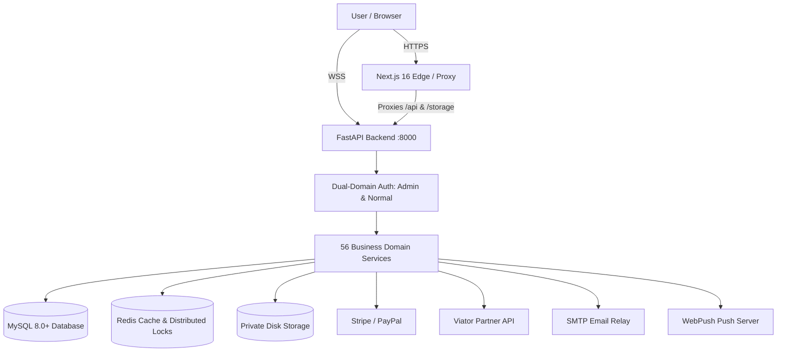

# 03 — System Architecture & Component Interaction

## 1. Architectural Philosophy

Tourvaa is built upon clean architecture principles:
1. **Decoupled Client & Server**: The Next.js frontend acts purely as a presentation and edge-routing layer, communicating with the FastAPI backend via JSON REST APIs and WebSocket streams.
2. **Layered Backend Separation**: Routers handle HTTP transport and validation; domain services encapsulate business logic; SQLAlchemy models define persistence; background workers manage asynchronous tasks.
3. **Escrow Booking Workflow**: Payment success does not equal final booking confirmation. Bookings follow an explicit supplier acceptance and Tourvaa operational approval lifecycle.

---

## 2. High-Level Architecture Diagram

Detailed architectural diagrams and component walkthroughs are available in:
- [System Architecture Diagram](diagrams/system-architecture.md)
- [Frontend Component Architecture](diagrams/frontend-architecture.md)
- [Backend Architecture & Request Lifecycle](diagrams/backend-architecture.md)
- [Module Dependencies Diagram](diagrams/module-dependencies.md)
