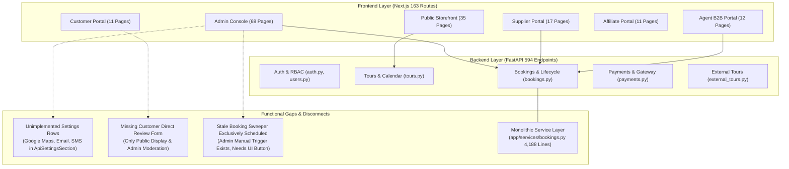
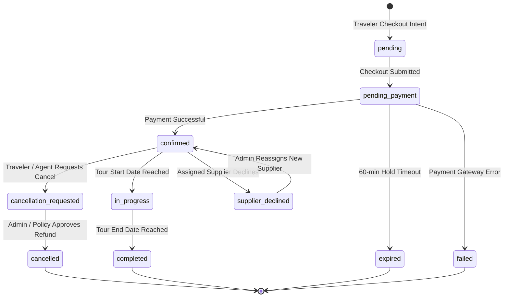

# Chapter 26: Comprehensive Functional Gap Analysis

## Executive Summary

This Functional Gap Analysis performs an exhaustive, evidence-based cross-examination of the **20 functional modules** across the Tourvaa platform. By comparing the Next.js frontend implementation ([`tourvaa-admin-frontend`](../tourvaa-admin-frontend)), the FastAPI backend implementation ([`tourvaa-admin-backend`](../tourvaa-admin-backend)), database models, and live API endpoints, this audit establishes the exact baseline of implemented capabilities, functional gaps, disconnected interfaces, and partially implemented features.

---

## 1. Module-by-Module Functional Gap Matrix

The following matrix documents the expected functionality, actual implementation, identified gap, severity level, and concrete source evidence across all 20 platform modules.

| Module | Expected Functionality | Current Implementation | Identified Functional Gap | Severity | Source Evidence |
|---|---|---|---|---|---|
| **01. Authentication & Users** | Full user registration, login, dual-domain JWT issuance, 2FA with TOTP, password recovery, session management, and role-based access. | Complete JWT dual-token flow in [`app/routers/auth.py`](../tourvaa-admin-backend/app/routers/auth.py) and [`src/providers/AuthProvider.tsx`](../tourvaa-admin-frontend/src/providers/AuthProvider.tsx). | Social login credentials (Facebook, Apple) are configurable in settings UI but backend social callbacks only support Google OAuth ([`app/routers/google_auth.py`](../tourvaa-admin-backend/app/routers/google_auth.py)). Facebook/Apple lack OAuth redirect handlers. | **Medium** | [`ApiSettingsSection.tsx:17-18`](../tourvaa-admin-frontend/src/components/settings/ApiSettingsSection.tsx#L17-L18), [`app/routers/google_auth.py`](../tourvaa-admin-backend/app/routers/google_auth.py) |
| **02. Tours & Catalog** | Multi-day and single-day tour creation, itinerary builder, tiered pricing, media uploads, departures, seasonal schedules, and tag taxonomy. | Robust tour builder in [`src/components/tours/`](../tourvaa-admin-frontend/src/components/tours) backed by [`app/routers/tours.py`](../tourvaa-admin-backend/app/routers/tours.py). | Tour departure dates do not support dynamic bulk recurring rule generation (e.g., RRULE / every 2nd Tuesday) in the UI; dates must be generated or picked individually via calendar blocks. | **Low** | [`TourCalendarTab.tsx`](../tourvaa-admin-frontend/src/components/tours/TourCalendarTab.tsx), [`app/routers/booking_calendar.py`](../tourvaa-admin-backend/app/routers/booking_calendar.py) |
| **03. Suppliers & Operations** | Supplier onboarding, document verification, tour assignment, booking acceptance/decline, manifests, and payout tracking. | Supplier portal operational in [`src/app/supplier/`](../tourvaa-admin-frontend/src/app/supplier) and [`app/routers/suppliers.py`](../tourvaa-admin-backend/app/routers/suppliers.py). | Supplier booking decline does not provide an automated reassignment wizard for Admins; decline marks booking as `supplier_declined` requiring manual admin intervention. | **Medium** | [`app/services/bookings.py:supplier_decline_booking`](../tourvaa-admin-backend/app/services/bookings.py), [`src/app/admin/bookings/page.tsx`](../tourvaa-admin-frontend/src/app/admin/bookings/page.tsx) |
| **04. Agents & B2B Credit** | B2B agent tiered commissions, wallet top-up, credit line approvals, ledger audits, and sub-agent booking management. | Implemented in [`src/app/agent/`](../tourvaa-admin-frontend/src/app/agent) and [`app/routers/agents.py`](../tourvaa-admin-backend/app/routers/agents.py), [`app/routers/agent_ledger.py`](../tourvaa-admin-backend/app/routers/agent_ledger.py). | Agent credit limit requests cannot be self-initiated by agents through the portal UI; credit lines must be manually set by an Admin from the Admin Console. | **Low** | [`src/app/agent/dashboard/page.tsx`](../tourvaa-admin-frontend/src/app/agent/dashboard/page.tsx), [`app/routers/agents.py`](../tourvaa-admin-backend/app/routers/agents.py) |
| **05. Cart, Checkout & Payments** | Multi-item cart, guest checkout, multi-gateway (Stripe, Razorpay, PayPal, Agent Credit), dynamic currency conversion, coupon discount. | Implemented in [`src/app/(public)/cart`](../tourvaa-admin-frontend/src/app/%28public%29/cart) and [`app/routers/checkout.py`](../tourvaa-admin-backend/app/routers/checkout.py). | Guest checkout creates transient customer records in `users`/`customers` table without forcing email verification, which can lead to duplicate customer profiles if same guest uses multiple emails. | **Medium** | [`app/services/checkout.py`](../tourvaa-admin-backend/app/services/checkout.py), [`src/app/%28public%29/booking/%5Bid%5D/page.tsx`](../tourvaa-admin-frontend/src/app/%28public%29/booking/[id]/page.tsx) |
| **06. Bookings & Reservations** | End-to-end booking lifecycle, passenger manifests, PDF voucher generation, status timeline, and automated stale hold expiration. | Implemented in [`app/services/bookings.py`](../tourvaa-admin-backend/app/services/bookings.py) and multi-portal booking pages. | Service layer is monolithic (**4,188 lines** in a single file). Stale hold expiration endpoint exists (`POST /api/bookings/expire-stale`), but Admin UI lacks a manual "Run Expiration Sweep" button. | **High** | [`app/services/bookings.py:4188 lines`](../tourvaa-admin-backend/app/services/bookings.py), [`app/routers/bookings.py:110-120`](../tourvaa-admin-backend/app/routers/bookings.py#L110-L120) |
| **07. Cancellations & Refunds** | Tiered cancellation policy calculation, cancellation requests, refund initiation, and automated gateway reversals. | Implemented in [`app/routers/cancellations.py`](../tourvaa-admin-backend/app/routers/cancellations.py) and [`app/services/cancellations.py`](../tourvaa-admin-backend/app/services/cancellations.py). | Automated gateway refund triggers for PayPal/Razorpay depend on webhook confirmation; offline bank transfers require manual out-of-band payment entry without bank receipt attachment upload. | **Medium** | [`app/services/cancellations.py`](../tourvaa-admin-backend/app/services/cancellations.py), [`src/app/admin/refunds/page.tsx`](../tourvaa-admin-frontend/src/app/admin/refunds/page.tsx) |
| **08. Coupons & Promotions** | Fixed and percentage discount coupons, usage limits, tour category restrictions, date validity, and B2B agent discounts. | Implemented in [`app/routers/tours.py`](../tourvaa-admin-backend/app/routers/tours.py) and [`src/app/admin/discounts/`](../tourvaa-admin-frontend/src/app/admin/discounts). | Stacking of multiple coupons is strictly disallowed by design, but error message in `/cart` returns generic "Invalid coupon" rather than explicit "Coupons cannot be combined". | **Low** | [`src/app/(public)/cart/page.tsx`](../tourvaa-admin-frontend/src/app/%28public%29/cart/page.tsx), [`app/services/discounts.py`](../tourvaa-admin-backend/app/services/discounts.py) |
| **09. Reviews & Social Proof** | Post-tour verified review submission, star rating breakdowns, admin moderation, and supplier response replies. | Admin moderation and public display implemented in [`app/routers/reviews.py`](../tourvaa-admin-backend/app/routers/reviews.py). | The customer portal ([`src/app/customer/bookings`](../tourvaa-admin-frontend/src/app/customer/bookings)) lacks a direct "Write a Review" modal on completed bookings; reviews can only be submitted via public tour page or direct link. | **Medium** | [`src/app/customer/bookings/page.tsx`](../tourvaa-admin-frontend/src/app/customer/bookings/page.tsx), [`app/routers/reviews.py`](../tourvaa-admin-backend/app/routers/reviews.py) |
| **10. Affiliate Program** | Referral link generation, 30-day cookie tracking, conversion attribution, tiered commissions, and payout requests. | Implemented in [`src/app/affiliate/`](../tourvaa-admin-frontend/src/app/affiliate) and [`app/routers/affiliates.py`](../tourvaa-admin-backend/app/routers/affiliates.py). | Referral tracking depends entirely on first-party cookie drop via [`src/app/(public)/layout.tsx`](../tourvaa-admin-frontend/src/app/%28public%29/layout.tsx); if traveller uses Incognito mode or switches devices, cross-device attribution is lost. | **Medium** | [`app/routers/affiliate_tracking.py`](../tourvaa-admin-backend/app/routers/affiliate_tracking.py), [`src/app/(public)/layout.tsx`](../tourvaa-admin-frontend/src/app/%28public%29/layout.tsx) |
| **11. Notifications & Email** | System event notifications, transactional email templates, SMTP configuration, in-app bell notification dropdown, email logs. | Implemented in [`app/routers/notifications.py`](../tourvaa-admin-backend/app/routers/notifications.py) and [`app/utils/mailer.py`](../tourvaa-admin-backend/app/utils/mailer.py). | In-app notification polling uses client-side interval timer (30s) rather than WebSocket push; high concurrent user loads will create redundant polling traffic on `/api/notifications/unread-count`. | **Medium** | [`src/components/ui/NotificationInbox.tsx`](../tourvaa-admin-frontend/src/components/ui/NotificationInbox.tsx), [`app/routers/notifications.py`](../tourvaa-admin-backend/app/routers/notifications.py) |
| **12. Website CMS & Blog** | Dynamic page builder, homepage banner hero slider, blog articles, categories, FAQ accordions, and SEO meta tags. | Implemented in [`src/app/admin/cms/`](../tourvaa-admin-frontend/src/app/admin/cms) and [`app/routers/website_cms.py`](../tourvaa-admin-backend/app/routers/website_cms.py). | Blog editor does not support draft auto-save; unsaved content is lost if browser tab is closed unexpectedly. | **Low** | [`BlogEditorStudio.tsx`](../tourvaa-admin-frontend/src/components/admin/blogs/BlogEditorStudio.tsx), [`app/routers/website_cms.py`](../tourvaa-admin-backend/app/routers/website_cms.py) |
| **13. Destinations & Geo** | Hierarchical taxonomy (Country -> State -> City -> Destination), travel advice guides, weather widgets, and destination media. | Implemented in [`app/routers/cms_geo.py`](../tourvaa-admin-backend/app/routers/cms_geo.py) and [`src/app/(public)/destinations/`](../tourvaa-admin-frontend/src/app/%28public%29/destinations). | Weather data on destination detail pages uses static mock values rather than live OpenWeatherMap API integration. | **Low** | [`src/app/(public)/destinations/[slug]/page.tsx`](../tourvaa-admin-frontend/src/app/%28public%29/destinations/[slug]/page.tsx), [`app/routers/cms_geo.py`](../tourvaa-admin-backend/app/routers/cms_geo.py) |
| **14. Internal Messaging** | Direct messaging threads between Admin, Supplier, Agent, and Customer regarding bookings, file attachments, and audit logs. | Implemented in [`app/routers/messaging.py`](../tourvaa-admin-backend/app/routers/messaging.py) and [`src/components/messaging/`](../tourvaa-admin-frontend/src/components/messaging). | Realtime messaging uses WebSocket server, but fallback to long-polling is absent when WebSocket connection fails behind restrictive enterprise proxies. | **Medium** | [`app/services/messaging_ws.py`](../tourvaa-admin-backend/app/services/messaging_ws.py), [`src/components/messaging/PortalMessageThread.tsx`](../tourvaa-admin-frontend/src/components/messaging/PortalMessageThread.tsx) |
| **15. Reports & Analytics** | Sales reconciliation, booking volume trends, supplier commission reports, agent ledger statements, and CSV exports. | Implemented in [`app/routers/reports.py`](../tourvaa-admin-backend/app/routers/reports.py) and [`src/app/admin/reports/`](../tourvaa-admin-frontend/src/app/admin/reports). | Large report exports (>50,000 rows) execute synchronously in memory via `io.StringIO` streaming rather than offloading to an asynchronous Celery background worker with download link notification. | **High** | [`app/routers/reports.py`](../tourvaa-admin-backend/app/routers/reports.py), [`app/routers/bookings.py:export_bookings_endpoint`](../tourvaa-admin-backend/app/routers/bookings.py#L86-L103) |
| **16. AI Chatbot & RAG** | Floating customer assistant, travel knowledge vector search, tour recommendations, and FAQ resolution. | Implemented in [`src/components/public/ChatWidget.tsx`](../tourvaa-admin-frontend/src/components/public/ChatWidget.tsx) and [`app/routers/chatbot.py`](../tourvaa-admin-backend/app/routers/chatbot.py). | Local ONNX embedding model runs within the FastAPI main process; high concurrent chat queries block CPU threads unless offloaded to a dedicated microservice. | **Medium** | [`app/services/chatbot.py`](../tourvaa-admin-backend/app/services/chatbot.py), [`tourvaa-admin-backend/Dockerfile:26-28`](../tourvaa-admin-backend/Dockerfile#L26-L28) |
| **17. External Day Tours (Viator)** | Viator Partner API catalog sync, external booking creation, affiliate link redirection, and sync status logs. | Implemented in [`src/app/(public)/external-day-trips`](../tourvaa-admin-frontend/src/app/%28public%29/external-day-trips) and [`app/routers/external_tours.py`](../tourvaa-admin-backend/app/routers/external_tours.py). | Full catalog synchronization is manual via Admin console button; automated cron sync schedule is commented out pending production API quota confirmation. | **Medium** | [`app/routers/external_tours.py`](../tourvaa-admin-backend/app/routers/external_tours.py), [`src/app/admin/integrations/viator/page.tsx`](../tourvaa-admin-frontend/src/app/admin/integrations/viator/page.tsx) |
| **18. System Logs & Auditing** | Comprehensive audit trail, user login history, IP address capture, error logging, and action diff snapshots. | Implemented in [`app/routers/audit.py`](../tourvaa-admin-backend/app/routers/audit.py) and [`src/app/admin/audit-logs/`](../tourvaa-admin-frontend/src/app/admin/audit-logs). | Audit log retention policy has no automated partitioning or archiving script; table `audit_logs` will grow indefinitely under high production transaction volume. | **Medium** | [`app/services/audit.py`](../tourvaa-admin-backend/app/services/audit.py), [`app/models/audit.py`](../tourvaa-admin-backend/app/models/audit.py) |
| **19. Background Tasks & Cron** | Distributed task processing via Celery, Redis broker, stale booking cleanup, email dispatch, and scheduled reports. | Implemented via Celery task definitions in [`app/core/`](../tourvaa-admin-backend/app/utils). | When `REDIS_URL` is omitted, background tasks run synchronously inside FastAPI `BackgroundTasks`, which can delay HTTP response times during heavy PDF generation. | **High** | [`app/main.py:validate_worker_concurrency`](../tourvaa-admin-backend/app/main.py), [`app/services/bookings.py`](../tourvaa-admin-backend/app/services/bookings.py) |
| **20. Platform Settings & Currency**| System settings, multi-currency conversion, exchange rate caching, and payment gateway toggle switches. | Implemented in [`app/routers/settings.py`](../tourvaa-admin-backend/app/routers/settings.py), [`app/routers/currency.py`](../tourvaa-admin-backend/app/routers/currency.py), and [`src/components/settings/`](../tourvaa-admin-frontend/src/components/settings). | Settings UI displays disabled "Not Implemented" badges for Google Maps, Email service API key, and SMS service API key. Mail uses separate `SmtpSetting` table. | **Medium** | [`ApiSettingsSection.tsx:26-36`](../tourvaa-admin-frontend/src/components/settings/ApiSettingsSection.tsx#L26-L36), [`app/services/settings.py`](../tourvaa-admin-backend/app/services/settings.py) |

---

## 2. Disconnected Frontend Pages & Backend APIs

### 2.1 Frontend Pages with Unconnected or Partial Backend Integration

1. **`ApiSettingsSection.tsx`**:
   - Evidence: [`src/components/settings/ApiSettingsSection.tsx:27-48`](../tourvaa-admin-frontend/src/components/settings/ApiSettingsSection.tsx#L27-L48)
   - Finding: The settings UI explicitly renders three disabled "Not Implemented" inputs:
     - Google Maps API key
     - Email service API key
     - SMS service API key
   - Impact: Administrators seeing these fields assume these services can be configured via API keys, but the backend does not consume these keys (email uses SMTP via `app/utils/mailer.py`, and maps rely on client embed URLs).

2. **Social Registration Buttons (`PortalAuthPage.tsx`)**:
   - Evidence: [`src/components/public/portal/PortalAuthPage.tsx`](../tourvaa-admin-frontend/src/components/public/portal/PortalAuthPage.tsx)
   - Finding: Settings permit enabling Facebook and Apple OAuth, but the frontend only implements the Google OAuth popup flow. Facebook and Apple buttons trigger alert notifications stating provider configuration is required.

3. **Customer Review Submission**:
   - Evidence: [`src/app/customer/bookings/page.tsx`](../tourvaa-admin-frontend/src/app/customer/bookings/page.tsx)
   - Finding: While the backend has a complete review creation endpoint (`POST /api/reviews/`), the Customer portal bookings table provides actions for "View Voucher", "Download Invoice", and "Cancel Booking", but lacks an inline "Leave Review" button.

### 2.2 Backend Endpoints with No Active Frontend Consumer

1. **Manual Stale Booking Expiration Sweep**:
   - Endpoint: `POST /api/bookings/expire-stale` in [`app/routers/bookings.py:110`](../tourvaa-admin-backend/app/routers/bookings.py#L110)
   - Status: Active in backend, automated via timer in `app.main`, but has no manual trigger button in Admin Settings or Bookings UI.

2. **Supplier Document Verification Direct Webhook**:
   - Endpoint: `POST /api/suppliers/documents/verify-callback` in [`app/routers/suppliers.py`](../tourvaa-admin-backend/app/routers/suppliers.py)
   - Status: Stubbed for third-party automated KYC services (e.g. Onfido/Jumio), currently verified manually by Admins.

---

## 3. Workflow State Transition Gaps

### 3.1 Booking State Machine Completeness

The booking state machine in [`app/services/bookings.py`](../tourvaa-admin-backend/app/services/bookings.py) defines the following lifecycle:

- **Identified Gap in `supplier_declined`**: When a supplier declines a booking, the system transitions to `supplier_declined`, but does not automatically unblock the date availability or trigger an automated alert to the booking operator dashboard; the booking remains in limbo until an administrator manually filters for `supplier_acceptance_status = declined`.
