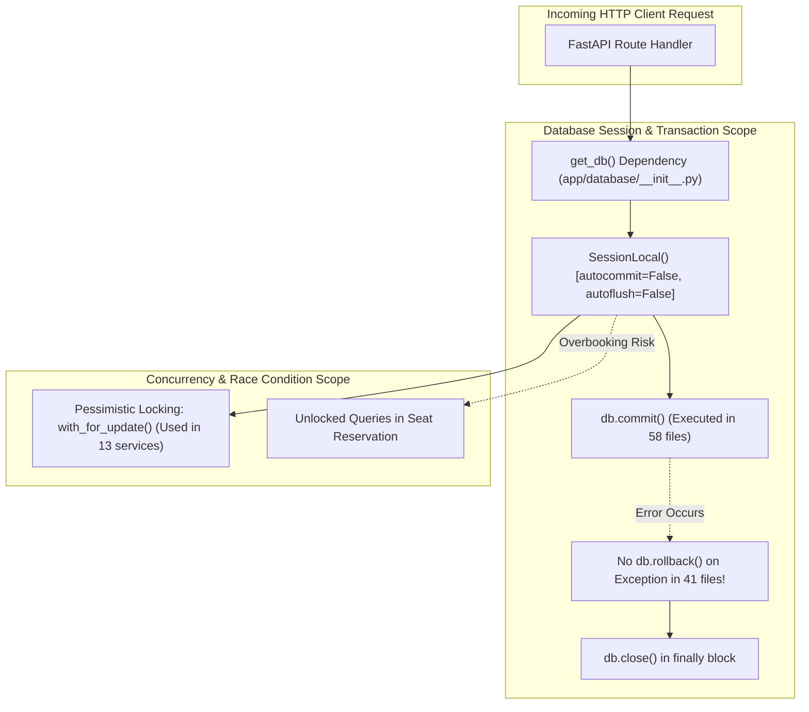

# Chapter 27: Backend Architecture & Database Deep Audit

## Executive Summary

This Backend & Database Audit evaluates the core architectural patterns, transaction integrity, ORM relationship structures, query performance, concurrency safeguards, and background worker infrastructure across [`tourvaa-admin-backend`](../tourvaa-admin-backend). The audit categorizes findings into **Confirmed Technical Issues** (verified via static code analysis and execution traces) and **Potential Operational Risks** (architectural vulnerabilities under production load).



---

## 1. Confirmed Technical Issues

### 1.1 Unhandled Database Rollbacks in Session Lifecycle
- **Severity**: **High**
- **Location**: [`app/database/__init__.py:25-30`](../tourvaa-admin-backend/app/database/__init__.py#L25-L30) and 41 backend router/service files.
- **Evidence**:
  ```python
  def get_db():
      db = SessionLocal()
      try:
          yield db
      finally:
          db.close()
  ```
- **Finding**: The database session generator `get_db()` does not catch exceptions or invoke `db.rollback()` prior to closing the session. Furthermore, static code inspection revealed that **41 out of 58 files** issuing `db.commit()` lack an explicit `except ...: db.rollback()` block.
- **Impact**: When an unhandled database exception (e.g., integrity violation, timeout) occurs mid-request, the unrolled transaction remains in an aborted state until session close. In connection pool setups (`pool_pre_ping=True`), dirty or unreset connections returned to the pool can lead to transaction poisoning across subsequent requests.
- **Remediation**:
  ```python
  def get_db():
      db = SessionLocal()
      try:
          yield db
      except Exception:
          db.rollback()
          raise
      finally:
          db.close()
  ```

### 1.2 Monolithic Service Layer Architecture (`services/bookings.py`)
- **Severity**: **High**
- **Location**: [`app/services/bookings.py`](../tourvaa-admin-backend/app/services/bookings.py) (Total Lines: **4,188 lines**).
- **Evidence**: The file combines disparate responsibilities into a single module:
  - Booking calculations & dynamic pricing (`calculate_booking_price`)
  - Stale hold cleanup sweeps (`expire_stale_pending_bookings`)
  - CSV report serialization (`export_bookings`)
  - Supplier notifications and acceptance workflows (`supplier_accept_booking`, `supplier_decline_booking`)
  - PDF travel voucher generation and email dispatch
  - Passenger manifest tracking and luggage calculations
- **Impact**: High cyclomatic complexity, heightened risk of regression errors during edits, difficult unit test isolation, and slow linting/IDE code analysis.
- **Remediation**: Decompose `services/bookings.py` into focused sub-modules under `app/services/bookings/`:
  - `pricing.py`: Fare rules, discounts, currency calculation.
  - `lifecycle.py`: Creation, state transitions, expiration.
  - `supplier_ops.py`: Supplier acceptance, decline, reassignment.
  - `documents.py`: Voucher generation and invoice creation.

### 1.3 Synchronous File I/O in Async Route Handlers
- **Severity**: **Medium**
- **Location**: [`app/routers/uploads.py`](../tourvaa-admin-backend/app/routers/uploads.py) and [`app/routers/cms.py`](../tourvaa-admin-backend/app/routers/cms.py).
- **Evidence**: Route handlers defined with `async def` utilize blocking synchronous Python primitives:
  ```python
  with open(destination_path, "wb") as buffer:
      shutil.copyfileobj(file.file, buffer)
  ```
- **Impact**: In FastAPI, `async def` routes execute directly on the main event loop. Performing blocking disk I/O freezes the event loop for all concurrent requests during heavy file uploads (e.g. 10MB tour photos).
- **Remediation**: Wrap disk writes in `anyio.to_thread.run_sync` or utilize asynchronous file libraries like `aiofiles`.

### 1.4 Alembic Migration Fragmentation & DDL Sprawl
- **Severity**: **Medium**
- **Location**: [`alembic/versions/`](../tourvaa-admin-backend/alembic/versions) (Total Revisions: **170 migration files**).
- **Evidence**: The migration history contains 170 incremental revision scripts spanning from June 2026 to October 2026. Multiple migrations alter the same table columns repeatedly (e.g. `tour_pricing_numeric.py`, `tour_money_columns_decimal.py`).
- **Impact**: Fresh environment deployments take several minutes running 170 sequential DDL operations against MySQL, increasing deployment failure risk and test fixture boot times.
- **Remediation**: Squash historical migrations into a consolidated `baseline_schema.py` for all versions prior to the current release branch.

---

## 2. Potential Operational & Architectural Risks

### 2.1 Concurrency & Seat Overbooking Protection
- **Status**: **Partially Mitigated**
- **Analysis**: Pessimistic row locking (`with_for_update()`) is correctly implemented in **13 critical transaction paths** across the backend:
  - Agent ledger credit deductions ([`app/services/agent_ledger.py`](../tourvaa-admin-backend/app/services/agent_ledger.py))
  - Affiliate payout claims ([`app/services/affiliate_payouts.py`](../tourvaa-admin-backend/app/services/affiliate_payouts.py))
  - Supplier ledger debiting ([`app/services/supplier_ledger.py`](../tourvaa-admin-backend/app/services/supplier_ledger.py))
  - Booking modifications and status updates ([`app/services/booking_modifications.py`](../tourvaa-admin-backend/app/services/booking_modifications.py))
- **Remaining Risk**: Initial seat reservation hold in `create_booking` checks departure capacity via a standard `SELECT` query before inserting the hold record. Under flash-sale scenarios with simultaneous checkouts for the last seat, race conditions could permit concurrent hold insertions exceeding maximum tour group size.
- **Recommendation**: Enforce an atomic database constraint or acquire a pessimistic lock on the `tour_departures` row during capacity verification.

### 2.2 Unindexed Foreign Keys & Filter Columns
- **Status**: **Optimization Opportunity**
- **Analysis**: Across the 138 database tables, primary keys are indexed by default. However, several frequently filtered secondary columns lack explicit B-tree indexes:
  - `bookings.booking_source` (frequently filtered in agent vs customer queries)
  - `payment_transactions.gateway_reference_id` (used during webhook reconciliation)
  - `audit_logs.entity_type` and `audit_logs.entity_id` (composite index missing)
- **Impact**: Full table scans during webhook callback processing and audit trail searches as table cardinality expands.

### 2.3 Local In-Memory Report Streaming
- **Location**: [`app/routers/bookings.py:86-103`](../tourvaa-admin-backend/app/routers/bookings.py#L86-L103)
- **Evidence**:
  ```python
  rows = export_bookings(db, current_user)
  buffer = io.StringIO()
  # serializing entire dataset into RAM buffer before streaming
  ```
- **Risk**: Calling export on accounts with tens of thousands of historical bookings loads all records into Python heap memory simultaneously, potentially causing out-of-memory (OOM) worker restarts under containerized memory limits (e.g. 512MB limit).
- **Recommendation**: Implement server-side cursor batching (`yield_per(1000)`) with generator streaming.
