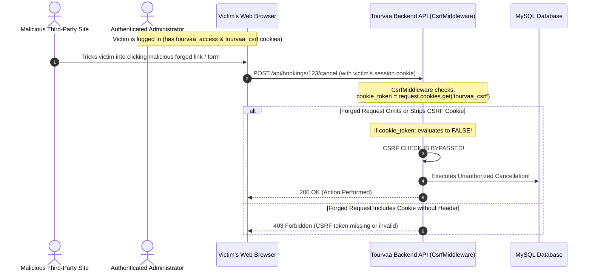

# Chapter 29: Comprehensive Security Gap Analysis & Vulnerability Assessment

## Executive Summary

This Security Gap Analysis presents an in-depth, evidence-based security audit of the Tourvaa web application and API infrastructure. Every layer of authentication, authorization, token lifecycle, CSRF defense, CORS configuration, object-level access control, input validation, and file handling was inspected. All findings are classified by severity according to CVSS criteria, accompanied by exact source code evidence.



---

## 1. Vulnerability Findings & Severity Ranking

The table below summarizes the verified security findings ranked by severity:

| Issue ID | Vulnerability Finding | Severity | CVSS v3.1 | Affected Component | Source Evidence |
|---|---|---|---|---|---|
| **SEC-01** | CSRF Middleware Bypass when CSRF Cookie is Omitted | **High** | 7.5 | [`app/middleware/csrf.py`](../tourvaa-admin-backend/app/middleware/csrf.py) | [`app/middleware/csrf.py:36-43`](../tourvaa-admin-backend/app/middleware/csrf.py#L36-L43) |
| **SEC-02** | Object-Level Authorization Bypass on `actor=None` | **High** | 7.1 | [`app/services/bookings.py`](../tourvaa-admin-backend/app/services/bookings.py) | [`app/services/bookings.py:_ensure_booking_access`](../tourvaa-admin-backend/app/services/bookings.py) |
| **SEC-03** | Potential Stored XSS via Unsanitized SVG File Uploads | **Medium** | 6.5 | [`app/routers/uploads.py`](../tourvaa-admin-backend/app/routers/uploads.py) | [`app/routers/uploads.py`](../tourvaa-admin-backend/app/routers/uploads.py), [`app/routers/uploads.py`](../tourvaa-admin-backend/app/routers/uploads.py) |
| **SEC-04** | Permissive Default Secrets in Environment Template | **Medium** | 5.3 | Configuration | [`tourvaa-admin-backend/.env.example`](../tourvaa-admin-backend/.env.example) |
| **SEC-05** | Inconsistent Rate Limiting on Authentication Endpoints | **Medium** | 5.3 | Auth Routers | [`app/routers/auth.py`](../tourvaa-admin-backend/app/routers/auth.py), [`app/routers/google_auth.py`](../tourvaa-admin-backend/app/routers/google_auth.py) |
| **SEC-06** | Synchronous File Writing Blocking Event Loop (DoS Risk) | **Low** | 3.7 | Uploads / CMS | [`app/routers/uploads.py`](../tourvaa-admin-backend/app/routers/uploads.py) |

---

## 2. Detailed Technical Findings

### 2.1 SEC-01: CSRF Middleware Bypass when CSRF Cookie is Omitted (High)
- **Component**: [`app/middleware/csrf.py:36-43`](../tourvaa-admin-backend/app/middleware/csrf.py#L36-L43)
- **Vulnerability Mechanism**:
  ```python
  async def dispatch(self, request: Request, call_next):
      if request.method in UNSAFE_METHODS and request.url.path not in EXEMPT_PATHS:
          cookie_token = request.cookies.get(csrf_cookie_name(portal_from_request(request)))
          if cookie_token:  # <--- CRITICAL BYPASS
              header_token = request.headers.get(CSRF_HEADER_NAME)
              if not header_token or header_token != cookie_token:
                  return JSONResponse(
                      status_code=403,
                      content={"status": "error", "message": "CSRF token missing or invalid"},
                  )
      return await call_next(request)
  ```
- **Analysis**: The middleware verifies that the header `X-CSRF-Token` matches the cookie token **only if** `cookie_token` is present in the request. The developer added a code comment indicating this was intended as a soft transition for legacy sessions.
- **Exploitation Impact**: An attacker crafting a cross-origin form POST or cross-site fetch where the browser does not transmit the client-readable CSRF cookie (e.g. cross-domain request or stripped cookie) causes `if cookie_token:` to evaluate to `False`. The request completely skips verification, allowing unauthorized state modifications while the victim's session cookie is sent.
- **Remediation**: If an authenticated session cookie (`tourvaa_access`) is detected in the request headers/cookies, the CSRF token **must be mandatory**:
  ```python
  has_auth_cookie = bool(request.cookies.get("tourvaa_access"))
  if has_auth_cookie and request.method in UNSAFE_METHODS and request.url.path not in EXEMPT_PATHS:
      cookie_token = request.cookies.get(csrf_cookie_name(portal_from_request(request)))
      header_token = request.headers.get(CSRF_HEADER_NAME)
      if not cookie_token or not header_token or header_token != cookie_token:
          return JSONResponse(status_code=403, content={"status": "error", "message": "CSRF verification failed"})
  ```

### 2.2 SEC-02: Object-Level Authorization Bypass on `actor=None` (High)
- **Component**: [`app/services/bookings.py:_ensure_booking_access`](../tourvaa-admin-backend/app/services/bookings.py)
- **Evidence**:
  ```python
  def _ensure_booking_access(booking: Booking, actor: User | None) -> None:
      role = _user_role(actor)
      if role == "admin" or actor is None:
          return
      if role == "supplier" and booking.supplier and booking.supplier.user_id == actor.id:
          return
      ...
      raise HTTPException(status_code=403, detail="Booking access denied")
  ```
- **Analysis**: Notice the guard: `if role == "admin" or actor is None: return`. If an internal function or route handler invokes `_ensure_booking_access(booking, actor)` with `actor=None` (for example, if a developer introduces an unauthenticated or optional-auth route calling `get_booking_detail`), the access check will silently pass instead of throwing an authentication required exception.
- **Impact**: Insecure Direct Object Reference (IDOR) risk if any public or semi-public endpoint interacts with booking details without strictly requiring `current_user`.
- **Remediation**: Disallow `actor is None` in access verification:
  ```python
  if actor is None:
      raise HTTPException(status_code=401, detail="Authentication required")
  ```

### 2.3 SEC-03: Stored Cross-Site Scripting (XSS) via SVG Uploads (Medium)
- **Component**: [`app/routers/uploads.py`](../tourvaa-admin-backend/app/routers/uploads.py) and [`app/routers/uploads.py`](../tourvaa-admin-backend/app/routers/uploads.py)
- **Analysis**: Image upload endpoints validate extensions against `ALLOWED_IMAGE_EXTENSIONS = {"jpg", "jpeg", "png", "webp", "gif", "svg"}`. While raster formats (JPG, PNG) are safe from script execution, SVG files are XML documents that can embed arbitrary `<script>` tags, `<animate>` handlers, or malicious `onload` attributes.
- **Impact**: If an administrator or supplier uploads a crafted SVG icon or logo, any user opening the raw SVG image URL in their browser executes JavaScript in the origin context of the application.
- **Remediation**: Run uploaded SVG files through a sanitizer like `defusedxml` / `cairosvg`, or serve media attachments with `Content-Disposition: attachment` or `Content-Security-Policy: default-src 'none'`.

### 2.4 SEC-04: Default Secret Fallbacks in Configuration (Medium)
- **Component**: [`tourvaa-admin-backend/.env.example`](../tourvaa-admin-backend/.env.example) and [`app/config/__init__.py`](../tourvaa-admin-backend/app/config/__init__.py)
- **Finding**: Configuration provides default fallback values for `SECRET_KEY`, `JWT_SECRET`, and `CSRF_SECRET` (e.g. `secret-change-in-production-12345`). While `app/main.py` enforces validation checks in production, if `ENVIRONMENT` is left at `development` or `staging`, predictable token signing keys could allow forged JWT creation.
- **Remediation**: Enforce application crash on startup if `SECRET_KEY` equals any known example string regardless of environment flag.
