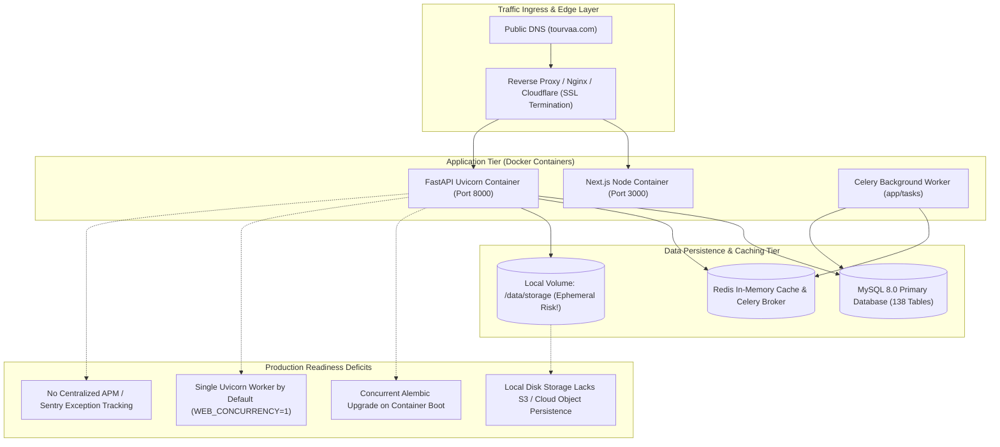

# Chapter 30: Production Readiness & Infrastructure Audit

## Executive Summary

This Production Readiness Audit reviews the deployment architecture, containerization configuration, database migration mechanics, process concurrency, logging, error monitoring, and failure isolation across [`tourvaa-admin-backend`](../tourvaa-admin-backend) and [`tourvaa-admin-frontend`](../tourvaa-admin-frontend). The evaluation identifies operational bottlenecks, single points of failure (SPOFs), and unverified deployment aspects before live production release.



---

## 1. Production Readiness Scorecard

| Assessment Domain | Verification Status | Production Readiness Rating | Key Observation / Limiting Factor |
|---|---|---|---|
| **Containerization & Builds** | Verified | **Acceptable (80%)** | Multi-stage Dockerfiles exist for both Backend and Frontend. Top-level `docker-compose.yml` orchestration file is missing from repo root. |
| **Database Migrations** | Verified | **Needs Remediation (60%)** | `docker-entrypoint.sh` runs `alembic upgrade head` on every container boot. Concurrent multi-replica boots can lock migrations. |
| **Process Concurrency** | Verified | **Needs Configuration (65%)** | Default `WEB_CONCURRENCY=1`. Scaling workers requires a verified external Redis broker (`REDIS_URL`). |
| **Storage & Media Persistence**| Verified | **High Risk (50%)** | Uploads write to local `/data/storage`. Container restarts without persistent volume claims will wipe uploaded documents. |
| **Health Checks & Probes** | Verified | **Good (90%)** | `/api/health` and database pre-ping verification implemented. |
| **Centralized Observability** | Verified | **Incomplete (40%)** | Standard Python stream logging to stdout. No Sentry DSN or OpenTelemetry tracing configured out of the box. |
| **Live Merchant Settlements** | **Unverified** | **Pending Live Keys** | Stripe, Razorpay, and PayPal tested via test-mode suites; live banking settlements require production merchant keys. |
| **Live Viator Inventory Sync** | **Unverified** | **Pending Partner API** | Tested via mock responses; live Viator inventory reservations require production Expedia/Viator credentials. |

---

## 2. Critical Operational Findings

### 2.1 Concurrent Database Migration Race Condition on Startup
- **Severity**: **High**
- **Location**: [`tourvaa-admin-backend/docker-entrypoint.sh:4-15`](../tourvaa-admin-backend/docker-entrypoint.sh#L4-L15)
- **Evidence**:
  ```sh
  if [ "${RUN_MIGRATIONS:-true}" = "true" ]; then
    attempts=0
    until python -m alembic upgrade head; do
      attempts=$((attempts + 1))
      ...
    done
  fi
  ```
- **Finding**: In production clusters (e.g. AWS ECS, Kubernetes, or multi-instance Docker Swarm), deploying a new release boots multiple backend container replicas simultaneously. Every replica executes `alembic upgrade head` against MySQL in parallel.
- **Impact**: Alembic will encounter `Lock wait timeout exceeded` or `Table already exists` errors when two workers attempt simultaneous DDL modifications on the same tables.
- **Remediation**: Set `RUN_MIGRATIONS=false` in application replica environment variables and execute migrations via a dedicated pre-deployment one-off job (e.g. Kubernetes Job, ECS Task).

### 2.2 Local Filesystem Upload Persistence
- **Severity**: **High**
- **Location**: [`tourvaa-admin-backend/Dockerfile:32-33`](../tourvaa-admin-backend/Dockerfile#L32-L33) and [`app/routers/uploads.py`](../tourvaa-admin-backend/app/routers/uploads.py)
- **Finding**: The backend writes uploaded tour photos, customer vouchers, supplier licenses, and blog banners to local directories (`/data/storage` and `/data/private-docs`).
- **Impact**: In containerized environments, container replacement during rolling deployments destroys all local filesystem data unless explicit persistent volume claims (PVCs) or Docker volume mounts are provisioned. In multi-replica clusters, an upload sent to Replica A will result in a 404 Not Found error when requested by a user routed to Replica B.
- **Remediation**: Transition file storage driver from local disk to S3-compatible cloud object storage (AWS S3, MinIO, or Cloudflare R2) using presigned upload/download URLs.

### 2.3 Process Worker Concurrency & Redis Dependency
- **Severity**: **Medium**
- **Location**: [`tourvaa-admin-backend/docker-entrypoint.sh:23-28`](../tourvaa-admin-backend/docker-entrypoint.sh#L23-L28) and [`app/main.py:validate_worker_concurrency`](../tourvaa-admin-backend/app/main.py)
- **Finding**: The entrypoint sets `WEB_CONCURRENCY=1` by default. Startup code enforces that raising worker count above 1 requires a valid `REDIS_URL` because scheduled job locking and WebSocket pub/sub rely on shared Redis primitives.
- **Impact**: Running with 1 worker severely limits backend throughput under concurrent I/O. If traffic spikes, requests queue behind long-running operations.
- **Remediation**: Ensure production deployment manifests provision a managed Redis instance (e.g. AWS ElastiCache) and configure `WEB_CONCURRENCY=4` (or `2 * CPU cores + 1`).

---

## 3. Disaster Recovery & Rollback Strategy

1. **Database Rollback Plan**:
   - Because 170 incremental migrations exist, rolling back a failed deployment via `alembic downgrade -1` is perilous if the preceding migration added non-nullable columns without defaults.
   - **Mandatory Procedure**: Perform an automated physical MySQL database snapshot (via `mysqldump` or AWS RDS automated snapshot) immediately prior to triggering any production migration.
2. **Configuration Secrets Rotation**:
   - Production secrets (`JWT_SECRET`, `SECRET_KEY`, `STRIPE_SECRET_KEY`) must be injected exclusively via secure secret managers (e.g. AWS Secrets Manager, HashiCorp Vault) rather than committed `.env` files.
