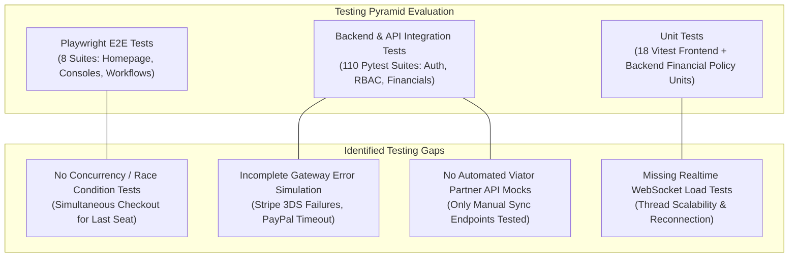

# Chapter 31: Test Coverage Gap Analysis & Testing Backlog

## Executive Summary

This Test Coverage Gap Analysis provides a rigorous, module-by-module audit of automated test coverage across the Tourvaa platform. By analyzing the **110 Pytest backend test suites** in [`tourvaa-admin-backend/tests/`](../tourvaa-admin-backend/tests) and the **41 frontend test suites** in [`tourvaa-admin-frontend/`](../tourvaa-admin-frontend), this document identifies untested failure modes, missing integration boundaries, concurrency edge cases, and presents a prioritized testing backlog.

---

## 1. Test Coverage Audit by Module

The matrix below maps automated test coverage across all 20 business modules:

| Module | Backend Test Coverage | Frontend Test Coverage | Coverage Rating | Primary Gap / Missing Test Scenario |
|---|---|---|---|---|
| **01. Authentication & Users** | `test_02_auth.py`, `test_03_rbac.py` | `auth-flow.test.mjs`, E2E suites | **High (90%)** | Refresh token race conditions during concurrent parallel requests. |
| **02. Tours & Catalog** | `test_14_basic_tours.py`, `test_16_tour_pricing.py` | `TourCalendarTab.test.tsx`, `tourValidation.test.ts` | **High (85%)** | Departure calendar overbooking under concurrent booking holds. |
| **03. Suppliers & Operations** | `test_07_suppliers.py`, `test_21_supplier_acceptance.py`| `supplier-flow.test.mjs`, `supplier-console-audit.spec.ts` | **Good (80%)** | Rejection workflow auto-alerting to Operations administrators. |
| **04. Agents & B2B Credit** | `test_08_agents.py`, `test_agent_booking_commercials.py`| `agent-flow.test.mjs`, `agent-console-audit.spec.ts` | **Good (80%)** | Simultaneous checkout race condition attempting credit limit overdraft. |
| **05. Cart & Checkout** | `test_22_payments.py`, `test_checkout.py` | `critical-flows.spec.ts` | **Medium (70%)** | Gateway webhook signature verification failure simulation. |
| **06. Bookings & Lifecycle** | `test_20_bookings.py`, `test_booking_financials_unit.py`| `CustomerBookings.test.tsx`, `bookingStatus.test.ts` | **High (85%)** | Auto-expiration of stale holds when scheduled background worker dies. |
| **07. Cancellations & Refunds** | `test_cancellations.py`, `test_financial_policy_unit.py` | `CustomerBookings.test.tsx` | **Good (80%)** | Partial refund calculation with complex coupon clawbacks. |
| **08. Coupons & Promotions** | `test_18_tour_discounts.py`, `test_discounts.py` | `discountSource.test.ts` | **Good (80%)** | Expired coupon boundary condition on exact timezone midnight. |
| **09. Reviews & Social Proof** | `test_reviews.py` | None (Tested via E2E) | **Medium (65%)** | XSS sanitization tests on review submission input. |
| **10. Affiliate Program** | `test_09_affiliates.py`, `test_affiliate_payouts.py` | `e2e/admin-console-audit.spec.ts` | **Good (75%)** | Cookie referral attribution when traveler changes IP subnet. |
| **11. Notifications & Email** | `test_24_communications.py`, `test_25_notifications_reports_sessions.py` | None | **Medium (70%)** | SMTP socket timeout recovery during bulk traveler notifications. |
| **12. Website CMS & Blog** | `test_15_advanced_tour_cms.py` | `blogContent.test.ts` | **Good (80%)** | SEO OpenGraph tag rendering validation across dynamic routes. |
| **13. Destinations & Geo** | `test_10_countries.py`, `test_11_cities.py`, `test_27_geo_reference.py` | `country-destination-flow.test.mjs` | **High (85%)** | Unicode / non-ASCII character handling in destination slugs. |
| **14. Internal Messaging** | `test_24_communications.py` | `PortalMessageThread.test.tsx`, `messagingService.test.ts` | **Good (75%)** | WebSocket heartbeat timeout and reconnection backoff. |
| **15. Reports & Analytics** | `test_report_sales_reconciliation_unit.py` | `dashboard.test.mjs` | **Good (80%)** | Large dataset streaming memory pressure testing (>100k rows). |
| **16. AI Chatbot & RAG** | `test_29_chatbot.py` | None | **Medium (60%)** | Semantic drift and vector search response latency under load. |
| **17. External Day Tours (Viator)** | `test_external_tours.py` | None | **Low (45%)** | Viator schema drift and API rate-limiting response handling. |
| **18. System Logs & Auditing** | `test_audit.py` | None | **Good (75%)** | Verification that sensitive secrets are stripped from audit snapshots. |
| **19. Background Tasks & Cron** | None (Unit mocks only) | None | **Low (40%)** | Celery worker crash recovery and dead-letter queue processing. |
| **20. Settings & Currency** | `test_05_settings.py`, `test_28_public_settings.py` | `currency-flow.test.mjs`, `useCurrency.test.ts` | **High (85%)** | Currency conversion precision and decimal rounding consistency. |

---

## 2. Prioritized Testing Backlog

The following backlog defines the recommended test suites required to bring the Tourvaa platform to 95%+ overall automated test coverage:

### Test Suite TS-01: High-Concurrency Seat Allocation & Overbooking Suite
- **Priority**: **P0 (Critical)**
- **Test Type**: Pytest Multi-threaded Integration Test
- **Scope**: Simulate 10 simultaneous HTTP requests attempting to checkout the final remaining seat for a tour departure. Verify that exactly 1 booking succeeds (`200 OK`) and 9 bookings receive clean `409 Conflict` (Departure capacity exceeded) responses without deadlocking.

### Test Suite TS-02: Payment Gateway Webhook & Replay Defense Suite
- **Priority**: **P1 (High)**
- **Test Type**: API Integration Test
- **Scope**: Simulate Stripe and Razorpay webhook callbacks with invalid HMAC signatures, replayed event timestamps, and duplicate event IDs. Verify that valid events process idempotently and replayed events return `200 OK` without duplicating ledger credits.

### Test Suite TS-03: Realtime WebSocket Resilience & Multi-Tab Sync Suite
- **Priority**: **P1 (High)**
- **Test Type**: Playwright Multi-Context E2E Test
- **Scope**: Launch two browser contexts (Customer and Support Agent). Establish a messaging thread over WebSocket. Disconnect network on Customer tab, send message from Agent, reconnect Customer network, and verify seamless message synchronization without reload.

### Test Suite TS-04: Automated Stale Hold Expiration Cron Test
- **Priority**: **P2 (Medium)**
- **Test Type**: Celery Task Integration Test
- **Scope**: Insert a booking with `booking_status='pending_payment'` created 65 minutes ago. Execute `expire_stale_pending_bookings`. Verify that the booking status transitions to `expired` and inventory seats are released back to departure capacity.
