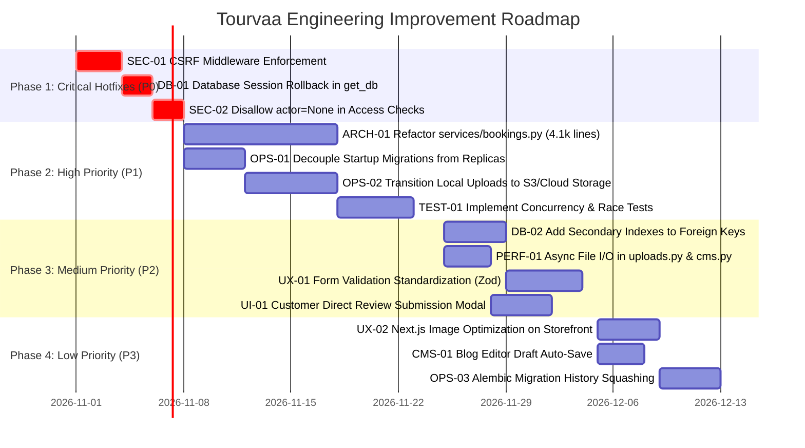

# Chapter 32: Master Technical Improvement Roadmap

## Executive Summary

This Master Technical Improvement Roadmap translates all architectural, security, database, and operational findings from the technical audit into a structured engineering execution plan. Recommendations are categorized into four strict priority tiers:

- **P0 — Critical**: Immediate security, data integrity, or availability risks.
- **P1 — High**: Substantial reliability, workflow gaps, and architectural refactoring.
- **P2 — Medium**: Maintainability, performance, test coverage, and accessibility enhancements.
- **P3 — Low**: Minor optimizations, UX polish, and non-blocking features.

---

## 1. Priority P0 — Critical Recommendations

### REC-P0-01: Enforce Mandatory CSRF Token Verification in CsrfMiddleware
- **Issue ID**: `SEC-01`
- **Module**: `01-authentication-and-users` / Core Middleware
- **Current Behavior**: If the client request omits the `tourvaa_csrf` cookie, the middleware skips validation, allowing cross-site requests to execute state-changing actions.
- **Expected Behavior**: Any state-changing request (POST, PUT, DELETE, PATCH) accompanied by an authenticated session cookie (`tourvaa_access`) must be rejected (`403 Forbidden`) if the CSRF header or cookie is missing or mismatched.
- **Root Cause**: An insecure fallback in `CsrfMiddleware` designed to support legacy sessions without CSRF cookies.
- **Source Files**: [`app/middleware/csrf.py:36-43`](../tourvaa-admin-backend/app/middleware/csrf.py#L36-L43)
- **Proposed Solution**: Check for the presence of session auth cookies. If auth cookies are present, require `cookie_token == header_token` unconditionally.
- **Dependencies**: Frontend Axios interceptor sending `X-CSRF-Token` header.
- **Complexity**: **Low**
- **Priority**: **P0**
- **Acceptance Criteria**: Automated test sends authenticated POST without CSRF header and receives 403 Forbidden.
- **Verification Approach**: Pytest suite simulating forged POST requests with session cookies.

### REC-P0-02: Ensure Transaction Rollback on Exception in `get_db`
- **Issue ID**: `DB-01`
- **Module**: `Database Infrastructure`
- **Current Behavior**: `get_db()` yields the database session and closes it in a `finally` block without catching exceptions or calling `db.rollback()`.
- **Expected Behavior**: If an unhandled exception occurs inside a request route, the transaction is explicitly rolled back before returning the connection to the connection pool.
- **Root Cause**: Standard FastAPI example generator pattern omitting `try ... except ...: db.rollback(); raise`.
- **Source Files**: [`app/database/__init__.py:25-30`](../tourvaa-admin-backend/app/database/__init__.py#L25-L30)
- **Proposed Solution**: Wrap `yield db` in `try ... except Exception: db.rollback(); raise finally: db.close()`.
- **Dependencies**: None.
- **Complexity**: **Low**
- **Priority**: **P0**
- **Acceptance Criteria**: Session exception triggers `db.rollback()` and connection returned to pool is clean.
- **Verification Approach**: Pytest creating an intentional database integrity violation and asserting session cleanliness.

### REC-P0-03: Disallow `actor=None` in Booking Access Verification
- **Issue ID**: `SEC-02`
- **Module**: `06-bookings-and-reservations`
- **Current Behavior**: `_ensure_booking_access` returns without error if `actor is None`.
- **Expected Behavior**: Invoking booking access checks without an authenticated user raises `401 Unauthorized` or `403 Forbidden`.
- **Root Cause**: Permissive default condition: `if role == "admin" or actor is None: return`.
- **Source Files**: [`app/services/bookings.py:_ensure_booking_access`](../tourvaa-admin-backend/app/services/bookings.py)
- **Proposed Solution**: Replace condition with `if actor is None: raise HTTPException(status_code=401, detail="Authentication required")`.
- **Dependencies**: None.
- **Complexity**: **Low**
- **Priority**: **P0**
- **Acceptance Criteria**: Unauthenticated call to `_ensure_booking_access` throws `401 Unauthorized`.
- **Verification Approach**: Unit test calling `_ensure_booking_access(booking, actor=None)`.

---

## 2. Priority P1 — High Recommendations

### REC-P1-01: Modularize Monolithic `app/services/bookings.py` (4,188 Lines)
- **Issue ID**: `ARCH-01`
- **Module**: `06-bookings-and-reservations`
- **Current Behavior**: Single 4,188-line file contains booking creation, pricing, supplier communication, cancellation, export, and status state machines.
- **Expected Behavior**: Distinct sub-services under `app/services/bookings.py` (`pricing.py`, `lifecycle.py`, `supplier_ops.py`, `documents.py`) with clean separation of concerns.
- **Root Cause**: Organic codebase growth without periodic domain refactoring.
- **Source Files**: [`app/services/bookings.py`](../tourvaa-admin-backend/app/services/bookings.py)
- **Proposed Solution**: Break down into dedicated service classes with unit tests covering each domain.
- **Dependencies**: Existing booking Pytest suite (`test_20_bookings.py`).
- **Complexity**: **High**
- **Priority**: **P1**
- **Acceptance Criteria**: All 110 existing backend test suites pass with 0 regressions.
- **Verification Approach**: Full Pytest regression run.

### REC-P1-02: Decouple Database Migrations from Application Container Startup
- **Issue ID**: `OPS-01`
- **Module**: `DevOps & Deployment`
- **Current Behavior**: `docker-entrypoint.sh` executes `alembic upgrade head` on every container boot.
- **Expected Behavior**: Application containers start immediately; migrations run as an isolated one-off CI/CD pre-deployment step.
- **Root Cause**: Convenience script for single-container development carried over into production container build.
- **Source Files**: [`tourvaa-admin-backend/docker-entrypoint.sh:4-15`](../tourvaa-admin-backend/docker-entrypoint.sh#L4-L15)
- **Proposed Solution**: Make `RUN_MIGRATIONS=false` the production default; document migration job in Kubernetes/ECS deployment guides.
- **Dependencies**: Production deployment pipeline.
- **Complexity**: **Low**
- **Priority**: **P1**
- **Acceptance Criteria**: Backend container starts up without running Alembic when `RUN_MIGRATIONS=false`.
- **Verification Approach**: Container startup test with `RUN_MIGRATIONS=false`.

### REC-P1-03: Transition Upload Storage to S3-Compatible Cloud Object Storage
- **Issue ID**: `OPS-02`
- **Module**: `Infrastructure & Storage`
- **Current Behavior**: Uploaded images, vouchers, and licenses are saved directly to local container disk `/data/storage`.
- **Expected Behavior**: Files are streamed directly to AWS S3, MinIO, or Cloudflare R2 with secure signed URLs.
- **Root Cause**: Early development local storage driver.
- **Source Files**: [`app/routers/uploads.py`](../tourvaa-admin-backend/app/routers/uploads.py), [`app/routers/uploads.py`](../tourvaa-admin-backend/app/routers/uploads.py)
- **Proposed Solution**: Implement an abstract `StorageBackend` interface with `LocalStorageBackend` and `S3StorageBackend` implementations.
- **Dependencies**: AWS SDK (`boto3` or `aioboto3`).
- **Complexity**: **Medium**
- **Priority**: **P1**
- **Acceptance Criteria**: Uploaded tour images persist across container restarts in multi-replica deployments.
- **Verification Approach**: MinIO local container upload test.

---

## 3. Priority P2 — Medium Recommendations

### REC-P2-01: Add Secondary B-Tree Indexes on High-Traffic Foreign Keys
- **Issue ID**: `DB-02`
- **Module**: `07-database-architecture-and-data-models`
- **Current Behavior**: Columns like `bookings.booking_source`, `payment_transactions.gateway_reference_id`, and `audit_logs.entity_type` lack explicit indexes.
- **Expected Behavior**: B-tree indexes exist on all columns used in SQL `WHERE` clauses and `JOIN` filters.
- **Complexity**: **Low** | **Priority**: **P2**

### REC-P2-02: Convert Synchronous Disk Writes in Route Handlers to Async
- **Issue ID**: `PERF-01`
- **Module**: `18-system-logs-and-auditing` / Uploads
- **Current Behavior**: `open()` and `shutil.copyfileobj()` block FastAPI event loop during file uploads.
- **Expected Behavior**: Asynchronous disk writes using `aiofiles` or `anyio.to_thread.run_sync`.
- **Complexity**: **Low** | **Priority**: **P2**

### REC-P2-03: Implement Direct Review Submission in Customer Bookings Portal
- **Issue ID**: `UI-01`
- **Module**: `09-reviews-and-ratings`
- **Current Behavior**: Completed customer bookings lack an inline action to write a tour review.
- **Expected Behavior**: Customer portal displays a "Write Review" button on completed tours opening a review modal.
- **Complexity**: **Medium** | **Priority**: **P2**

---

## 4. Priority P3 — Low Recommendations

### REC-P3-01: Migrate Storefront Images to `next/image`
- **Issue ID**: `UX-02`
- **Module**: `12-website-cms-and-blog`
- **Current Behavior**: Raw HTML `` tags used in banner and blog cards.
- **Expected Behavior**: Next.js `<Image>` components with automatic WebP conversion and responsive `srcset`.
- **Complexity**: **Low** | **Priority**: **P3**

### REC-P3-02: Squash Historical Alembic Migrations to Baseline
- **Issue ID**: `OPS-03`
- **Module**: `DevOps & Database`
- **Current Behavior**: 170 individual migration scripts run sequentially on fresh databases.
- **Expected Behavior**: Historical revisions consolidated into a single clean `baseline_schema.py`.
- **Complexity**: **Medium** | **Priority**: **P3**
