# Chapter 33: Prioritized Engineering Action Items & Implementation Checklist

## Executive Summary

This document provides a sprint-by-sprint, actionable engineering checklist derived from the master technical audit and improvement roadmap. Designed for immediate execution by full-stack developers, DevOps engineers, and QA leads, each action item specifies clear technical instructions, affected source files, acceptance criteria, and exact verification commands.

```mermaid
flowchart LR
    subgraph Sprint1["Sprint 1: Security & Integrity Hotfixes (Days 1-7)"]
        A1["SEC-01: CSRF Middleware Patch"]
        A2["DB-01: Session Rollback in get_db"]
        A3["SEC-02: Strict Actor Check in Bookings"]
        A4["OPS-01: Decouple Startup Migrations"]
    end

    subgraph Sprint2["Sprint 2: Architecture & Concurrency (Days 8-21)"]
        B1["ARCH-01: Decompose services/bookings.py"]
        B2["OPS-02: Cloud Object Storage (S3/MinIO)"]
        B3["CONC-01: Departure Seat Pessimistic Lock"]
        B4["TEST-01: Concurrency Pytest Suite"]
    end

    subgraph Sprint3["Sprint 3: Database & Performance (Days 22-35)"]
        C1["DB-02: Foreign Key Secondary Indexes"]
        C2["PERF-01: Async File I/O in Uploads"]
        C3["PERF-02: Chunked Cursor Report Streaming"]
        C4["ARCH-02: Centralize Scattered Models"]
    end

    subgraph Sprint4["Sprint 4: UX, A11y & Polish (Days 36-50)"]
        D1["UI-01: Customer Review Submission Modal"]
        D2["UX-02: Next.js Image Optimization"]
        D3["A11Y-01: ARIA Combobox Accessibility"]
        D4["UX-01: Zod Schema Form Validation"]
    end

    Sprint1 --> Sprint2
    Sprint2 --> Sprint3
    Sprint3 --> Sprint4
```



---

## Sprint 1: Security & Data Integrity Hotfixes (Days 1–7)

### Task 1.1: Patch CSRF Middleware Bypass
- **Target File**: [`app/middleware/csrf.py`](../tourvaa-admin-backend/app/middleware/csrf.py)
- **Action**: Ensure that any state-changing request carrying session cookies (`tourvaa_access`) requires valid CSRF tokens unconditionally.
- **Verification Command**:
  ```bash
  pytest tests/test_02_auth.py -k "csrf"
  ```
- **Acceptance Checklist**:
  - [ ] Request with session cookie and missing CSRF header returns `403 Forbidden`.
  - [ ] Request with session cookie and mismatched CSRF header returns `403 Forbidden`.
  - [ ] Request with matching cookie and header succeeds (`200 OK`).

### Task 1.2: Add Rollback Protection to `get_db`
- **Target File**: [`app/database/__init__.py`](../tourvaa-admin-backend/app/database/__init__.py)
- **Action**: Wrap the database session generator in a `try...except Exception: db.rollback(); raise finally: db.close()`.
- **Verification Command**:
  ```bash
  pytest tests/test_01_core_health.py
  ```
- **Acceptance Checklist**:
  - [ ] Unhandled exception inside any route handler triggers explicit transaction rollback.
  - [ ] Clean connection returned to SQLAlchemy connection pool.

### Task 1.3: Enforce Strict Authentication in `_ensure_booking_access`
- **Target File**: [`app/services/bookings.py`](../tourvaa-admin-backend/app/services/bookings.py)
- **Action**: Remove `actor is None` bypass; raise `401 Unauthorized` if actor is missing.
- **Verification Command**:
  ```bash
  pytest tests/test_20_bookings.py
  ```
- **Acceptance Checklist**:
  - [ ] Unauthenticated call to `_ensure_booking_access` throws `401 Unauthorized`.
  - [ ] Admin, Agent, Supplier, and Customer access permissions remain intact.

### Task 1.4: Decouple Alembic Migrations from Container Startup
- **Target File**: [`tourvaa-admin-backend/docker-entrypoint.sh`](../tourvaa-admin-backend/docker-entrypoint.sh)
- **Action**: Set `RUN_MIGRATIONS=false` as default; document dedicated migration deployment job.
- **Acceptance Checklist**:
  - [ ] Multi-replica container deployment boots without simultaneous Alembic executions.

---

## Sprint 2: Core Architecture & Concurrency (Days 8–21)

### Task 2.1: Modularize `app/services/bookings.py` (4,188 Lines)
- **Target Directory**: [`app/services/bookings.py`](../tourvaa-admin-backend/app/services/bookings.py)
- **Action**: Split into four domain files: `pricing.py`, `lifecycle.py`, `supplier_ops.py`, `documents.py`.
- **Verification Command**:
  ```bash
  pytest tests/test_20_bookings.py tests/test_booking_financials_unit.py
  ```
- **Acceptance Checklist**:
  - [ ] All 110 existing backend test suites pass with 0 regressions.
  - [ ] File line counts in any single file stay under 1,000 lines.

### Task 2.2: Implement Cloud Object Storage Abstraction (S3/MinIO)
- **Target Files**: [`app/routers/uploads.py`](../tourvaa-admin-backend/app/routers/uploads.py), [`app/routers/uploads.py`](../tourvaa-admin-backend/app/routers/uploads.py)
- **Action**: Replace direct local disk writes with an S3-compatible storage driver supporting AWS S3, MinIO, or Cloudflare R2.
- **Acceptance Checklist**:
  - [ ] Tour media uploads persist across multi-replica container instances.
  - [ ] Private documents (supplier KYC, vouchers) generate signed temporary download URLs.

### Task 2.3: Implement Concurrency Pytest Suite
- **Target File**: `tourvaa-admin-backend/tests/test_concurrency_race.py`
- **Action**: Create a multi-threaded test simulating simultaneous checkouts for a single remaining departure seat.
- **Verification Command**:
  ```bash
  pytest tests/test_concurrency_race.py
  ```

---

## Sprint 3: Database & Performance Optimization (Days 22–35)

### Task 3.1: Add Secondary B-Tree Indexes
- **Target File**: New Alembic migration in [`alembic/versions/`](../tourvaa-admin-backend/alembic/versions)
- **Action**: Index `bookings.booking_source`, `payment_transactions.gateway_reference_id`, and `audit_logs(entity_type, entity_id)`.
- **Verification Command**:
  ```bash
  alembic upgrade head
  ```

### Task 3.2: Convert Synchronous Disk I/O to Asynchronous Handlers
- **Target Files**: [`app/routers/uploads.py`](../tourvaa-admin-backend/app/routers/uploads.py), [`app/routers/cms.py`](../tourvaa-admin-backend/app/routers/cms.py)
- **Action**: Replace `open()` and `shutil.copyfileobj()` with `aiofiles` or `anyio.to_thread.run_sync`.
- **Verification Command**:
  ```bash
  pytest tests/test_19_uploads.py
  ```

### Task 3.3: Centralize Router Model Definitions into `app/models/`
- **Target Files**: Move model classes from `messaging.py`, `external_tours.py`, `reports.py`, `agent_ledger.py`, and `public_leads.py` into [`app/models/`](../tourvaa-admin-backend/app/models).
- **Verification Command**:
  ```bash
  pytest
  ```

---

## Sprint 4: Frontend UX, Accessibility & Polish (Days 36–50)

### Task 4.1: Add Direct Review Submission in Customer Portal
- **Target File**: [`src/app/customer/bookings/page.tsx`](../tourvaa-admin-frontend/src/app/customer/bookings/page.tsx)
- **Action**: Add "Write Review" button on completed bookings opening review submission dialog.
- **Verification Command**:
  ```bash
  npm run test:e2e
  ```

### Task 4.2: Migrate Public Storefront Images to `next/image`
- **Target Directory**: [`src/components/public/`](../tourvaa-admin-frontend/src/components/public)
- **Action**: Replace raw HTML `` tags with `next/image` with responsive `sizes` attributes.
- **Verification Command**:
  ```bash
  npm run build
  ```

### Task 4.3: WAI-ARIA Accessibility Standards on `SearchableSelect`
- **Target File**: [`src/components/ui/SearchableSelect.tsx`](../tourvaa-admin-frontend/src/components/ui/SearchableSelect.tsx)
- **Action**: Implement `role="combobox"`, `aria-expanded`, and keyboard arrow navigation.
