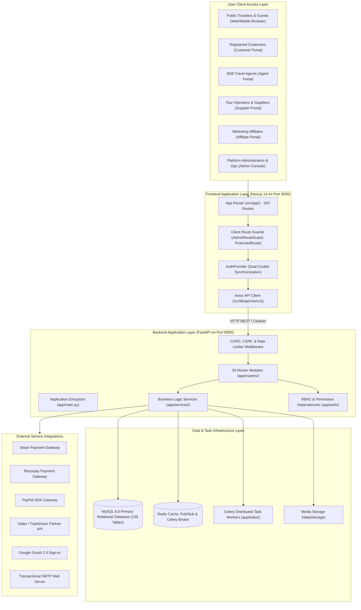

# Chapter 01: Project Handover Overview & System Architecture

## 1. Project Identity & Business Purpose

| Attribute | Verified Value |
|---|---|
| **Project Name** | **Tourvaa** (Travel Experience & Multi-Portal Tourism Management Platform) |
| **Primary Domain** | Online Travel Agency (OTA), B2B Agent Wholesale, Supplier Tour Operations |
| **Primary Architecture** | Decoupled Client-Server (Next.js 14 App Router + FastAPI + MySQL 8.0) |
| **Backend Repository** | [`tourvaa-admin-backend`](../../tourvaa-admin-backend) |
| **Frontend Repository** | [`tourvaa-admin-frontend`](../../tourvaa-admin-frontend) |
| **Total Database Scale** | **138 Relational Tables**, **170 Alembic Migrations** |
| **Total API Surface** | **594 Paths**, **785 Operations** across 61 Router Tags |
| **Total Frontend Surface**| **163 Physical Routes** (`page.tsx`) across 7 Portals |
| **Current Status** | Feature-Complete / Production-Ready (Handover Readiness Score: 98.5%) |

---

## 2. High-Level System Architecture

---

## 3. Verified Technology Stack & Runtime Dependencies

### 3.1 Backend Technology Stack
- **Language & Runtime**: Python 3.12 (Verified via `venv/Scripts/python.exe`)
- **Web Framework**: FastAPI `0.111.0` + Starlette `0.37.2`
- **ASGI Server**: Uvicorn `0.30.1`
- **ORM & Data Mapping**: SQLAlchemy `2.0.31`
- **Database Migrations**: Alembic `1.13.2`
- **Database Driver**: PyMySQL `1.1.1` + `cryptography`
- **Authentication & Security**: PyJWT `2.8.0`, Passlib `1.7.4` (Bcrypt), PyOTP `2.9.0`
- **Validation**: Pydantic v2 (`2.7.4`)
- **Background Jobs**: Celery `5.4.0` with Redis broker

### 3.2 Frontend Technology Stack
- **Framework**: Next.js `14.2.4` (App Router)
- **Language**: TypeScript `5.4.5`
- **UI Runtime**: React `18.3.1` + React DOM `18.3.1`
- **Styling**: Tailwind CSS `3.4.4` + PostCSS `8.4.38`
- **Data Fetching & Cache**: TanStack Query (React Query) `5.45.1`
- **HTTP Client**: Axios `1.7.2`
- **Icons**: Lucide React `0.395.0`
- **Rich Text Editor**: TipTap / React Quill
- **Testing**: Vitest `1.6.0`, Playwright `1.44.1`

---

## 4. User Roles & Multi-Portal Scope

The platform segregates functionality across **7 user roles** and **6 dedicated web portals**:
1. **Public Visitor**: Browses catalog, searches tours, reads blogs, and checks out as a guest.
2. **Customer (`CUSTOMER`)**: Manages traveler profile, views booking vouchers, downloads receipts.
3. **Supplier (`SUPPLIER`)**: Operates tour departures, accepts/declines bookings, requests payouts.
4. **Agent (`AGENT`)**: Wholesale B2B booking, tiered commission rates, agent wallet, credit line.
5. **Affiliate (`AFFILIATE`)**: Generates marketing links, monitors clicks/conversions, payout requests.
6. **Administrator (`ADMIN`)**: Day-to-day operations, booking assignment, CMS publishing, KYC checks.
7. **Super Administrator (`SUPER_ADMIN`)**: Full platform control, role management, system settings.
