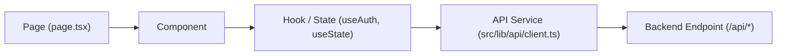

# Chapter 04: Frontend Knowledge Transfer & Architecture Deep-Dive

## 1. Directory Structure & Organization

The frontend codebase [`tourvaa-admin-frontend`](../../tourvaa-admin-frontend) implements the Next.js 14 App Router pattern under `src/`:

```
tourvaa-admin-frontend/src/
├── app/                                 # 163 Physical App Router pages (page.tsx)
│   ├── (public)/                        # Public storefront route group (tours, blogs, booking)
│   ├── admin/                           # Admin operations console (68 management routes)
│   ├── supplier/                        # Supplier operations portal (17 routes)
│   ├── customer/                        # Customer traveler portal (11 routes)
│   ├── agent/                           # Wholesale B2B agent portal (12 routes)
│   └── affiliate/                       # Marketing affiliate portal (11 routes)
├── components/                          # UI components organized by domain
│   ├── admin/                           # Admin-specific tables, dialogs, forms
│   ├── auth/                            # AuthInput, AuthLayout, ProtectedRoute
│   ├── common/                          # Reusable buttons, badges, loaders
│   ├── public/                          # PublicHeader, PublicFooter, ChatWidget
│   ├── tours/                           # Tour editor tabs (Pricing, Media, Itinerary)
│   └── ui/                              # SearchableSelect, NotificationInbox
├── hooks/                               # Custom React hooks (useAuth, useCurrency)
├── lib/                                 # Core utility libraries
│   ├── api/                             # Axios client & service wrappers
│   └── utils/                           # Validators, formatters, currency helpers
├── providers/                           # Global React context providers
│   ├── AuthProvider.tsx                 # Authentication, user session & role state
│   ├── CurrencyProvider.tsx             # Active currency & exchange rates
│   └── QueryProvider.tsx                # TanStack Query client & cache configuration
└── types/                               # TypeScript domain type definitions
```

---

## 2. End-to-End Component Flow Examples

For every major user interaction, data flows through a strict 5-layer pipeline:



### Flow 1: Public Tour Catalog & Filtering
- **Page**: [`src/app/(public)/tours/page.tsx`](../../tourvaa-admin-frontend/src/app/%28public%29/tours/page.tsx)
- **Components**: `TourFilterSidebar.tsx`, `TourCardGrid.tsx`
- **Hook/State**: `useSearchParams()` for URL state, TanStack Query `useQuery(['tours', filters])`
- **API Service**: `api.get('/tours', { params })`
- **Backend Endpoint**: `GET /api/tours` in [`app/routers/tours.py`](../../tourvaa-admin-backend/app/routers/tours.py)

### Flow 2: Customer Traveler Booking History
- **Page**: [`src/app/customer/bookings/page.tsx`](../../tourvaa-admin-frontend/src/app/customer/bookings/page.tsx)
- **Components**: `CustomerBookingsTable.tsx`, `BookingVoucherDownloadButton.tsx`
- **Hook/State**: `useAuth()` (verifies `CUSTOMER` role), TanStack Query `useQuery(['customer-bookings'])`
- **API Service**: `api.get('/customer/bookings')`
- **Backend Endpoint**: `GET /api/customer/bookings` in [`app/routers/customers_portal.py`](../../tourvaa-admin-backend/app/routers/customers_portal.py)

### Flow 3: Supplier Booking Decision (Accept / Decline)
- **Page**: [`src/app/supplier/bookings/page.tsx`](../../tourvaa-admin-frontend/src/app/supplier/bookings/page.tsx)
- **Components**: `SupplierBookingActions.tsx`, `ConfirmDecisionModal.tsx`
- **Hook/State**: `useMutation()` triggering cache invalidation
- **API Service**: `api.post('/supplier/bookings/{id}/accept')`
- **Backend Endpoint**: `POST /api/supplier/bookings/{id}/accept` in [`app/routers/bookings.py`](../../tourvaa-admin-backend/app/routers/bookings.py)

---

## 3. Route Guarding & Authentication State

Frontend security does not use Next.js edge `middleware.ts`. Instead, route protection is enforced via React Client Component guards:
- **`AdminRouteGuard.tsx`**: Wraps all `/admin/*` pages. Checks `user.role in ['admin', 'super_admin']`. Redirects unauthenticated users to `/admin/login`.
- **`ProtectedRoute.tsx`**: Wraps `/customer/*`, `/supplier/*`, `/agent/*`, `/affiliate/*`. Validates that the active user profile matches the expected portal scope.
- **`AuthProvider.tsx`**: Initializes auth state on mount by pinging `/api/auth/me`. Sets up Axios request interceptors to attach `X-CSRF-Token` headers and handle `401 Unauthorized` token refresh sequences.
