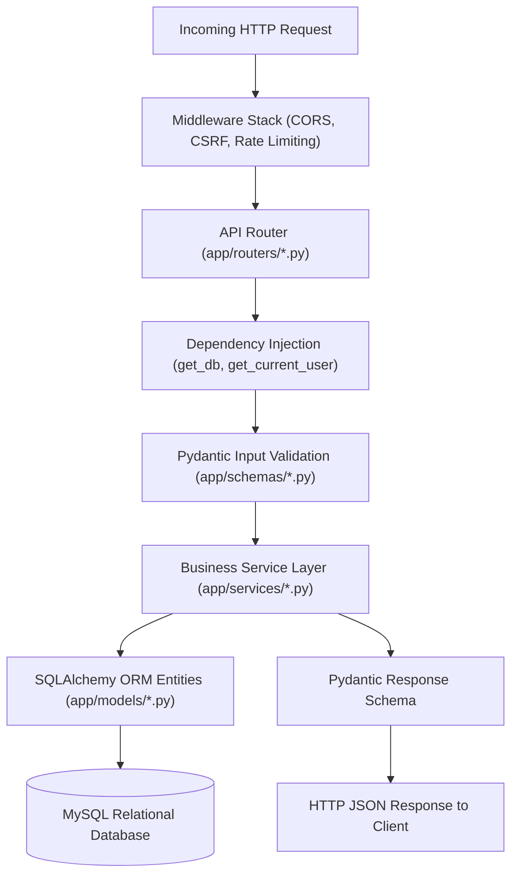

# Chapter 05: Backend Knowledge Transfer & Architecture Deep-Dive

## 1. Request Lifecycle & Layered Architecture

The backend application [`tourvaa-admin-backend`](../../tourvaa-admin-backend) follows a strict layered architectural pattern:



---

## 2. Directory Layout & Key Modules

```
tourvaa-admin-backend/app/
├── main.py                              # FastAPI entrypoint, router mounting, lifespan events
├── config/                              # Settings management (base.py, settings.py)
├── database/                            # SQLAlchemy engine & sessionmaker (get_db)
├── auth/                                # JWT security, password hashing, RBAC permissions
├── middleware/                          # CORS setup, CSRF double-submit validation
├── models/                              # 125 SQLAlchemy entity models
├── schemas/                             # Pydantic request & response serialization models
├── routers/                             # 56 API router modules (594 paths)
├── services/                            # Business domain services (bookings, payments, etc.)
└── utils/                               # Mailer, rate limiter, currency, and pagination
```

---

## 3. Core Architectural Patterns

### 3.1 Dependency Injection in Route Handlers
Every secured route injects database sessions and user authorization via FastAPI `Depends`:
```python
@router.post("/tours")
def create_tour(
    data: TourCreate,
    db: Session = Depends(get_db),
    current_user: User = Depends(require_any_permission("tours.create", "create-tours")),
):
    return {"status": "success", "data": tours_service.create_tour(db, data, current_user)}
```

### 3.2 Service Layer Responsibility
Routers **never** execute raw database queries or complex domain logic directly. Routers handle HTTP parsing, status codes, and call service functions in `app/services/`.
- `calculate_booking_price(...)` in [`app/services/bookings.py`](../../tourvaa-admin-backend/app/services/bookings.py)
- `process_gateway_payment(...)` in [`app/services/payments.py`](../../tourvaa-admin-backend/app/services/payments.py)
- `record_ledger_entry(...)` in [`app/services/agent_ledger.py`](../../tourvaa-admin-backend/app/services/agent_ledger.py)
