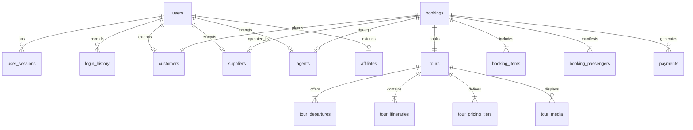

# Chapter 06: Database Architecture & Maintenance Knowledge Transfer

## 1. Database Specifications

| Attribute | Verified Value |
|---|---|
| **Database Engine** | MySQL Server 8.0.x (InnoDB Storage Engine) |
| **Character Set / Collation** | `utf8mb4` / `utf8mb4_unicode_ci` |
| **Connection Pooling** | SQLAlchemy `SessionLocal` with `pool_pre_ping=True` |
| **Total Table Count** | **138 Relational Tables** |
| **Total Migration Revisions** | **170 Alembic Version Files** |
| **Soft Delete Pattern** | `is_deleted = Column(Boolean, default=False)` on major tables |

---

## 2. Core Relational Entities & Cardinality



---

## 3. Database Maintenance & Migration Runbook

### 3.1 Checking Migration Status
```bash
# Navigate to backend directory
cd tourvaa-admin-backend

# Check current active revision in database
python -m alembic current

# Check available head revision
python -m alembic heads
```

### 3.2 Executing Migrations Safely
```bash
# Upgrade database to latest head
python -m alembic upgrade head
```

### 3.3 Creating a New Migration
```bash
# Auto-generate migration from modified SQLAlchemy models
python -m alembic revision --autogenerate -m "add_column_name_to_table"
```
*Always inspect the generated file in `alembic/versions/` before running `upgrade head`.*

### 3.4 Safe Backup & Restore Procedures
```bash
# Backup complete database with schema and data
mysqldump -u root -p --single-transaction --quick --routines --triggers --events tourvaa_db > tourvaa_backup_$(date +%Y%m%d_%H%M%S).sql

# Restore database from backup
mysql -u root -p tourvaa_db < tourvaa_backup_20261029_120000.sql
```
