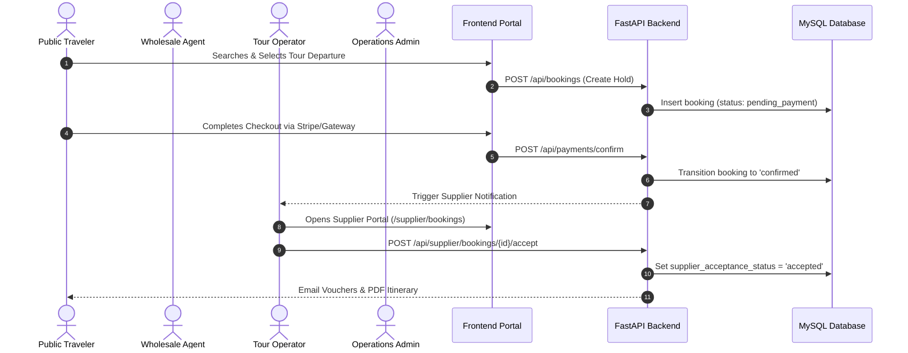

# Chapter 07: Complete Functional Module Handover

## 1. Overview of 20 Platform Modules

The Tourvaa platform is partitioned into **20 discrete functional modules**, each mapping to dedicated frontend pages, backend routers, services, and database tables.

---

## 2. Core Module Handover Directory

### Module 01: Authentication & User Management
- **Frontend**: [`src/app/%28public%29/login/page.tsx`](../../tourvaa-admin-frontend/src/app/%28public%29/login/page.tsx), [`src/app/admin/users/page.tsx`](../../tourvaa-admin-frontend/src/app/admin/users/page.tsx)
- **Backend Routers**: [`app/routers/auth.py`](../../tourvaa-admin-backend/app/routers/auth.py), [`app/routers/users.py`](../../tourvaa-admin-backend/app/routers/users.py)
- **Services**: `app/services/auth.py`, `app/services/users.py`
- **Models**: `users`, `roles`, `permissions`, `user_sessions`, `login_history`

### Module 02: Tours & Catalog Management
- **Frontend**: [`src/app/%28public%29/tours/page.tsx`](../../tourvaa-admin-frontend/src/app/%28public%29/tours/page.tsx), [`src/app/admin/tours/page.tsx`](../../tourvaa-admin-frontend/src/app/admin/tours/page.tsx)
- **Backend Routers**: [`app/routers/tours.py`](../../tourvaa-admin-backend/app/routers/tours.py), [`app/routers/booking_calendar.py`](../../tourvaa-admin-backend/app/routers/booking_calendar.py)
- **Services**: `app/services/tours.py`, `app/services/tour_pricing.py`
- **Models**: `tours`, `tour_itineraries`, `tour_departures`, `tour_pricing_tiers`, `tour_media`

### Module 03: Suppliers & Tour Operations
- **Frontend**: [`src/app/supplier/dashboard/page.tsx`](../../tourvaa-admin-frontend/src/app/supplier/dashboard/page.tsx), [`src/app/supplier/bookings/page.tsx`](../../tourvaa-admin-frontend/src/app/supplier/bookings/page.tsx)
- **Backend Routers**: [`app/routers/suppliers.py`](../../tourvaa-admin-backend/app/routers/suppliers.py), [`app/routers/supplier_ledger.py`](../../tourvaa-admin-backend/app/routers/supplier_ledger.py)
- **Services**: `app/services/suppliers.py`, `app/services/supplier_ledger.py`
- **Models**: `suppliers`, `supplier_documents`, `supplier_payouts`, `supplier_ledger_entries`

### Module 04: Wholesale B2B Agents & Credit Lines
- **Frontend**: [`src/app/agent/dashboard/page.tsx`](../../tourvaa-admin-frontend/src/app/agent/dashboard/page.tsx), [`src/app/agent/bookings/page.tsx`](../../tourvaa-admin-frontend/src/app/agent/bookings/page.tsx)
- **Backend Routers**: [`app/routers/agents.py`](../../tourvaa-admin-backend/app/routers/agents.py), [`app/routers/agent_ledger.py`](../../tourvaa-admin-backend/app/routers/agent_ledger.py)
- **Services**: `app/services/agents.py`, `app/services/agent_ledger.py`
- **Models**: `agents`, `agent_wallets`, `agent_credit_limits`, `agent_ledger_entries`

### Module 05: Cart, Checkout & Multi-Gateway Payments
- **Frontend**: [`src/app/%28public%29/cart/page.tsx`](../../tourvaa-admin-frontend/src/app/%28public%29/cart/page.tsx), [`src/app/%28public%29/booking/%5Bid%5D/page.tsx`](../../tourvaa-admin-frontend/src/app/%28public%29/booking/[id]/page.tsx)
- **Backend Routers**: [`app/routers/checkout.py`](../../tourvaa-admin-backend/app/routers/checkout.py), [`app/routers/payments.py`](../../tourvaa-admin-backend/app/routers/payments.py), [`app/routers/payments_gateway.py`](../../tourvaa-admin-backend/app/routers/payments_gateway.py)
- **Services**: `app/services/checkout.py`, `app/services/payments.py`
- **Models**: `cart_items`, `payments`, `payment_transactions`, `invoices`

### Module 06: Bookings & Reservation Lifecycle
- **Frontend**: [`src/app/admin/bookings/page.tsx`](../../tourvaa-admin-frontend/src/app/admin/bookings/page.tsx), [`src/app/customer/bookings/page.tsx`](../../tourvaa-admin-frontend/src/app/customer/bookings/page.tsx)
- **Backend Routers**: [`app/routers/bookings.py`](../../tourvaa-admin-backend/app/routers/bookings.py)
- **Services**: `app/services/bookings.py` (4,188 lines)
- **Models**: `bookings`, `booking_items`, `booking_passengers`, `booking_status_history`

### Module 07: Cancellations & Tiered Refunds
- **Frontend**: [`src/app/admin/refunds/page.tsx`](../../tourvaa-admin-frontend/src/app/admin/refunds/page.tsx)
- **Backend Routers**: [`app/routers/cancellations.py`](../../tourvaa-admin-backend/app/routers/cancellations.py)
- **Services**: `app/services/cancellations.py`
- **Models**: `cancellation_requests`, `cancellation_penalties`, `refunds`

### Modules 08–20 Reference
For the detailed technical breakdown of Modules 08 to 20 (Coupons, Reviews, Affiliates, Notifications, CMS, Geo, Messaging, Reports, AI Chatbot, Viator, Audit Logs, Cron, Settings), refer directly to the dedicated technical specifications in [`technical-documentation/modules/`](../modules).
