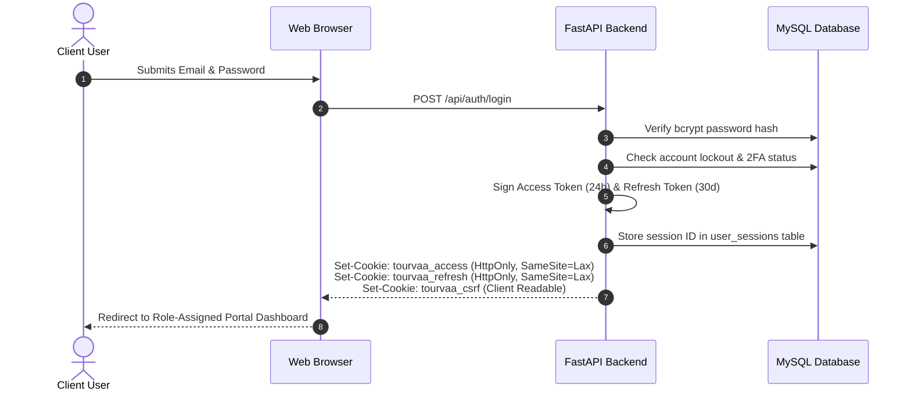

# Chapter 08: Authentication & Authorization Knowledge Transfer

## 1. Authentication Architecture

Tourvaa uses a **dual-domain JWT architecture** delivered via hardened HTTP-only cookies:



---

## 2. Role-Permission Matrix (RBAC)

The platform defines 7 distinct roles with hierarchical permissions:

| Permission Group | Public | Customer | Supplier | Agent | Affiliate | Admin | Super Admin |
|---|---|---|---|---|---|---|---|
| `tours.view` | Yes | Yes | Yes | Yes | Yes | Yes | Yes |
| `tours.create` / `tours.edit` | - | - | Own | - | - | Yes | Yes |
| `bookings.create` | Guest | Yes | - | Yes | - | Yes | Yes |
| `bookings.view` | - | Own | Assigned | Own | - | All | All |
| `supplier.payouts` | - | - | Own | - | - | Approve | Approve |
| `agent.credit` | - | - | - | Own | - | Manage | Manage |
| `affiliate.links` | - | - | - | - | Own | View | View |
| `settings.edit` | - | - | - | - | - | - | Yes |

---

## 3. How to Add a New Role or Protected Endpoint

### Adding a Protected Backend Endpoint
1. Import permission dependencies in your router:
   ```python
   from app.auth.permissions import require_any_permission, get_current_user
   ```
2. Annotate the endpoint with `Depends`:
   ```python
   @router.get("/partner/special-deals")
   def get_deals(
       db: Session = Depends(get_db),
       current_user: User = Depends(require_any_permission("deals.view", "view-deals")),
   ):
       ...
   ```

### Adding a New Protected Frontend Page
1. Wrap the page with the appropriate portal layout or guard:
   ```tsx
   import ProtectedRoute from "@/components/auth/ProtectedRoute";

   export default function PartnerDealsPage() {
     return (
       <ProtectedRoute requiredRole="agent">
         <DealsView />
       </ProtectedRoute>
     );
   }
   ```
