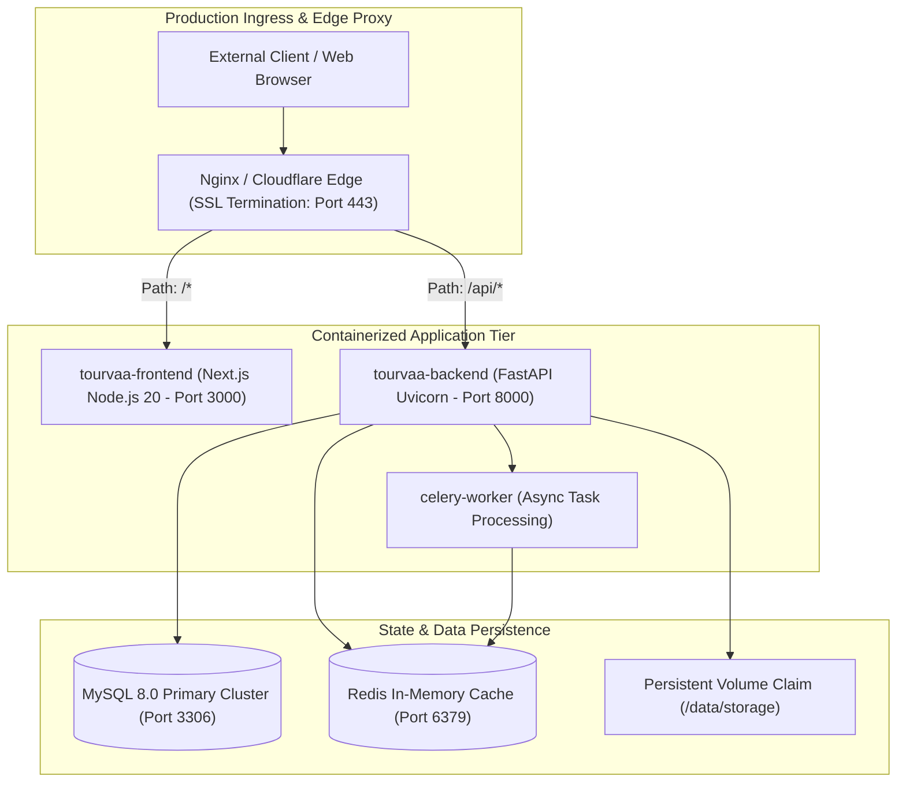

# Chapter 10: Deployment, Server Operations & Infrastructure Handover

## 1. Verified Infrastructure Architecture

---

## 2. Containerization & Build Specifications

### 2.1 Backend Dockerfile ([`tourvaa-admin-backend/Dockerfile`](../../tourvaa-admin-backend/Dockerfile))
- **Builder Stage**: `python:3.12-slim` builds wheels and installs dependencies to `/install`.
- **Runtime Stage**: `python:3.12-slim` non-root user `tourvaa:tourvaa` (UID/GID 1001).
- **Installed Packages**: `libgomp1` (required for ONNX chatbot embeddings).
- **Default Entrypoint**: `/usr/local/bin/tourvaa-entrypoint` executing [`docker-entrypoint.sh`](../../tourvaa-admin-backend/docker-entrypoint.sh).

### 2.2 Frontend Dockerfile ([`tourvaa-admin-frontend/Dockerfile`](../../tourvaa-admin-frontend/Dockerfile))
- **Builder Stage**: Node.js 20 Alpine builds Next.js standalone bundle via `npm run build`.
- **Runtime Stage**: Lightweight Node.js Alpine container executing `node server.js` on port 3000.

---

## 3. Clustered Deployment Guidelines

1. **Decouple Database Migrations from Application Startup**:
   - In `docker-entrypoint.sh`, ensure `RUN_MIGRATIONS=false` in production application replicas.
   - Run migrations as an isolated one-off CI/CD deployment step prior to spinning up new containers.
2. **Worker Concurrency**:
   - For multi-worker Uvicorn (`WEB_CONCURRENCY > 1`), ensure `REDIS_URL` is set to enable Redis-backed distributed locking and WebSocket pub/sub.
