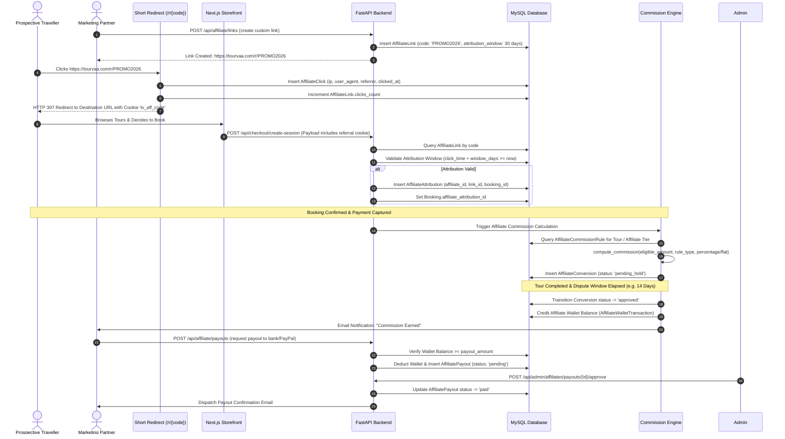

# Affiliate Referral Tracking & Commission Workflow

This document details the tracking, attribution, commission calculation, and wallet payout mechanics of the Tourvaa Affiliate Marketing system.

---

## 1. Affiliate Referral & Attribution Architecture Diagram

---

## 2. Commission Calculation Rules & Slabs

- **Rule Types**: Supports both `percentage` (e.g. 5% of net tour price) and `fixed` amounts (e.g. $50 per booking).
- **Attribution Logic**: First-touch or last-touch attribution within configurable attribution windows (default: 30 days).
- **Fraud Prevention**: Commissions remain in `pending_hold` status until the tour travel date has completed and cancellation dispute periods have expired. Cancelled or refunded bookings automatically invalidate associated pending conversions.
