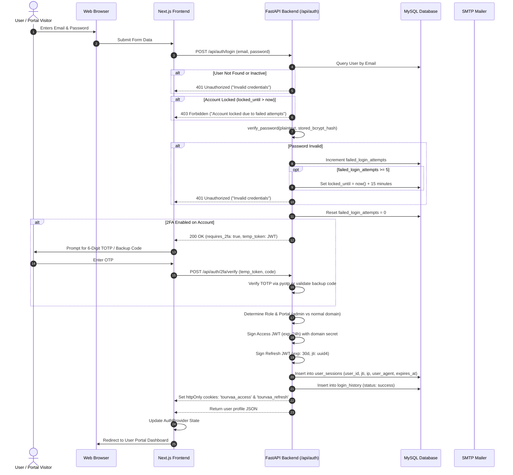
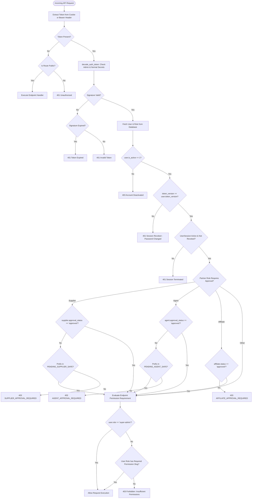

# Authentication & Authorization Decision Flow

This document details the authentication and authorization lifecycle in Tourvaa, encompassing credential login, dual-domain JWT validation, 2FA with TOTP, session tracking, password reset token rotation, and RBAC permission checks.

---

## 1. Login & Token Lifecycle Sequence Diagram

---

## 2. Authorization Decision Flowchart

---

## 3. Key Security Properties

1. **Dual Cryptographic Domains**:
   - The administration interface uses `ADMIN_JWT_SECRET_KEY`.
   - External portal users (customers, suppliers, agents, affiliates) use `NORMAL_JWT_SECRET_KEY`.
   - Even if a customer obtains a valid token, it is cryptographically rejected by administrative endpoints because the token domain claim is strictly verified.
2. **Revocation via `token_version`**:
   - When a user changes their password or clicks "Sign out everywhere", the database increments `user.token_version`.
   - All outstanding JWTs become instantly invalid, preventing session replay.
3. **Defense Against Brute Force**:
   - Consecutive login failures are counted in `failed_login_attempts`.
   - Upon the 5th failed attempt, `locked_until` is populated with `now() + 15 minutes`.
   - The API short-circuits attempts during lockout without verifying the password, mitigating timing attacks.
