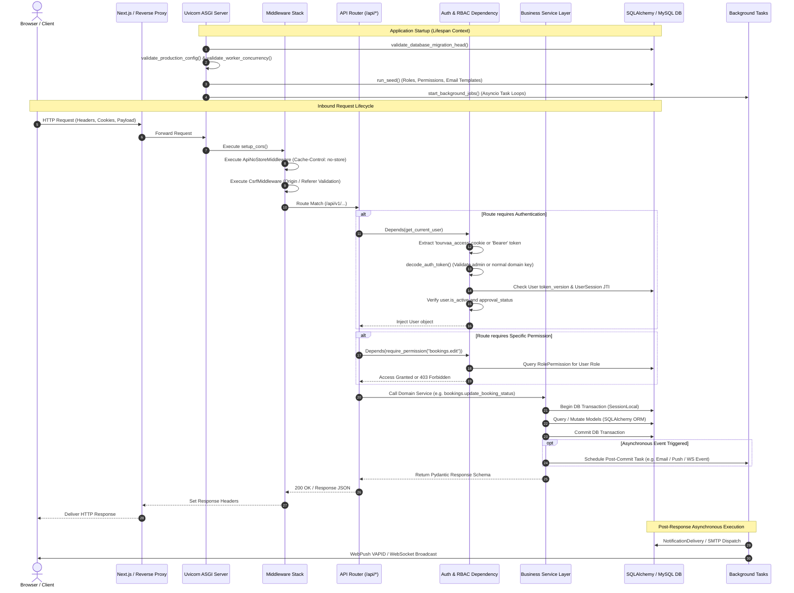

# Backend Architecture & Request-Response Lifecycle

This document describes the internal architecture of the Tourvaa FastAPI backend (`tourvaa-admin-backend`), detailing application startup, middleware sequencing, route dispatching, dependency injection, and data persistence.

---

## 1. Backend Architecture & Request Flow Diagram

---

## 2. Request-Response Lifecycle Stages

### Stage 1: Lifespan Startup & Self-Healing Guards
When the FastAPI process boots, `_lifespan` in [`app/main.py`](../../tourvaa-admin-backend/app/main.py) executes:
1. **Migration Verification**: Compares Alembic code heads to running database heads. Discrepancies abort the server to prevent queries against outdated schemas.
2. **Production Hardening Checks**: Validates strong secrets, verifies debug mode is off, and ensures separate admin and normal domain keys.
3. **Concurrency Guard**: Ensures `REDIS_URL` is set if `WEB_CONCURRENCY > 1`.
4. **Automated Seeding**: Executes `run_seed()` to backfill any newly introduced roles, admin modules, or email templates.
5. **Background Sweeps Launch**: Starts 12 distinct background coroutines for payment hold releases, booking expirations, balance alerts, and email retries.

### Stage 2: Middleware Stack
Every request passes through three custom middlewares:
1. **CORS Middleware**: Evaluates origin against `ALLOWED_ORIGINS` (fails closed if wildcard in production).
2. **ApiNoStore Middleware**: Enforces `Cache-Control: no-store, no-cache, must-revalidate, max-age=0` to ensure user sessions are never cached by intermediate proxies or browser history.
3. **CSRF Middleware**: Validates that state-modifying requests (`POST`, `PUT`, `DELETE`, `PATCH`) carry an `Origin` or `Referer` matching allowed platform hosts.

### Stage 3: Routing & Dependency Injection
- API routers are segregated into 4 logical groups (`CORE_ROUTERS`, `PARTNER_AND_CUSTOMER_ROUTERS`, `CONTENT_AND_TOUR_ROUTERS`, `OPERATIONS_ROUTERS`) and registered under `/api`.
- Request schemas are validated using **Pydantic v2**, rejecting malformed data with `422 Unprocessable Entity` before hitting business logic.
- Authentication dependencies (`get_current_user`, `require_permission`) inspect the JWT domain, session table, and role permission mappings.

### Stage 4: Business Service Layer & Transaction Boundaries
- Router endpoints never perform raw database queries directly. They delegate to dedicated service modules in `app/services/`.
- All database modifications take place within explicit SQLAlchemy session boundaries.
- Critical operations (such as payment captures and supplier acceptance) utilize transaction commits before triggering post-commit notifications.

### Stage 5: Asynchronous Post-Commit Execution
- Emails, push notifications, and WebSocket broadcasts are never performed synchronously inside request threads.
- Instead, services enqueue records into `notification_deliveries` and trigger non-blocking `BackgroundTasks` to ensure that external network delays never slow down user requests.
