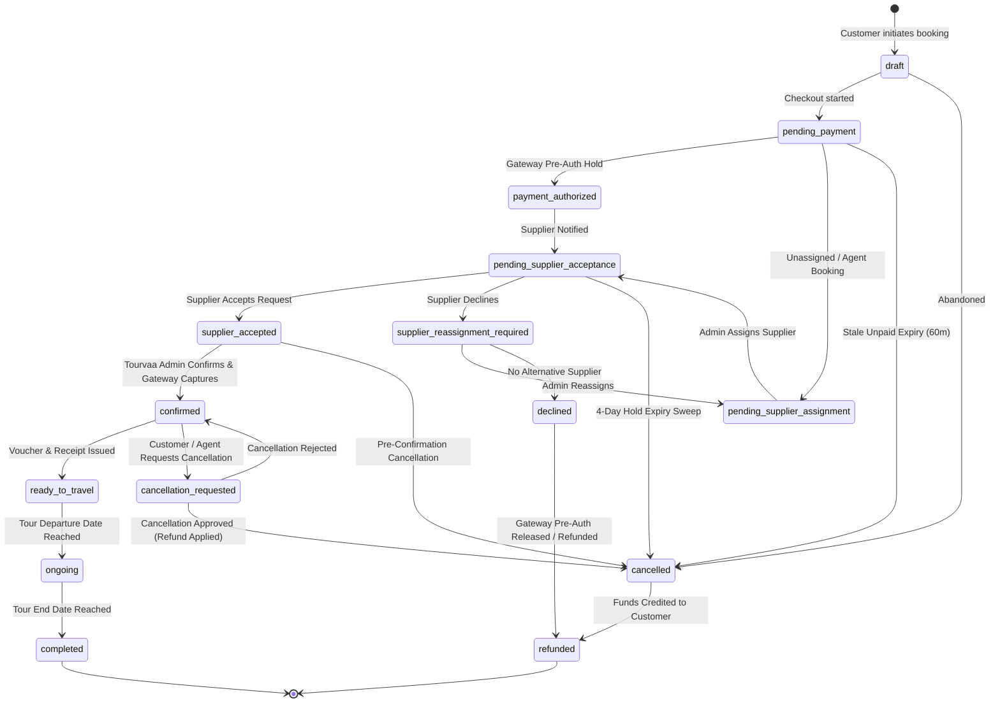
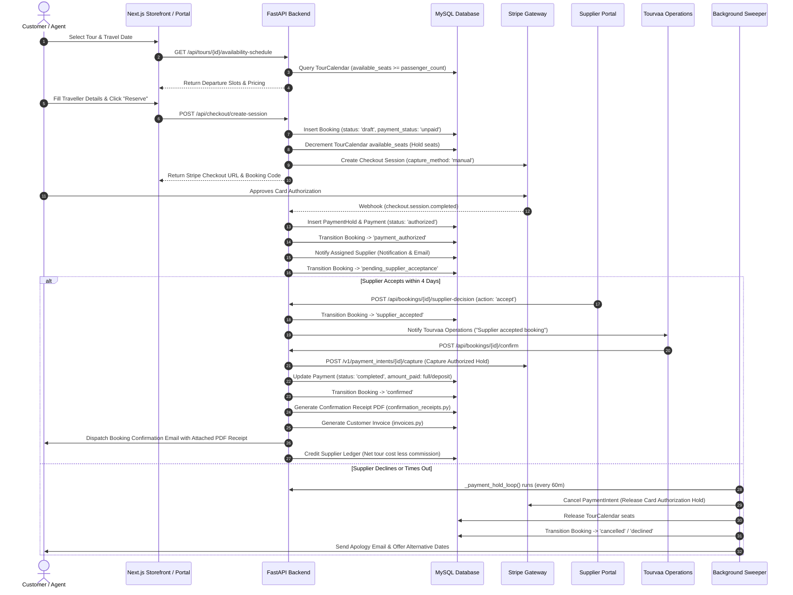

# Booking Lifecycle & State Transition Workflow

This document models the complete booking lifecycle in Tourvaa, detailing the state machine, seat reservation mechanics, supplier acceptance requirements, payment hold-to-capture sequence, and customer receipt generation.

---

## 1. Booking State Transition Diagram

---

## 2. End-to-End Booking Sequence Walkthrough

---

## 3. Critical Business Rules Verified from Source Code

1. **Payment Authorization Is Not Final Confirmation**:
   - As stated in [`app/services/payments.py`](../../tourvaa-admin-backend/app/services/payments.py) line 21: *"A payment authorization is not a receipt and supplier acceptance is not the customer-facing final confirmation."*
   - Stripe card authorizations use `capture_method="manual"` to place an authorized hold without debiting the customer immediately.
2. **Four-Day Supplier Decision Window**:
   - The automated background worker `_payment_hold_loop()` periodically cancels authorizations before they expire on the gateway, preventing funds from hanging in customer bank accounts if a supplier is unresponsive.
3. **Seat Holding & Stale Booking Expiry**:
   - Unpaid bookings in `pending_payment` hold seats in `TourCalendar`. The coroutine `_expire_stale_bookings_loop()` runs every 15 minutes and automatically releases seats if payment is not authorized within `BOOKING_EXPIRY_HOLD_MINUTES` (60 minutes).
4. **Immutable Confirmation Receipts**:
   - Final booking receipts (`booking-confirmation-{id}-v2.pdf`) are stored in `private-docs/booking-confirmations/` upon initial confirmation. They are immutable snapshots and are never dynamically recomputed from mutable database rows on later download.
