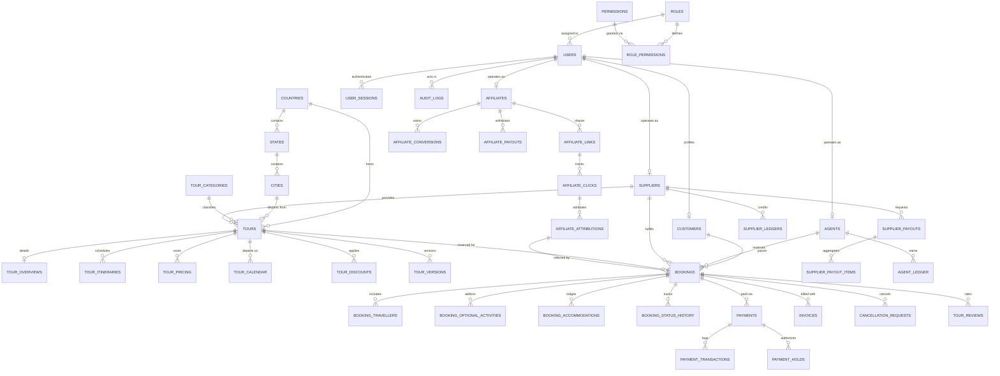

# Database Entity-Relationship Diagram (ERD) & Schema Overview

This document presents the Entity-Relationship Diagram (ERD) of the core database entities in the Tourvaa platform, modeling the relationships across users, tours, bookings, payments, invoices, suppliers, agents, and affiliates.

---

## 1. Core Domain Entity-Relationship Diagram

---

## 2. Core Entity Descriptions & Primary Keys

| Entity Name | Primary Key | Description & Role in Architecture |
|---|---|---|
| `users` | `id` (int) | Master user identity record containing email, password hash, status, 2FA flag, and lockout parameters. |
| `roles` | `id` (int) | System and custom RBAC roles (`super-admin`, `admin`, `supplier`, `agent-reseller`, `customer`, `affiliate`). |
| `permissions` | `id` (int) | Granular permission catalog mapping action (`get`, `post`, `put`, `delete`) to module slugs. |
| `customers` | `id` (int) | Customer profile linking to `users.id`, holding contact address, emergency contacts, and nationality. |
| `suppliers` | `id` (int) | Tour operator identity linking to `users.id`, tracking approval status, commission rates, and banking. |
| `agents` | `id` (int) | B2B travel agent profile linking to `users.id`, holding trade license, credit limits, and agency details. |
| `affiliates` | `id` (int) | Marketing affiliate profile linking to `users.id`, holding referral codes, tax IDs, and payout methods. |
| `tours` | `id` (int) | Core tour catalog record with slug, destination link, durations, starting price, and publishing status. |
| `tour_versions` | `id` (int) | Immutable snapshot of tour edits submitted for review; prevents live tour corruption before admin approval. |
| `tour_calendar` | `id` (int) | Individual departure calendar date entry tracking available seats, departure status, and cutoff rules. |
| `bookings` | `id` (int) | The central transaction hub of Tourvaa. Links tour, dates, customer, agent, supplier, and financial state. |
| `booking_travellers`| `id` (int) | Detailed passenger manifests containing full names, passport details, DOB, and dietary requirements. |
| `payments` | `id` (int) | Payment tracking record storing gateway transaction ID, captured amount, currency, and authorization status. |
| `payment_holds` | `id` (int) | Explicit record of pre-authorization holds held with Stripe/PayPal pending supplier booking acceptance. |
| `invoices` | `id` (int) | Formal commercial invoice issued to customers or agents, tracking invoice number, GST, and balance due. |
| `supplier_ledgers`| `id` (int) | Double-entry ledger tracking net tour amounts credited to suppliers, platform commission, and debits. |
| `agent_ledger` | `id` (int) | Commercial account statement tracking agent commissions, customer direct payments, and remittances. |
| `affiliate_links` | `id` (int) | Custom referral links (`/r/{code}`) configured with attribution window days and destination redirects. |
| `affiliate_conversions` | `id` (int) | Commission records generated upon successful checkout attribution, linked to booking financial records. |
