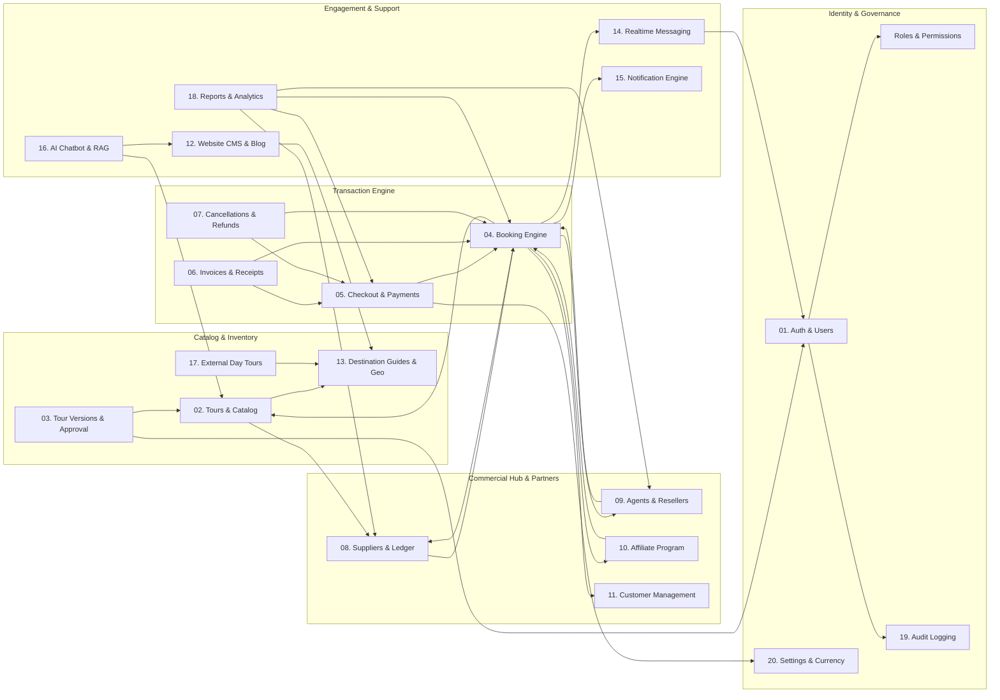

# Architectural Module Dependencies & Communication Graph

This document details the inter-module dependency graph, showcasing the communication pathways and data flow among all 20 business modules in the Tourvaa platform.

---

## 1. Complete System Module Dependency Graph

---

## 2. Structural Layering & Separation of Concerns

The architecture strictly adheres to a layered hierarchy:
1. **Foundation Tier**: Database engines, Redis cache, filesystem roots, encryption utilities (`app/utils/money.py`, `app/utils/distributed_lock.py`).
2. **Persistence Tier**: 138 SQLAlchemy declarative models in `app/models/` defining primary keys, indexes, foreign key constraints, and cascade policies.
3. **Domain Service Tier**: 56 business domain services in `app/services/` encapsulating business logic, calculation formulas, and external API requests.
4. **Interface / Transport Tier**: 51 FastAPI routers in `app/routers/` handling HTTP request deserialization, Pydantic validation, authorization dependencies, and JSON serialization.
5. **Client Presentation Tier**: Next.js 16 frontend consuming the API via same-origin proxied HTTP requests and direct WebSocket streams.
