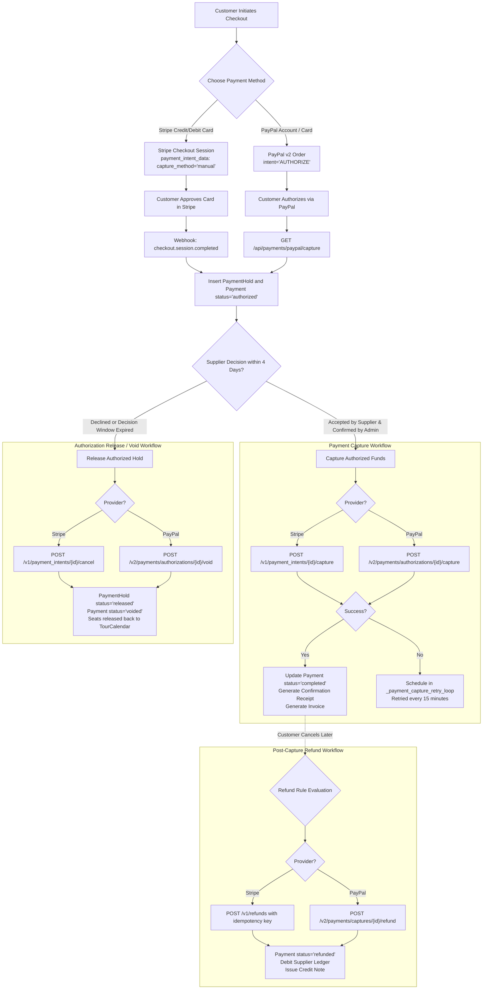

# Payment Pre-Authorization, Hold & Capture Flow

This document details the payment gateway interaction architecture for Stripe and PayPal, demonstrating how funds are pre-authorized upon checkout, held in escrow during supplier evaluation, captured upon final confirmation, or released/refunded upon rejection or cancellation.

---

## 1. Payment Lifecycle Architecture Diagram

---

## 2. Key Gateway Integration Mechanisms

### 2.1 Webhook Signature Validation
1. **Stripe Webhook (`construct_event`)**:
   - Parses the `Stripe-Signature` header for timestamp `t` and signature `v1`.
   - Computes HMAC-SHA256 signature using `STRIPE_WEBHOOK_SECRET` over `${t}.${raw_body}`.
   - Rejects stale webhooks where `abs(time.time() - int(t)) > 300` (5-minute replay defense).
   - Validates using constant-time string comparison (`hmac.compare_digest`).

2. **PayPal Webhook (`verify_webhook_signature`)**:
   - Compares incoming transmission headers (`PAYPAL-AUTH-ALGO`, `PAYPAL-TRANSMISSION-ID`, `PAYPAL-CERT-URL`, `PAYPAL-TRANSMISSION-SIG`, `PAYPAL-TRANSMISSION-TIME`).
   - Verifies against `PAYPAL_WEBHOOK_ID` configured for the production API endpoint.

### 2.2 Idempotency & Fault Tolerance
- All Stripe captures, voids, and refunds supply a unique `Idempotency-Key` (e.g. `capture-{payment.id}-{attempt}`).
- If gateway capture fails due to temporary network partitions after supplier acceptance, the record enters retry state and is automatically re-attempted by `_payment_capture_retry_loop()` every 15 minutes.
