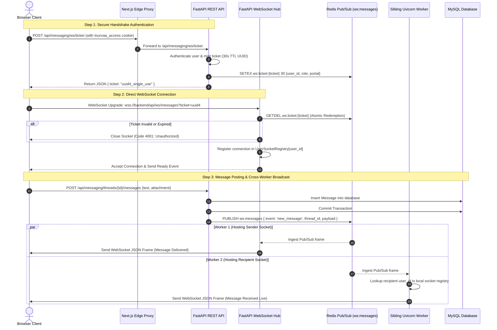

# Realtime WebSocket Messaging & Notification Flow

This document details the WebSocket architecture in Tourvaa, explaining the ticket minting protocol, cross-worker Redis pub/sub messaging, presence tracking, and conversation thread synchronization.

---

## 1. WebSocket Connection & Messaging Architecture

---

## 2. Technical Highlights

1. **Ticket-Based Handshake**:
   - Web browsers cannot set custom headers during native `new WebSocket()` upgrades.
   - Cross-origin WebSocket handshakes bypass the Next.js same-origin rewrite proxy.
   - Tourvaa mints a single-use, 30-second Redis-backed ticket via an authenticated same-origin REST request, then passes it as a query param. The ticket is immediately destroyed upon connection (`GETDEL`).
2. **Multi-Worker Scaling via Redis**:
   - In production environments where `WEB_CONCURRENCY > 1`, user sockets are distributed across different OS processes.
   - The Redis pub/sub channel `ws:messages` guarantees that any message published by worker A immediately broadcasts to worker B holding the recipient's socket.
3. **Presence & Heartbeats**:
   - Sockets emit periodic ping/pong frames (`PRESENCE_TTL_SECONDS = 75`).
   - Connections are capped at `MAX_SOCKETS_PER_USER = 5` to prevent resource starvation.
