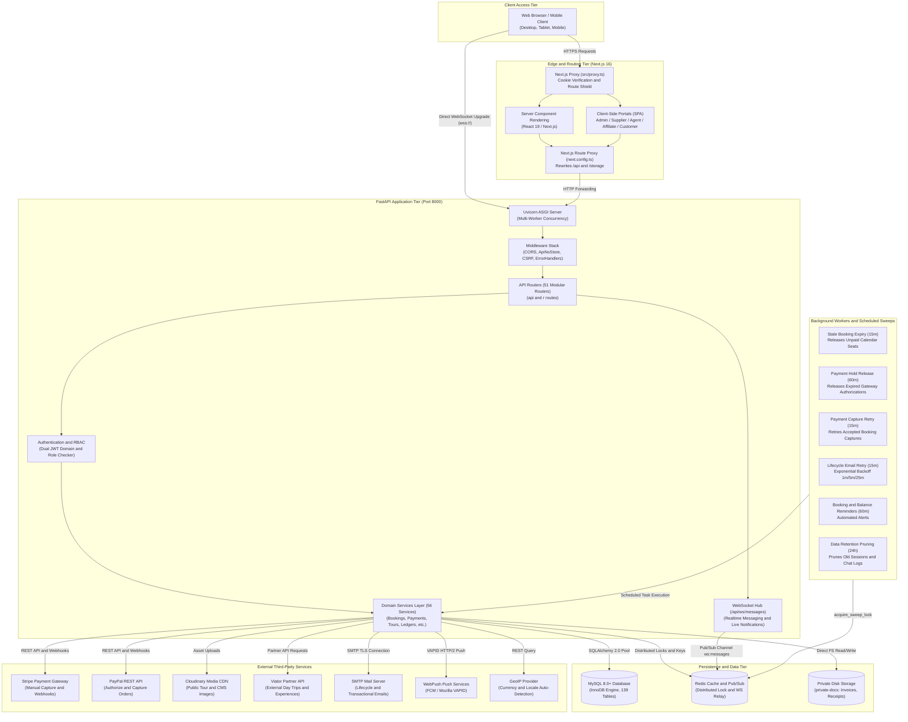

# System Architecture Diagram & Walkthrough

This document illustrates the end-to-end system architecture of the Tourvaa travel platform, showing the multi-tier boundaries between users, frontend edge layers, backend API services, asynchronous workers, persistence layers, and external service providers.

---

## 1. High-Level Architecture Diagram

---

## 2. Component Descriptions & Boundaries

### 2.1 Client Access Tier
Users connect via standard modern web browsers on desktop, tablet, and mobile devices. All public web traffic terminates at the Next.js edge router over HTTPS. WebSocket connections upgrade directly to the backend origin (`NEXT_PUBLIC_WS_URL`) over secure WebSockets (`wss://`).

### 2.2 Edge & Routing Tier (Next.js 16)
- **`src/proxy.ts`**: Implements Next.js 16's server-side proxy convention (formerly middleware). Checks for the presence of the `tourvaa_access` session cookie on all protected portal routes (`/admin/*`, `/customer/*`, `/supplier/*`, `/agent/*`, `/affiliate/*`) before serving React Server Components. Redirects unauthenticated requests to their role-specific login routes (`/admin/login`, `/customer/login`, etc.).
- **`next.config.ts` Rewrites**: Configures reverse proxy rewrites from the frontend domain to `BACKEND_INTERNAL_URL:8000` for `/api/:path*` and `/storage/:path*`, allowing the client browser to execute same-origin API calls without CORS overhead.
- **Server Components (RSC)**: Renders initial page layouts server-side, pre-fetching static CMS, destination guides, and tour catalog data.
- **Client Portals (SPA)**: Highly interactive administrative, supplier, B2B wholesale, and customer portals built with React 19 client components (`"use client"`), Axios interceptors, and Tailwind CSS 4 styling.

### 2.3 FastAPI Application Tier (Port 8000)
- **Uvicorn ASGI Server**: Runs the FastAPI application with high-concurrency async event loops.
- **Middleware Stack**:
  - `ApiNoStoreMiddleware`: Enforces `Cache-Control: no-store, no-cache, must-revalidate` across all sensitive API routes.
  - `CORSMiddleware`: Enforces explicit origin validation for API and WebSocket clients.
  - `CSRFMiddleware`: Requires valid CSRF tokens on state-mutating requests (`POST`, `PUT`, `PATCH`, `DELETE`) for cookie-authenticated browser sessions.
  - `AppErrorHandlers`: Catches unhandled exceptions, logs forensic stack traces, and emits sanitized JSON error payloads (`{"success": false, "detail": "..."}`).
- **51 Modular Routers**: Organizes 594 endpoints into discrete domain routers registered via `app.include_router()`.
- **Authentication & RBAC**: Validates dual-domain JWT tokens (Admin domain vs Customer domain), enforces TOTP two-factor authentication, and evaluates fine-grained role-based permissions (`RequirePermission`).
- **Domain Services (56 Services)**: Decouples business logic from HTTP transport, orchestrating database transactions, external API interactions, and background jobs.
- **WebSocket Hub (`/api/ws/messages`)**: Manages real-time bidirectional messaging channels between travellers, suppliers, and customer support representatives.

### 2.4 Background Workers & Scheduled Sweeps
FastAPI lifespan background coroutines periodically execute maintenance sweeps using distributed Redis locks (`acquire_sweep_lock`) to prevent race conditions in horizontal multi-container deployments:
- **Stale Booking Expiry (every 15 min)**: Cancels pending bookings that have exceeded their reservation timeout, restoring calendar seats.
- **Payment Hold Release (every 60 min)**: Releases expired pre-authorization holds when suppliers decline or fail to confirm bookings within 4 days.
- **Payment Capture Retry (every 15 min)**: Retries gateway payment captures for confirmed bookings that encountered transient gateway timeouts.
- **Lifecycle Email Retry (every 15 min)**: Retries failed notification emails with exponential backoff intervals (1 min, 5 min, 25 min).
- **Booking Reminders (every 60 min)**: Dispatches upcoming departure reminders and balance-due payment notifications.
- **Data Retention Pruning (every 24 hours)**: Prunes expired session tokens, temporary verification codes, and stale audit records according to compliance policies.

### 2.5 Persistence & Data Tier
- **MySQL 8.0+ Database**: Primary relational data store utilizing the InnoDB storage engine, with 139 relational tables and 170 Alembic migration revisions.
- **Redis Cache & Pub/Sub**: Manages distributed mutex locks (`acquire_sweep_lock`), cached exchange rates, rate-limiting tokens, and WebSocket message fan-out across multiple Uvicorn worker processes.
- **Private Disk Storage**: Houses sensitive generated PDF invoices, itineraries, booking receipts, and partner KYC documentation in a protected filesystem directory (`private-docs/`) accessible only by authenticated backend services.

### 2.6 External Third-Party Services
- **Stripe**: Handles card pre-authorization, manual capture, refunds, and webhook events (`checkout.session.completed`, `payment_intent.succeeded`).
- **PayPal**: Handles international wallet transactions using PayPal v2 Orders (Authorize and Capture APIs).
- **Cloudinary**: Serves as the primary content delivery network (CDN) for tour gallery images, destination banners, and user avatar uploads.
- **Viator**: Synchronizes external day tours, activities, and live pricing via the Viator Partner API.
- **SMTP Server**: Dispatches transactional and lifecycle emails over TLS (Port 587 / 465).
- **WebPush / VAPID**: Broadcasts browser push notifications for booking status updates and incoming messages.
- **GeoIP Providers**: Automatically detects incoming user currency and locale from client IP addresses.
