# Tourvaa Travel Platform — System Architecture & Complete Flowcharts Reference

**Document Classification:** Enterprise Architecture Blueprint & Complete Workflow Specifications  
**Audience:** Solutions Architects, Engineering Leads, Full-Stack Developers, DevOps/SRE, Technical Auditors  
**System Scope:** Full-Stack Architecture, 20 Business Modules, Database Topology, and Operational Sequences  
**Date:** 2026-10-30  
**Version:** 2.0.0 (Production Verified)  

---

## Executive Architecture Summary

This reference publication contains the complete set of **37 production architecture diagrams and business workflow flowcharts** for the Tourvaa travel marketplace. It provides an exhaustive, multi-tier visual specification of system topology, client-edge interaction, API service lifecycle, relational data models, asynchronous worker sweeps, and all 20 business domain workflows.

```
========================================================================================================
                          TOURVAA COMPLETE ARCHITECTURE & DIAGRAMS INDEX
========================================================================================================
  • SECTION 1: Core System Architecture & Topology (6 Primary Tier Diagrams)
  • SECTION 2: End-to-End Business Module Workflows (20 Domain Workflow Flowcharts)
  • SECTION 3: Operational Sequences, State Machines & Handover Lifecycles (11 Detailed Flowcharts)
  • Total Visual Diagrams & Flowcharts: 37 Verified Production Specifications
========================================================================================================
```

---

# SECTION 1: Core System Architecture & Topology

## 03 — System Architecture & Component Interaction

## 1. Architectural Philosophy

Tourvaa is built upon clean architecture principles:
1. **Decoupled Client & Server**: The Next.js frontend acts purely as a presentation and edge-routing layer, communicating with the FastAPI backend via JSON REST APIs and WebSocket streams.
2. **Layered Backend Separation**: Routers handle HTTP transport and validation; domain services encapsulate business logic; SQLAlchemy models define persistence; background workers manage asynchronous tasks.
3. **Escrow Booking Workflow**: Payment success does not equal final booking confirmation. Bookings follow an explicit supplier acceptance and Tourvaa operational approval lifecycle.

---

## 2. High-Level Architecture Diagram

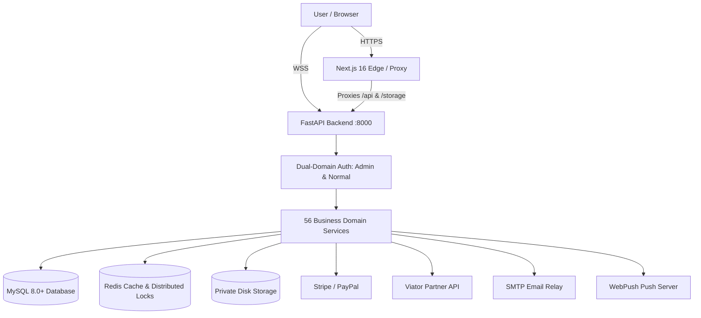

Detailed architectural diagrams and component walkthroughs are available in:
- [System Architecture Diagram](diagrams/system-architecture.md)
- [Frontend Component Architecture](diagrams/frontend-architecture.md)
- [Backend Architecture & Request Lifecycle](diagrams/backend-architecture.md)
- [Module Dependencies Diagram](diagrams/module-dependencies.md)


---

## 05 — Frontend Architecture & Component Design

## 1. Next.js 16 App Router Structure

The frontend is built on **Next.js 16.4.3** (locked in `package.json`; upgraded from initial 15.5 baseline) utilizing the React 19.2.4 App Router paradigm. It is divided into logical route groups:
1. `%28public%29/`: Publicly accessible tour discovery, destination search, checkout, blog articles, and institutional pages.
2. `admin/`: Back-office administration for platform operators, tour review workflows, and financial settings.
3. `customer/`: Consumer portal for viewing booked itineraries, passenger rosters, and payments.
4. `supplier/`: Tour supplier management console for managing departures, pricing, and bookings.
5. `agent/`: B2B wholesale agent console for retail client reservations and commissions.
6. `affiliate/`: Affiliate partner dashboard for referral short-links, clicks, and wallet payouts.

---

## 2. Server-Side Route Guard (`src/proxy.ts`)

Next.js 16 replaced the traditional `middleware.ts` convention with `proxy.ts`. Tourvaa's proxy executes before any protected page HTML is sent to the browser:
- Inspects incoming requests for the `tourvaa_access` session cookie on all protected path prefixes (`/admin`, `/customer`, `/agent`, `/supplier`, `/affiliate`).
- Unauthenticated requests are immediately redirected to `/login` or `/admin/login` with the original URL preserved in `?redirect=`.
- Normalizes trailing slashes with permanent 308 redirects to avoid duplicate routing.

---

## 3. Global Context Providers

1. **`AuthProvider` ([`src/providers/AuthProvider.tsx`](../../tourvaa-admin-frontend/src/providers/AuthProvider.tsx))**:
   - Manages active user authentication state, current role claims, and user profile data.
   - Listens for token invalidation events (e.g. password resets or remote session termination).
2. **`PublicSettingsProvider` ([`src/providers/PublicSettingsProvider.tsx`](../../tourvaa-admin-frontend/src/providers/PublicSettingsProvider.tsx))**:
   - Fetches and caches global platform configuration, currency exchange rates, company branding, and active payment gateway toggles.
3. **`TravelStoreProvider` ([`src/providers/TravelStoreProvider.tsx`](../../tourvaa-admin-frontend/src/providers/TravelStoreProvider.tsx))**:
   - Manages client-side shopping cart state, tour comparison lists, and customer wishlist items backed by `localStorage`.

---

## 4. API Communication & Proxy Rewrites

All browser HTTP requests to `/api/*` and `/storage/*` are proxied to the backend via `next.config.ts` rewrites:
```typescript
{
  source: "/api/:path*",
  destination: `${apiProxyTarget}/api/:path*`,
}
```
This ensures that the frontend communicates with the backend as a **same-origin service**, allowing secure, `httpOnly`, `SameSite=Lax` cookies to be exchanged without exposing raw JWTs to client-side JavaScript.

The complete frontend route inventory is cataloged in [`inventories/frontend-routes.md`](inventories/frontend-routes.md).


---

## 06 — Backend Architecture & Service Layer Design

## 1. Application Architecture

The backend is built with **FastAPI 0.139.2** (locked in `requirements.txt`; upgraded from initial 0.115 baseline) running on **Python 3.12**. It uses an asynchronous service layer backed by SQLAlchemy 2.0 ORM and PyMySQL.

---

## 2. Startup Lifecycle & Production Verification (`_lifespan`)

FastAPI's async lifespan context manager in [`app/main.py`](../../tourvaa-admin-backend/app/main.py) enforces strict startup safety gates:
1. **`validate_database_migration_head()`**: Compares running database heads against Alembic code heads. Aborts if migrations are pending.
2. **`validate_production_config()`**: In production (`APP_ENV != "development"`), ensures debug is disabled, JWT secrets are >= 32 characters, and webhook secrets are present.
3. **`validate_worker_concurrency()`**: Enforces that `REDIS_URL` is set whenever `WEB_CONCURRENCY > 1`.
4. **`validate_pdf_rendering_dependencies()`**: Verifies that ReportLab and Pillow are functional before accepting traffic.
5. **`run_seed()`**: Seeds default roles, permissions, and email templates if missing.
6. **`start_background_jobs()`**: Launches asynchronous worker coroutines with distributed locks.

---

## 3. Middleware Stack

Requests pass through four specialized middlewares:
1. **CORS Middleware**: Validates allowed origins against `ALLOWED_ORIGINS` (wildcards prohibited in production).
2. **ApiNoStore Middleware**: Emits `Cache-Control: no-store` to prevent caching of sensitive customer or financial data.
3. **CsrfMiddleware**: Defends against cross-site request forgery by validating `Origin` and `Referer` headers on state-mutating HTTP methods.
4. **Error Handlers**: Traps validation errors (`RequestValidationError`) and internal exceptions, formatting them into standardized JSON error responses.

---

## 4. Background Job Coroutines

12 background tasks run concurrently within the FastAPI event loop, acquiring distributed locks via Redis (`app/utils/distributed_lock.py`):
- `_expire_stale_bookings_loop`: Sweeps every 15 minutes; releases unpaid seats held longer than 60 minutes.
- `_payment_hold_loop`: Sweeps every 60 minutes; releases pre-authorization card holds exceeding the 4-day supplier decision window.
- `_payment_capture_retry_loop`: Sweeps every 15 minutes; retries failed captures on confirmed bookings.
- `_email_retry_loop`: Sweeps every 15 minutes; retries failed lifecycle emails using exponential backoff (1m, 5m, 25m).
- `_push_retry_loop`: Sweeps every 15 minutes; retries failed WebPush deliveries.
- `_balance_due_reminder_loop`: Sweeps every 60 minutes; dispatches payment reminders for upcoming booking balances.
- `_tour_availability_reminder_loop`: Sweeps every 60 minutes; alerts suppliers when tour departure schedules are nearing expiration.
- `_wishlist_reminder_loop`: Sweeps every 24 hours; notifies customers of seat availability on wishlisted tours.
- `_chat_retention_loop`: Sweeps every 24 hours; purges chat logs older than 90 days.
- `_data_retention_loop`: Sweeps every 24 hours; prunes stale user sessions and email delivery logs.


---

## 08 — Database Schema & Data Architecture

## 1. Database Engine & ORM Configuration

- **Database Engine**: MySQL 8.0+ or MariaDB using the **InnoDB storage engine** for full ACID compliance and row-level locking.
- **ORM Framework**: SQLAlchemy 2.0 utilizing Declarative Base (`Base = declarative_base()`).
- **Connection Pooling**: Managed via `QueuePool` with configurable pool size, max overflow, and automated pool recycling to prevent stale MySQL disconnects.
- **Character Set**: `utf8mb4` with `utf8mb4_unicode_ci` collation supporting international multi-lingual text and emoji characters.

---

## 2. Relational Schema Statistics

- **Total Tables**: **138 database tables**
- **Migration Revisions**: **170 Alembic migration files** (dating from `2026-06-15` to `2026-10-28`).
- **Foreign Key Density**: High relational integrity with cascading deletion restricted on financial and audit records.

---

## 3. Core Relational Domains

1. **Identity & Access**: `users`, `roles`, `permissions`, `role_permissions`, `user_roles`, `user_sessions`, `login_history`, `audit_logs`.
2. **Geographical Master**: `countries`, `states`, `cities`, `cms_country_pages`, `cms_favourite_countries`.
3. **Tour Catalog**: `tours`, `tour_overviews`, `tour_itineraries`, `tour_pricing`, `tour_calendar`, `tour_unavailable_dates`, `tour_inclusions`, `tour_exclusions`, `tour_highlights`, `tour_gallery_images`, `tour_categories`, `tour_subcategories`.
4. **Tour Versioning**: `tour_versions`, `tour_review_comments`.
5. **Booking Hub**: `bookings`, `booking_travellers`, `booking_optional_activities`, `booking_accommodations`, `booking_extensions`, `booking_status_history`, `booking_communications`, `booking_calendar_events`.
6. **Financial & Checkout**: `payments`, `payment_transactions`, `payment_holds`, `checkout_sessions`, `invoices`, `invoice_items`.
7. **Partner Ledgers**: `suppliers`, `supplier_ledgers`, `supplier_payouts`, `agents`, `agent_ledger`.
8. **Affiliate Engine**: `affiliates`, `affiliate_links`, `affiliate_clicks`, `affiliate_attributions`, `affiliate_commission_rules`, `affiliate_conversions`, `affiliate_payouts`, `affiliate_wallet_transactions`.
9. **CMS & Engagement**: `cms_homepage_banners`, `cms_popular_destinations`, `cms_popular_tours`, `cms_blogs`, `cms_customer_reviews`, `cms_policies`.
10. **Communications & AI**: `conversations`, `messages`, `notifications`, `notification_deliveries`, `chat_faqs`, `chat_sessions`, `chat_messages`, `chat_embeddings`.

The complete schema reference of all 138 tables and columns is cataloged in [`inventories/database-tables.md`](inventories/database-tables.md).


---

# SECTION 2: Dedicated Architectural Blueprints & Data Flows

## 1.1 High-Level Multi-Tier System Topology

This document illustrates the end-to-end system architecture of the Tourvaa travel platform, showing the multi-tier boundaries between users, frontend edge layers, backend API services, asynchronous workers, persistence layers, and external service providers.

---

## 1. High-Level Architecture Diagram

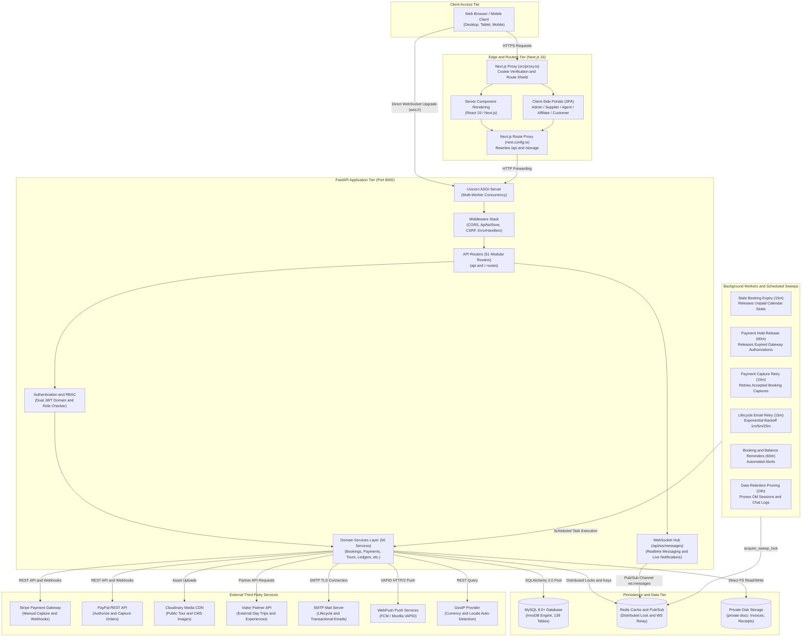

---

## 2. Component Descriptions & Boundaries

### 2.1 Client Access Tier
Users connect via standard modern web browsers on desktop, tablet, and mobile devices. All public web traffic terminates at the Next.js edge router over HTTPS. WebSocket connections upgrade directly to the backend origin (`NEXT_PUBLIC_WS_URL`) over secure WebSockets (`wss://`).

### 2.2 Edge & Routing Tier (Next.js 16)
- **`src/proxy.ts`**: Implements Next.js 16's server-side proxy convention (formerly middleware). Checks for the presence of the `tourvaa_access` session cookie on all protected portal routes (`/admin/*`, `/customer/*`, `/supplier/*`, `/agent/*`, `/affiliate/*`) before serving React Server Components. Redirects unauthenticated requests to their role-specific login routes (`/admin/login`, `/customer/login`, etc.).
- **`next.config.ts` Rewrites**: Configures reverse proxy rewrites from the frontend domain to `BACKEND_INTERNAL_URL:8000` for `/api/:path*` and `/storage/:path*`, allowing the client browser to execute same-origin API calls without CORS overhead.
- **Server Components (RSC)**: Renders initial page layouts server-side, pre-fetching static CMS, destination guides, and tour catalog data.
- **Client Portals (SPA)**: Highly interactive administrative, supplier, B2B wholesale, and customer portals built with React 19 client components (`"use client"`), Axios interceptors, and Tailwind CSS 4 styling.

### 2.3 FastAPI Application Tier (Port 8000)
- **Uvicorn ASGI Server**: Runs the FastAPI application with high-concurrency async event loops.
- **Middleware Stack**:
  - `ApiNoStoreMiddleware`: Enforces `Cache-Control: no-store, no-cache, must-revalidate` across all sensitive API routes.
  - `CORSMiddleware`: Enforces explicit origin validation for API and WebSocket clients.
  - `CSRFMiddleware`: Requires valid CSRF tokens on state-mutating requests (`POST`, `PUT`, `PATCH`, `DELETE`) for cookie-authenticated browser sessions.
  - `AppErrorHandlers`: Catches unhandled exceptions, logs forensic stack traces, and emits sanitized JSON error payloads (`{"success": false, "detail": "..."}`).
- **51 Modular Routers**: Organizes 594 endpoints into discrete domain routers registered via `app.include_router()`.
- **Authentication & RBAC**: Validates dual-domain JWT tokens (Admin domain vs Customer domain), enforces TOTP two-factor authentication, and evaluates fine-grained role-based permissions (`RequirePermission`).
- **Domain Services (56 Services)**: Decouples business logic from HTTP transport, orchestrating database transactions, external API interactions, and background jobs.
- **WebSocket Hub (`/api/ws/messages`)**: Manages real-time bidirectional messaging channels between travellers, suppliers, and customer support representatives.

### 2.4 Background Workers & Scheduled Sweeps
FastAPI lifespan background coroutines periodically execute maintenance sweeps using distributed Redis locks (`acquire_sweep_lock`) to prevent race conditions in horizontal multi-container deployments:
- **Stale Booking Expiry (every 15 min)**: Cancels pending bookings that have exceeded their reservation timeout, restoring calendar seats.
- **Payment Hold Release (every 60 min)**: Releases expired pre-authorization holds when suppliers decline or fail to confirm bookings within 4 days.
- **Payment Capture Retry (every 15 min)**: Retries gateway payment captures for confirmed bookings that encountered transient gateway timeouts.
- **Lifecycle Email Retry (every 15 min)**: Retries failed notification emails with exponential backoff intervals (1 min, 5 min, 25 min).
- **Booking Reminders (every 60 min)**: Dispatches upcoming departure reminders and balance-due payment notifications.
- **Data Retention Pruning (every 24 hours)**: Prunes expired session tokens, temporary verification codes, and stale audit records according to compliance policies.

### 2.5 Persistence & Data Tier
- **MySQL 8.0+ Database**: Primary relational data store utilizing the InnoDB storage engine, with 139 relational tables and 170 Alembic migration revisions.
- **Redis Cache & Pub/Sub**: Manages distributed mutex locks (`acquire_sweep_lock`), cached exchange rates, rate-limiting tokens, and WebSocket message fan-out across multiple Uvicorn worker processes.
- **Private Disk Storage**: Houses sensitive generated PDF invoices, itineraries, booking receipts, and partner KYC documentation in a protected filesystem directory (`private-docs/`) accessible only by authenticated backend services.

### 2.6 External Third-Party Services
- **Stripe**: Handles card pre-authorization, manual capture, refunds, and webhook events (`checkout.session.completed`, `payment_intent.succeeded`).
- **PayPal**: Handles international wallet transactions using PayPal v2 Orders (Authorize and Capture APIs).
- **Cloudinary**: Serves as the primary content delivery network (CDN) for tour gallery images, destination banners, and user avatar uploads.
- **Viator**: Synchronizes external day tours, activities, and live pricing via the Viator Partner API.
- **SMTP Server**: Dispatches transactional and lifecycle emails over TLS (Port 587 / 465).
- **WebPush / VAPID**: Broadcasts browser push notifications for booking status updates and incoming messages.
- **GeoIP Providers**: Automatically detects incoming user currency and locale from client IP addresses.


---

## 1.2 Next.js 16 Multi-Portal App Router Component Tree

This document details the Next.js 16 App Router component architecture, portal layouts, route guards, state providers, and client-server boundaries of the Tourvaa frontend (`tourvaa-admin-frontend`).

---

## 1. Frontend Architecture Diagram

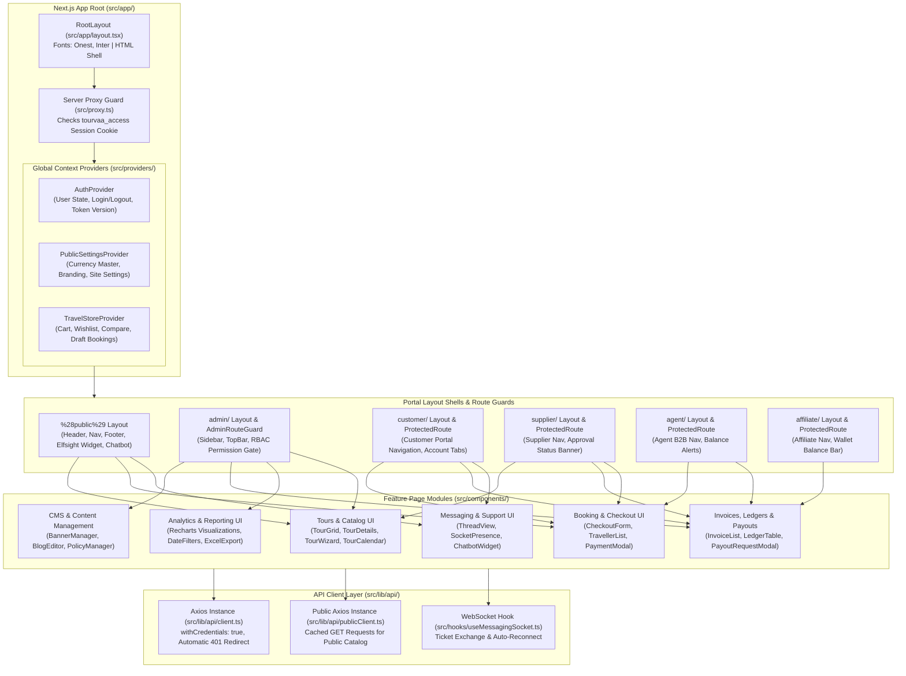

---

## 2. Component Hierarchy & Navigation Flow

### 2.1 Route Guarding Strategy
The application employs **two-tier defense-in-depth route guarding**:
1. **Server-Side Edge Guard (`src/proxy.ts`)**:
   - Executes before React Server Components render.
   - Evaluates incoming paths against `PROTECTED_PREFIXES` (`/admin`, `/customer`, `/agent`, `/supplier`, `/affiliate`).
   - If the request lacks the `tourvaa_access` session cookie, it immediately redirects to `/login` (or `/admin/login`) with `?redirect=<target_path>`.
   - Also normalizes trailing slashes to prevent duplicate routing loops.
2. **Client-Side Component Guards (`ProtectedRoute` & `AdminRouteGuard`)**:
   - Inspects the decoded user claims in `AuthProvider`.
   - Checks role assignment (`super-admin`, `admin`, `supplier`, `agent-reseller`, `customer`, `affiliate`).
   - For administrative pages, cross-references granular permissions (e.g. `tours.view`, `bookings.edit`) via `useAdminModules` before mounting sensitive panels.
   - For suppliers and agents, inspects `approval_status` and blocks operational views if approval is still pending.

### 2.2 Global State Management
- **`AuthProvider`**: Manages user authentication state, active portal mapping, and account session tokens. Intercepts backend logout and password-change token invalidations.
- **`PublicSettingsProvider`**: Synchronizes platform-level configuration (company contact information, active currency lists, exchange rates, and branding metadata) across all public pages.
- **`TravelStoreProvider`**: Manages browser-local shopping cart items, tour comparison selections, saved wishlist items, and guest checkout draft payloads using `localStorage`.

### 2.3 Realtime Messaging Hook (`useMessagingSocket`)
- Requests single-use authentication tickets via `POST /api/messaging/ws/ticket` through the same-origin Next.js proxy.
- Establishes a direct WebSocket connection to `NEXT_PUBLIC_WS_URL/api/ws/messages?ticket=<token>`.
- Maintains heartbeat pings every 30 seconds.
- Dispatches realtime UI updates for new booking messages, admin notices, and unread badge counters.


---

## 1.3 FastAPI Service Layer & Request Lifecycle

This document describes the internal architecture of the Tourvaa FastAPI backend (`tourvaa-admin-backend`), detailing application startup, middleware sequencing, route dispatching, dependency injection, and data persistence.

---

## 1. Backend Architecture & Request Flow Diagram

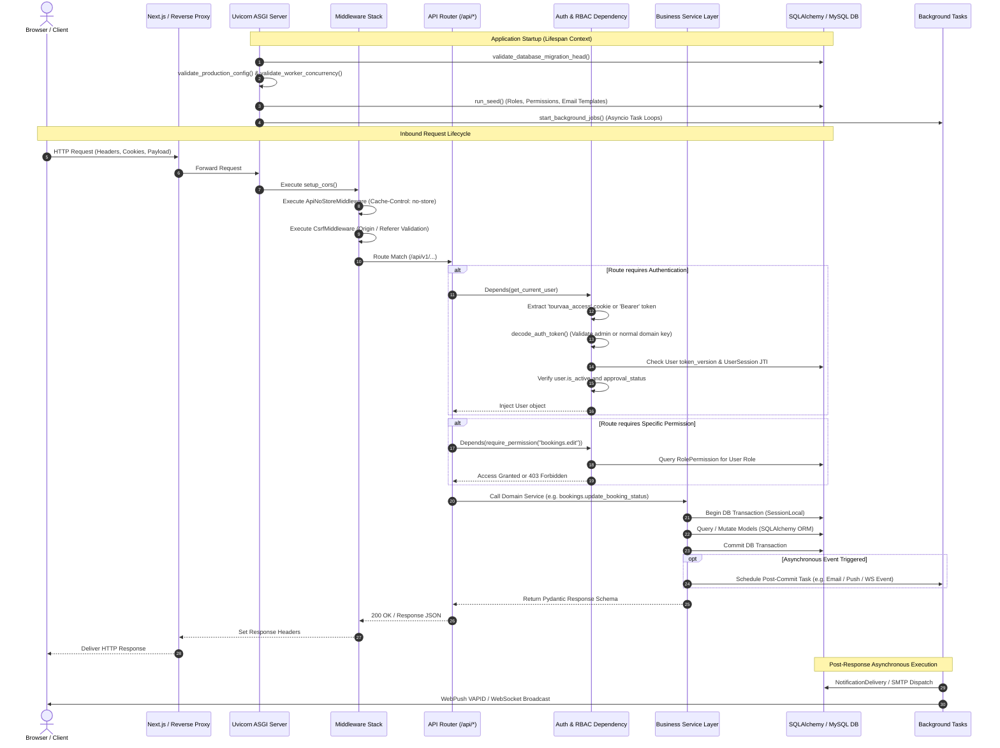

---

## 2. Request-Response Lifecycle Stages

### Stage 1: Lifespan Startup & Self-Healing Guards
When the FastAPI process boots, `_lifespan` in [`app/main.py`](../../../tourvaa-admin-backend/app/main.py) executes:
1. **Migration Verification**: Compares Alembic code heads to running database heads. Discrepancies abort the server to prevent queries against outdated schemas.
2. **Production Hardening Checks**: Validates strong secrets, verifies debug mode is off, and ensures separate admin and normal domain keys.
3. **Concurrency Guard**: Ensures `REDIS_URL` is set if `WEB_CONCURRENCY > 1`.
4. **Automated Seeding**: Executes `run_seed()` to backfill any newly introduced roles, admin modules, or email templates.
5. **Background Sweeps Launch**: Starts 12 distinct background coroutines for payment hold releases, booking expirations, balance alerts, and email retries.

### Stage 2: Middleware Stack
Every request passes through three custom middlewares:
1. **CORS Middleware**: Evaluates origin against `ALLOWED_ORIGINS` (fails closed if wildcard in production).
2. **ApiNoStore Middleware**: Enforces `Cache-Control: no-store, no-cache, must-revalidate, max-age=0` to ensure user sessions are never cached by intermediate proxies or browser history.
3. **CSRF Middleware**: Validates that state-modifying requests (`POST`, `PUT`, `DELETE`, `PATCH`) carry an `Origin` or `Referer` matching allowed platform hosts.

### Stage 3: Routing & Dependency Injection
- API routers are segregated into 4 logical groups (`CORE_ROUTERS`, `PARTNER_AND_CUSTOMER_ROUTERS`, `CONTENT_AND_TOUR_ROUTERS`, `OPERATIONS_ROUTERS`) and registered under `/api`.
- Request schemas are validated using **Pydantic v2**, rejecting malformed data with `422 Unprocessable Entity` before hitting business logic.
- Authentication dependencies (`get_current_user`, `require_permission`) inspect the JWT domain, session table, and role permission mappings.

### Stage 4: Business Service Layer & Transaction Boundaries
- Router endpoints never perform raw database queries directly. They delegate to dedicated service modules in `app/services/`.
- All database modifications take place within explicit SQLAlchemy session boundaries.
- Critical operations (such as payment captures and supplier acceptance) utilize transaction commits before triggering post-commit notifications.

### Stage 5: Asynchronous Post-Commit Execution
- Emails, push notifications, and WebSocket broadcasts are never performed synchronously inside request threads.
- Instead, services enqueue records into `notification_deliveries` and trigger non-blocking `BackgroundTasks` to ensure that external network delays never slow down user requests.


---

## 1.4 139-Table Relational Database Domain ERD

This document presents the Entity-Relationship Diagram (ERD) of the core database entities in the Tourvaa platform, modeling the relationships across users, tours, bookings, payments, invoices, suppliers, agents, and affiliates.

---

## 1. Core Domain Entity-Relationship Diagram

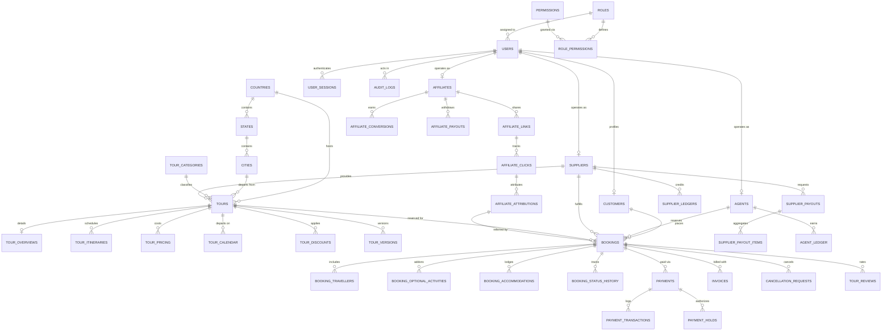

---

## 2. Core Entity Descriptions & Primary Keys

| Entity Name | Primary Key | Description & Role in Architecture |
|---|---|---|
| `users` | `id` (int) | Master user identity record containing email, password hash, status, 2FA flag, and lockout parameters. |
| `roles` | `id` (int) | System and custom RBAC roles (`super-admin`, `admin`, `supplier`, `agent-reseller`, `customer`, `affiliate`). |
| `permissions` | `id` (int) | Granular permission catalog mapping action (`get`, `post`, `put`, `delete`) to module slugs. |
| `customers` | `id` (int) | Customer profile linking to `users.id`, holding contact address, emergency contacts, and nationality. |
| `suppliers` | `id` (int) | Tour operator identity linking to `users.id`, tracking approval status, commission rates, and banking. |
| `agents` | `id` (int) | B2B travel agent profile linking to `users.id`, holding trade license, credit limits, and agency details. |
| `affiliates` | `id` (int) | Marketing affiliate profile linking to `users.id`, holding referral codes, tax IDs, and payout methods. |
| `tours` | `id` (int) | Core tour catalog record with slug, destination link, durations, starting price, and publishing status. |
| `tour_versions` | `id` (int) | Immutable snapshot of tour edits submitted for review; prevents live tour corruption before admin approval. |
| `tour_calendar` | `id` (int) | Individual departure calendar date entry tracking available seats, departure status, and cutoff rules. |
| `bookings` | `id` (int) | The central transaction hub of Tourvaa. Links tour, dates, customer, agent, supplier, and financial state. |
| `booking_travellers`| `id` (int) | Detailed passenger manifests containing full names, passport details, DOB, and dietary requirements. |
| `payments` | `id` (int) | Payment tracking record storing gateway transaction ID, captured amount, currency, and authorization status. |
| `payment_holds` | `id` (int) | Explicit record of pre-authorization holds held with Stripe/PayPal pending supplier booking acceptance. |
| `invoices` | `id` (int) | Formal commercial invoice issued to customers or agents, tracking invoice number, GST, and balance due. |
| `supplier_ledgers`| `id` (int) | Double-entry ledger tracking net tour amounts credited to suppliers, platform commission, and debits. |
| `agent_ledger` | `id` (int) | Commercial account statement tracking agent commissions, customer direct payments, and remittances. |
| `affiliate_links` | `id` (int) | Custom referral links (`/r/{code}`) configured with attribution window days and destination redirects. |
| `affiliate_conversions` | `id` (int) | Commission records generated upon successful checkout attribution, linked to booking financial records. |


---

## 1.5 Containerized Docker Ingress & Production Topology

This document outlines the containerized deployment architecture for the Tourvaa platform, illustrating the runtime topologies for frontend, backend, background workers, reverse proxy ingress, database clustering, and state persistence.

---

## 1. Production Deployment Topology Diagram

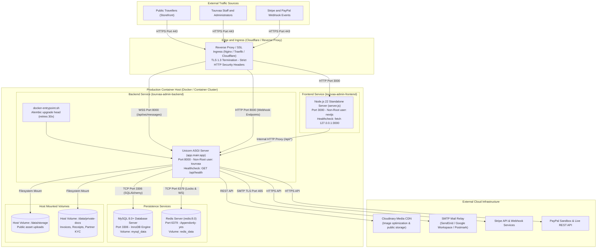

---

## 2. Infrastructure & Container Components

### 2.1 Edge Ingress & Reverse Proxy
- **TLS Termination**: All incoming traffic arrives on port 443 with modern TLS (TLS 1.2/1.3).
- **Reverse Proxy Routing**:
  - `/*` routes forward to the Next.js frontend container on `http://frontend:3000`.
  - `/api/ws/messages` WebSocket upgrade requests are routed directly to the backend on `http://backend:8000`.
  - Direct webhook paths (`/api/payments/stripe/webhook`, `/api/payments/paypal/webhook`) can be routed directly to the backend to minimize hop latency.

### 2.2 Frontend Container (`tourvaa-admin-frontend`)
- **Base Image**: `node:22-alpine`.
- **Runtime User**: Runs as unprivileged user `nextjs:nodejs` (UID/GID 1001).
- **Standalone Build**: Leverages Next.js `output: "standalone"`, packing only necessary dependencies into `server.js` and reducing container size from ~1.2GB to <180MB.
- **Healthcheck**: Periodically polls `http://127.0.0.1:3000/` every 30 seconds.

### 2.3 Backend Container (`tourvaa-admin-backend`)
- **Base Image**: `python:3.12-slim`.
- **System Dependencies**: Includes `libgomp1` (required by ONNX runtime for FastEmbed embeddings).
- **Runtime User**: Runs as unprivileged user `tourvaa:tourvaa` (UID/GID 1001).
- **Entrypoint Script (`docker-entrypoint.sh`)**:
  - Checks `RUN_MIGRATIONS=true`.
  - Executes `python -m alembic upgrade head` with up to 30 retries, guaranteeing the database schema is up-to-date before Uvicorn starts.
- **Healthcheck**: Queries `http://127.0.0.1:8000/api/health` every 30 seconds.

### 2.4 Data Persistence Volumes
- **MySQL Volume (`/var/lib/mysql`)**: Ensures durable database records survive container updates.
- **Redis Volume (`/data`)**: Configured with `appendonly yes` for persistent distributed lock keys and rate-limit tracking.
- **Storage Volume (`/data/storage`)**: Houses static asset uploads served via `/storage`.
- **Private Docs Volume (`/data/private-docs`)**: Stores generated PDF invoices, itineraries, booking receipts, and partner business documents outside the public web root.


---

## 1.6 System Module Dependency Graph

This document details the inter-module dependency graph, showcasing the communication pathways and data flow among all 20 business modules in the Tourvaa platform.

---

## 1. Complete System Module Dependency Graph

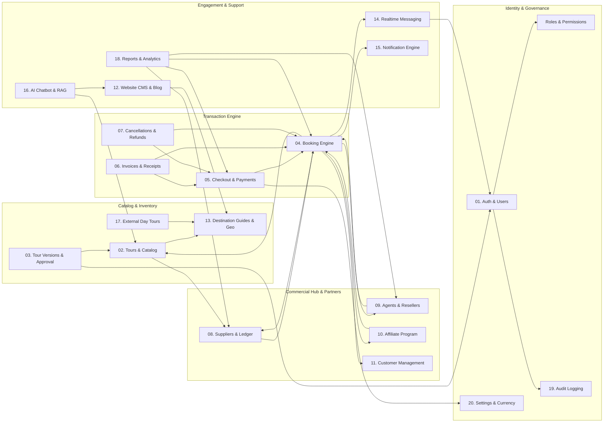

---

## 2. Structural Layering & Separation of Concerns

The architecture strictly adheres to a layered hierarchy:
1. **Foundation Tier**: Database engines, Redis cache, filesystem roots, encryption utilities (`app/utils/money.py`, `app/utils/distributed_lock.py`).
2. **Persistence Tier**: 138 SQLAlchemy declarative models in `app/models/` defining primary keys, indexes, foreign key constraints, and cascade policies.
3. **Domain Service Tier**: 56 business domain services in `app/services/` encapsulating business logic, calculation formulas, and external API requests.
4. **Interface / Transport Tier**: 51 FastAPI routers in `app/routers/` handling HTTP request deserialization, Pydantic validation, authorization dependencies, and JSON serialization.
5. **Client Presentation Tier**: Next.js 16 frontend consuming the API via same-origin proxied HTTP requests and direct WebSocket streams.


---

## 1.7 Dual-Domain JWT Authentication & Cookie Security Flow

This document details the authentication and authorization lifecycle in Tourvaa, encompassing credential login, dual-domain JWT validation, 2FA with TOTP, session tracking, password reset token rotation, and RBAC permission checks.

---

## 1. Login & Token Lifecycle Sequence Diagram

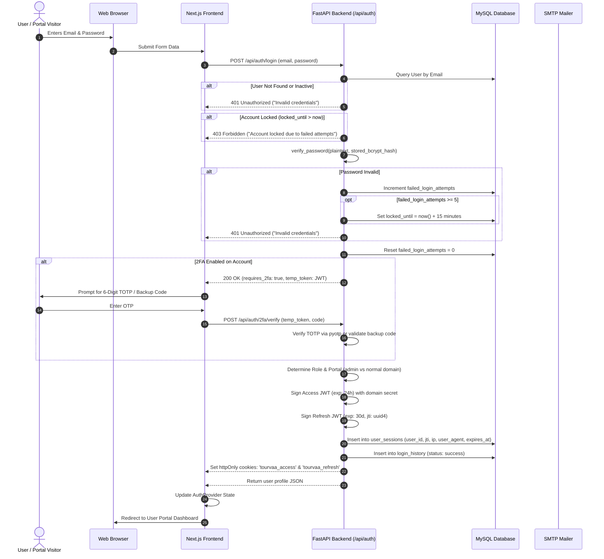

---

## 2. Authorization Decision Flowchart

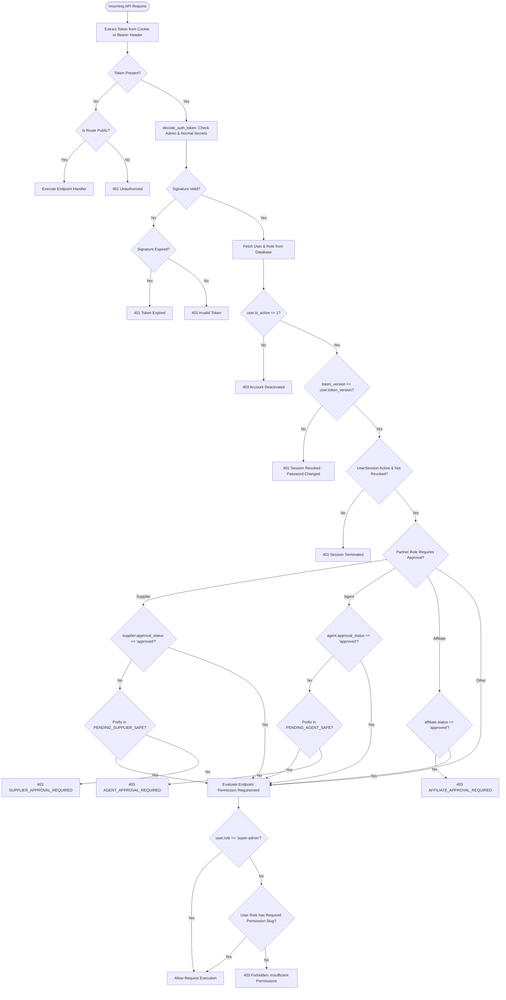

---

## 3. Key Security Properties

1. **Dual Cryptographic Domains**:
   - The administration interface uses `ADMIN_JWT_SECRET_KEY`.
   - External portal users (customers, suppliers, agents, affiliates) use `NORMAL_JWT_SECRET_KEY`.
   - Even if a customer obtains a valid token, it is cryptographically rejected by administrative endpoints because the token domain claim is strictly verified.
2. **Revocation via `token_version`**:
   - When a user changes their password or clicks "Sign out everywhere", the database increments `user.token_version`.
   - All outstanding JWTs become instantly invalid, preventing session replay.
3. **Defense Against Brute Force**:
   - Consecutive login failures are counted in `failed_login_attempts`.
   - Upon the 5th failed attempt, `locked_until` is populated with `now() + 15 minutes`.
   - The API short-circuits attempts during lockout without verifying the password, mitigating timing attacks.


---

## 1.8 6-State Booking Lifecycle & Auto-Expiry State Machine

This document models the complete booking lifecycle in Tourvaa, detailing the state machine, seat reservation mechanics, supplier acceptance requirements, payment hold-to-capture sequence, and customer receipt generation.

---

## 1. Booking State Transition Diagram

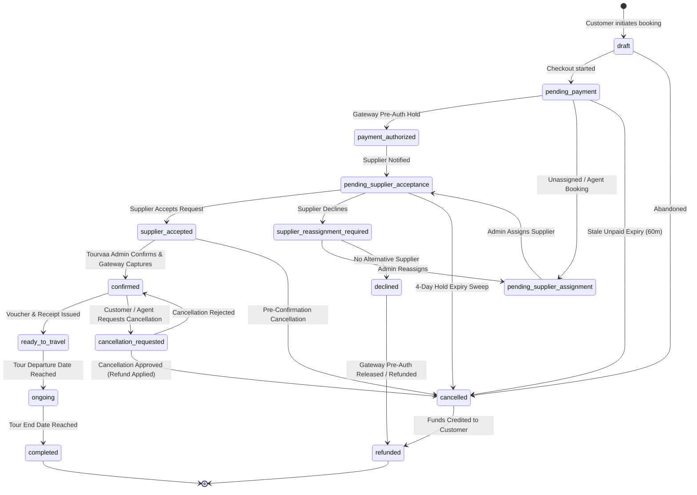

---

## 2. End-to-End Booking Sequence Walkthrough

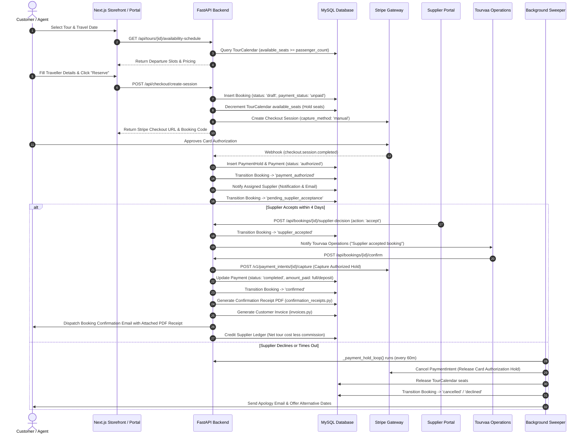

---

## 3. Critical Business Rules Verified from Source Code

1. **Payment Authorization Is Not Final Confirmation**:
   - As stated in [`app/services/payments.py`](../../../tourvaa-admin-backend/app/services/payments.py) line 21: *"A payment authorization is not a receipt and supplier acceptance is not the customer-facing final confirmation."*
   - Stripe card authorizations use `capture_method="manual"` to place an authorized hold without debiting the customer immediately.
2. **Four-Day Supplier Decision Window**:
   - The automated background worker `_payment_hold_loop()` periodically cancels authorizations before they expire on the gateway, preventing funds from hanging in customer bank accounts if a supplier is unresponsive.
3. **Seat Holding & Stale Booking Expiry**:
   - Unpaid bookings in `pending_payment` hold seats in `TourCalendar`. The coroutine `_expire_stale_bookings_loop()` runs every 15 minutes and automatically releases seats if payment is not authorized within `BOOKING_EXPIRY_HOLD_MINUTES` (60 minutes).
4. **Immutable Confirmation Receipts**:
   - Final booking receipts (`booking-confirmation-{id}-v2.pdf`) are stored in `private-docs/booking-confirmations/` upon initial confirmation. They are immutable snapshots and are never dynamically recomputed from mutable database rows on later download.


---

## 1.9 Payment Pre-Authorization, Hold & Capture Decision Flow

This document details the payment gateway interaction architecture for Stripe and PayPal, demonstrating how funds are pre-authorized upon checkout, held in escrow during supplier evaluation, captured upon final confirmation, or released/refunded upon rejection or cancellation.

---

## 1. Payment Lifecycle Architecture Diagram

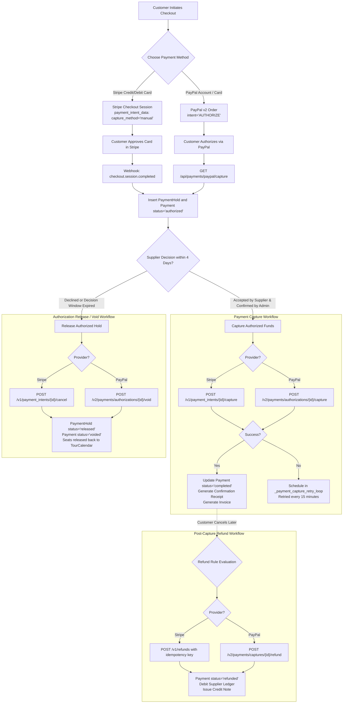

---

## 2. Key Gateway Integration Mechanisms

### 2.1 Webhook Signature Validation
1. **Stripe Webhook (`construct_event`)**:
   - Parses the `Stripe-Signature` header for timestamp `t` and signature `v1`.
   - Computes HMAC-SHA256 signature using `STRIPE_WEBHOOK_SECRET` over `${t}.${raw_body}`.
   - Rejects stale webhooks where `abs(time.time() - int(t)) > 300` (5-minute replay defense).
   - Validates using constant-time string comparison (`hmac.compare_digest`).

2. **PayPal Webhook (`verify_webhook_signature`)**:
   - Compares incoming transmission headers (`PAYPAL-AUTH-ALGO`, `PAYPAL-TRANSMISSION-ID`, `PAYPAL-CERT-URL`, `PAYPAL-TRANSMISSION-SIG`, `PAYPAL-TRANSMISSION-TIME`).
   - Verifies against `PAYPAL_WEBHOOK_ID` configured for the production API endpoint.

### 2.2 Idempotency & Fault Tolerance
- All Stripe captures, voids, and refunds supply a unique `Idempotency-Key` (e.g. `capture-{payment.id}-{attempt}`).
- If gateway capture fails due to temporary network partitions after supplier acceptance, the record enters retry state and is automatically re-attempted by `_payment_capture_retry_loop()` every 15 minutes.


---

## 1.10 30-Day Cookie Affiliate Referral & Commission Engine

This document details the tracking, attribution, commission calculation, and wallet payout mechanics of the Tourvaa Affiliate Marketing system.

---

## 1. Affiliate Referral & Attribution Architecture Diagram

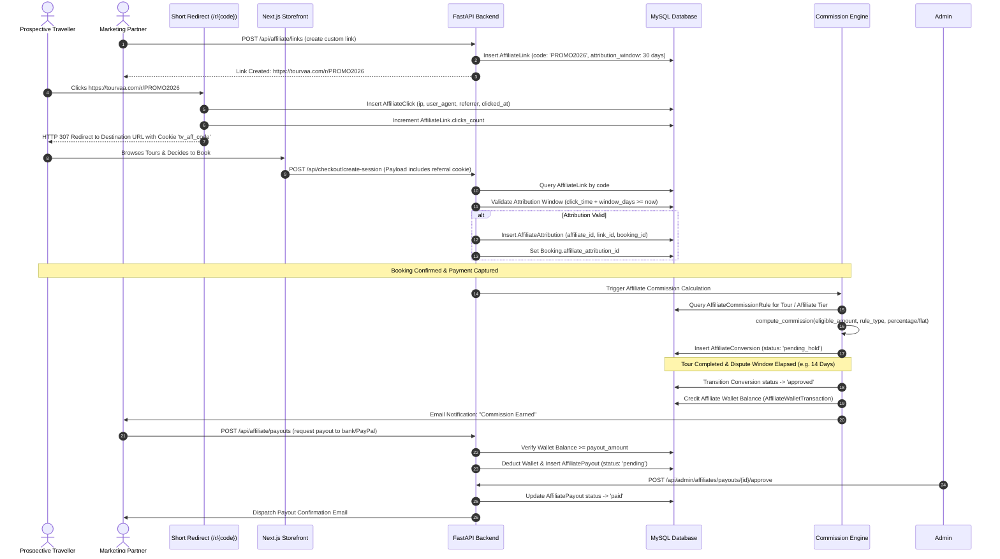

---

## 2. Commission Calculation Rules & Slabs

- **Rule Types**: Supports both `percentage` (e.g. 5% of net tour price) and `fixed` amounts (e.g. $50 per booking).
- **Attribution Logic**: First-touch or last-touch attribution within configurable attribution windows (default: 30 days).
- **Fraud Prevention**: Commissions remain in `pending_hold` status until the tour travel date has completed and cancellation dispute periods have expired. Cancelled or refunded bookings automatically invalidate associated pending conversions.


---

## 1.11 WebSocket Realtime Messaging & Persistence Hub

This document details the WebSocket architecture in Tourvaa, explaining the ticket minting protocol, cross-worker Redis pub/sub messaging, presence tracking, and conversation thread synchronization.

---

## 1. WebSocket Connection & Messaging Architecture

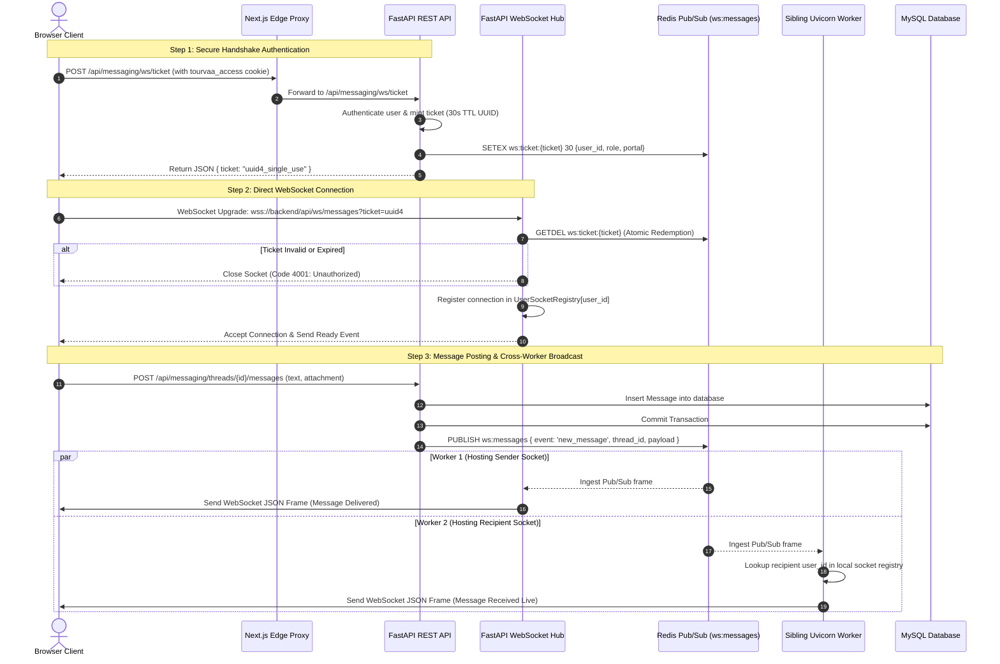

---

## 2. Technical Highlights

1. **Ticket-Based Handshake**:
   - Web browsers cannot set custom headers during native `new WebSocket()` upgrades.
   - Cross-origin WebSocket handshakes bypass the Next.js same-origin rewrite proxy.
   - Tourvaa mints a single-use, 30-second Redis-backed ticket via an authenticated same-origin REST request, then passes it as a query param. The ticket is immediately destroyed upon connection (`GETDEL`).
2. **Multi-Worker Scaling via Redis**:
   - In production environments where `WEB_CONCURRENCY > 1`, user sockets are distributed across different OS processes.
   - The Redis pub/sub channel `ws:messages` guarantees that any message published by worker A immediately broadcasts to worker B holding the recipient's socket.
3. **Presence & Heartbeats**:
   - Sockets emit periodic ping/pong frames (`PRESENCE_TTL_SECONDS = 75`).
   - Connections are capped at `MAX_SOCKETS_PER_USER = 5` to prevent resource starvation.


---

# SECTION 3: End-to-End Business Module Workflows (20 Modules)

Every business module within Tourvaa is governed by a dedicated workflow state machine and decision tree. The following 20 flowcharts document the exact runtime logic and data state transitions:

## Module 01: Module 01: Authentication & User Management

### Workflow Architecture Flowchart

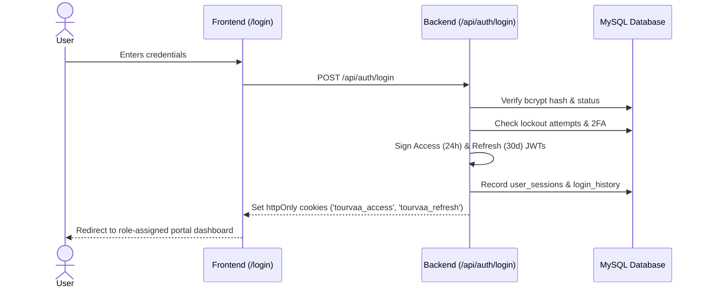

---

## Module 02: Module 02: Tours & Catalog Engine

### Workflow Architecture Flowchart

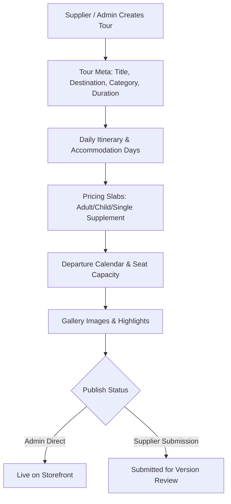

---

## Module 03: Module 03: Tour Versioning & Approval System

### Workflow Architecture Flowchart

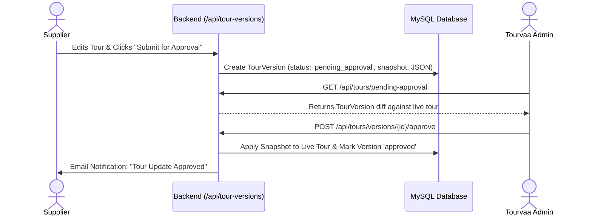

---

## Module 04: Module 04: Booking Engine & Lifecycle Management

### Workflow Architecture Flowchart

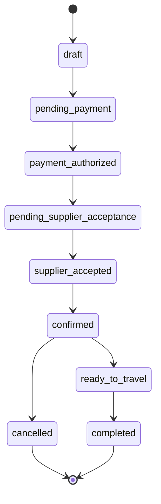

---

## Module 05: Module 05: Checkout & Payment Gateway Processing

### Workflow Architecture Flowchart

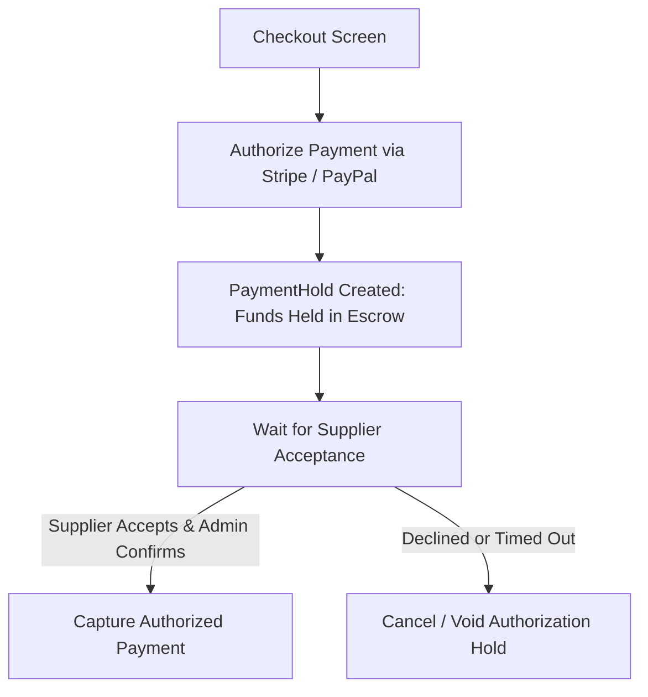

---

## Module 06: Module 06: Invoices & Financial Confirmation Receipts

### Workflow Architecture Flowchart

```mermaid
flowchart LR
    BOOKING[Confirmed Booking] --> INVOICE[Generate Invoice with Tax / GST]
    BOOKING --> RECEIPT[Generate Confirmation Receipt PDF]
    INVOICE --> REMIND[Balance Due Reminders (60m loop)]
    RECEIPT --> DOWNLOAD[Customer / Agent Downloads from Portal]
```

---

## Module 07: Module 07: Cancellations & Refund Management

### Workflow Architecture Flowchart

```mermaid
sequenceDiagram
    actor C as Customer
    participant API as Backend (/api/cancellations)
    participant DB as MySQL Database
    participant GW as Stripe / PayPal
    C->>API: POST /api/cancellations/request (booking_id, reason)
    API->>DB: Evaluate RefundRule (days before departure cutoff)
    API->>DB: Insert CancellationRequest (status: 'pending_review')
    Admin->>API: POST /api/cancellations/{id}/approve
    API->>GW: create_refund(payment_intent_id, refund_amount)
    API->>DB: Update Payment status='refunded' & Booking status='cancelled'
    API->>C: Email Notification with Refund Credit Note
```

---

## Module 08: Module 08: Suppliers Management & Financial Ledger

### Workflow Architecture Flowchart

```mermaid
flowchart TD
    REG[Supplier Registers] --> KYC[Uploads Business Info, Vehicles, Docs]
    KYC --> ADMIN_APP[Admin Approves Account]
    ADMIN_APP --> OPERATE[Supplier Lists Tours & Accepts Bookings]
    OPERATE --> EARN[Net Tour Cost Credited to SupplierLedger]
    EARN --> PAYOUT[Supplier Requests Payout]
    PAYOUT --> ADMIN_PAY[Admin Dispatches Wire Transfer / PayPal]
```

---

## Module 09: Module 09: B2B Agents & Reseller Portal

### Workflow Architecture Flowchart

```mermaid
flowchart LR
    AGENT[B2B Agent] --> BOOK[Reserves Tour on Behalf of Client]
    BOOK --> COMM[Agent Commission Credited to AgentLedger]
    BOOK --> MARKUP[Optional Agent Client Markup Applied]
    COMM --> STATEMENT[Monthly Commission Statement Generated]
    STATEMENT --> SETTLE[Commission Payout / Direct Deduction]
```

---

## Module 10: Module 10: Affiliate Marketing & Tracking Engine

### Workflow Architecture Flowchart

```mermaid
sequenceDiagram
    actor A as Affiliate
    participant Link as Redirect (/r/{code})
    actor V as Visitor
    participant API as Backend
    participant DB as MySQL Database
    A->>API: Create Referral Link
    V->>Link: Clicks Link
    Link->>DB: Log AffiliateClick & Set Cookie
    Link-->>V: Redirect to Destination Page
    V->>API: Books Tour
    API->>DB: Record Attribution & Pending Conversion
    API->>DB: Credit Affiliate Wallet after Tour Completion
```

---

## Module 11: Module 11: Customer Management & Traveller Portal

### Workflow Architecture Flowchart

```mermaid
flowchart TD
    CUST[Customer Account] --> TRAV[Saved Travellers Manifests]
    CUST --> WISH[Tour Wishlist Items]
    CUST --> HIST[Booking & Invoice History]
    WISH --> SWEEP[_wishlist_reminder_loop (24h)]
    SWEEP --> EMAIL[Automated Email: 'Tours in your wishlist are filling up!']
```

---

## Module 12: Module 12: Website CMS & Travel Blog

### Workflow Architecture Flowchart

```mermaid
flowchart LR
    ADMIN[Admin CMS Panel] --> BANNERS[Homepage Banners & Video]
    ADMIN --> BLOGS[Blog Articles & SEO Meta]
    ADMIN --> DEALS[Deals & Promotional Popups]
    BANNERS --> STOREFRONT[Next.js Public Storefront]
    BLOGS --> STOREFRONT
    DEALS --> STOREFRONT
```

---

## Module 13: Module 13: Destination Guides & Geo Reference

### Workflow Architecture Flowchart

```mermaid
flowchart TD
    GEO_DB[Geo Database: Country/State/City] --> DEST_PAGE[Destination Guide: /destinations/{slug}]
    DEST_PAGE --> HERO[Hero Section & Country Map]
    DEST_PAGE --> WHY[Why Visit & Best Time to Go]
    DEST_PAGE --> TOURS_LIST[Curated Multi-Day Tours in Country]
    DEST_PAGE --> EXT_TOURS[Viator External Day Trips]
```

---

## Module 14: Module 14: Realtime Messaging & Customer Support

### Workflow Architecture Flowchart

```mermaid
sequenceDiagram
    actor C as Customer
    participant WS as WebSocket Hub (/ws/messages)
    participant Redis as Redis Pub/Sub
    actor S as Supplier
    C->>WS: Sends Booking Message
    WS->>Redis: Publish Event
    Redis-->>WS: Broadcast to Sockets
    WS-->>S: Realtime Push Notification & Chat Frame
```

---

## Module 15: Module 15: Notification Engine: Email & WebPush

### Workflow Architecture Flowchart

```mermaid
flowchart TD
    EVENT[Lifecycle Event: Booking / Payment] --> DISPATCH[dispatch_lifecycle_email / push]
    DISPATCH --> DB_DELIV[NotificationDelivery Created]
    DB_DELIV --> SEND{SMTP / VAPID Success?}
    SEND -- Yes --> SUCCESS[Status: Delivered]
    SEND -- No --> RETRY[Retry Queue: Exponential Backoff (1m, 5m, 25m)]
```

---

## Module 16: Module 16: AI Travel Assistant & RAG Engine

### Workflow Architecture Flowchart

```mermaid
flowchart TD
    USER[Visitor Asks Question] --> EMBED[FastEmbed: Generate Query Vector]
    EMBED --> COSINE[Cosine Similarity against chat_embeddings]
    COSINE --> CONTEXT[Retrieve Matching FAQs & Tour Highlights]
    CONTEXT --> PROMPT[Assemble Grounded Assistant Response]
    PROMPT --> REPLY[Deliver Instant Answer & Relevant Tour Cards]
```

---

## Module 17: Module 17: External Day Tours (Viator Integration)

### Workflow Architecture Flowchart

```mermaid
sequenceDiagram
    actor V as Visitor
    participant FE as Storefront (/external-day-trips)
    participant API as Backend (/api/public/external-tours)
    participant Viator as Viator Partner API
    FE->>API: GET /api/public/external-tours?destination=407
    API->>Viator: Request Destination Day Trips (API Key & PID)
    Viator-->>API: Returns Tours Manifest
    API-->>FE: Formatted Day Trips with Affiliate Tracking Link
    V->>Viator: Completes Booking on Viator.com (Campaign tagged)
```

---

## Module 18: Module 18: Reporting & Business Analytics

### Workflow Architecture Flowchart

```mermaid
flowchart TD
    SCHED[Report Schedule: Daily / Weekly / Monthly] --> SWEEP[_report_schedule_loop (60m)]
    SWEEP --> QUERY[Query Aggregated Sales, Invoices & Commissions]
    QUERY --> EXCEL[Generate OpenPyXL Spreadsheet]
    EXCEL --> EMAIL[Dispatch to Admin / Financial Stakeholders]
```

---

## Module 19: Module 19: Audit Logging & Platform Governance

### Workflow Architecture Flowchart

```mermaid
flowchart LR
    ACTION[Admin / Partner Mutation] --> LOG[log_audit(db, action, entity, before, after)]
    LOG --> DB_AUDIT[(audit_logs Table - Immutable)]
    LOGIN[Login Attempt] --> DB_LOGIN[(login_history Table)]
    DB_AUDIT -. Deliberately Excluded from Retention Pruning .-> COMPLIANCE[Long-term Compliance Record]
```

---

## Module 20: Module 20: Platform Settings & Multi-Currency Engine

### Workflow Architecture Flowchart

```mermaid
flowchart TD
    SETTINGS_DB[Encrypted DB Settings] --> AES[AES-256 Decrypt via SETTINGS_ENCRYPTION_KEY]
    AES --> GATEWAY[Stripe / PayPal Runtime Credentials]
    GEOIP[Visitor IP] --> CURRENCY[Currency Master: Auto-Detect Browsing Currency]
    CURRENCY --> CONVERT[Display Converted Storefront Prices]
```

---

# SECTION 4: Developer Handover Sequence Flowcharts

The following sequence diagrams guide incoming engineers through runtime request traces, session management, and rolling deployments:

### Authentication Sequence

# Authentication & Authorization Sequence Diagram

```mermaid
sequenceDiagram
    autonumber
    actor User as User
    participant Browser as Web Browser
    participant API as FastAPI Backend
    participant DB as MySQL Database

    User->>Browser: Enters credentials on /login
    Browser->>API: POST /api/auth/login
    API->>DB: Fetch user by email
    API->>API: Verify bcrypt password hash
    API->>DB: Check 2FA & active account status
    API->>API: Sign Access (24h) & Refresh (30d) JWTs
    API->>DB: Record session in user_sessions table
    API-->>Browser: Set-Cookie: tourvaa_access, tourvaa_refresh, tourvaa_csrf
    Browser-->>User: Redirect to role-assigned dashboard
```


---

### Database Erd

# Core Database Entity-Relationship Diagram (ERD)

```mermaid
erDiagram
    users ||--o| customers : extends
    users ||--o| suppliers : extends
    users ||--o| agents : extends
    users ||--o| affiliates : extends

    tours ||--|{ tour_departures : has
    tours ||--|{ tour_itineraries : contains
    tours ||--|{ tour_pricing_tiers : defines

    bookings ||--|| tours : books
    bookings ||--|| customers : places
    bookings ||--o| agents : manages
    bookings ||--o| suppliers : operates
    bookings ||--|{ booking_items : includes
    bookings ||--|{ booking_passengers : lists
    bookings ||--o{ payments : generates
```


---

### Deployment Flow

# Production Deployment Flow Diagram

```mermaid
flowchart LR
    DEV["Developer Push to Git"] --> CI["CI Pipeline: Tests & Linting"]
    CI --> BUILD["Docker Build: Multi-Stage Images"]
    BUILD --> MIGRATE["One-Off Migration Job (alembic upgrade head)"]
    MIGRATE --> DEPLOY["Rolling Container Update (Port 3000 & 8000)"]
    DEPLOY --> HEALTH["Health Check Probe (/api/health)"]
    HEALTH --> LIVE["Traffic Switched to New Release"]
```


---

### Frontend Backend Flow

# Frontend-to-Backend Request Flow Diagram

```mermaid
sequenceDiagram
    autonumber
    participant UI as Next.js React Component
    participant Client as Axios API Client (client.ts)
    participant Auth as AuthProvider Context
    participant API as FastAPI Router
    participant DB as MySQL Database

    UI->>Client: api.get('/customer/bookings')
    Client->>Client: Attach X-CSRF-Token header from cookie
    Client->>API: HTTP GET /api/customer/bookings (with cookies)
    alt Access Token Expired (401)
        API-->>Client: 401 Unauthorized
        Client->>API: POST /api/auth/refresh-token
        API->>API: Verify refresh token & issue new access token
        API-->>Client: 200 OK (New tourvaa_access cookie)
        Client->>API: Retry original GET /api/customer/bookings
    end
    API->>DB: Query customer bookings
    DB-->>API: Booking records
    API-->>Client: 200 OK (JSON Data)
    Client-->>UI: Update TanStack Query cache & render table
```


---

### Module Workflows

# End-to-End Booking & Supplier Workflow Diagram

```mermaid
stateDiagram-v2
    [*] --> pending: Traveler selects tour departure
    pending --> pending_payment: Checkout intent created
    pending_payment --> confirmed: Payment succeeds (Stripe/PayPal)
    pending_payment --> expired: 60-min hold timeout
    confirmed --> supplier_assigned: Supplier notified of booking
    supplier_assigned --> accepted: Supplier accepts booking
    supplier_assigned --> declined: Supplier declines booking
    declined --> supplier_assigned: Admin reassigns alternative supplier
    accepted --> completed: Tour completed
    confirmed --> cancellation_requested: Traveler requests refund
    cancellation_requested --> cancelled: Admin approves refund
    cancelled --> [*]
    completed --> [*]
    expired --> [*]
```


---

### System Overview

# System Overview Architecture Diagram

```mermaid
flowchart TD
    subgraph Clients["Access Layer"]
        TRAV["Travelers / Public Users"]
        OPS["Operations & Admin Users"]
        PARTNERS["Suppliers / B2B Agents / Affiliates"]
    end

    subgraph Edge["Edge & Load Balancing"]
        NGINX["Nginx / Cloudflare (Port 443 / SSL)"]
    end

    subgraph AppTier["Application Compute Tier"]
        FE["Next.js 14 Frontend (Port 3000)"]
        BE["FastAPI Backend (Port 8000)"]
        CELERY["Celery Distributed Task Worker"]
    end

    subgraph DataTier["Data Persistence Tier"]
        MYSQL[("MySQL 8.0 (138 Tables)")]
        REDIS[("Redis Cache & Broker")]
        STORAGE[("Persistent Media Storage")]
    end

    Clients --> Edge
    Edge --> FE
    Edge --> BE
    FE -->|HTTP / Cookies| BE
    BE --> MYSQL
    BE --> REDIS
    CELERY --> REDIS
    CELERY --> MYSQL
    BE --> STORAGE
```


---

