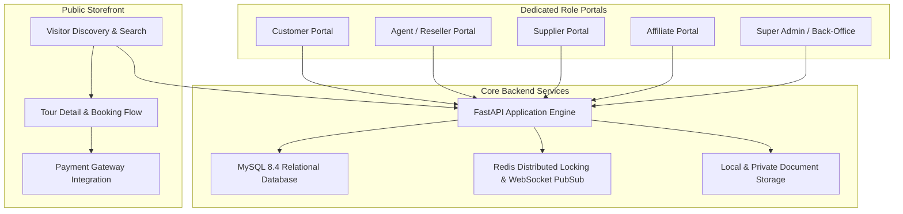

# Chapter 01 — Release Overview

## 1. Release Objective & Purpose

The purpose of this release candidate is to transition the Tourvaa multi-portal travel management platform into production readiness. Tourvaa is an enterprise full-stack booking engine, tour distribution platform, and back-office management system designed for multi-tier travel operations.

---

## 2. Release Scope & Platform Capabilities

### Key Business Domains Included
1. **Public Storefront & Booking Flow**: Dynamic destination search, curated package discovery, tour comparison, real-time availability pricing, and customer checkout.
2. **Multi-Role Portals**: Distinct dashboards and access scopes for Customers, Agents/Resellers, Suppliers, Affiliates, and Back-Office Administrators.
3. **Financial & Invoicing Engine**: Commission calculations, markup rules, discount redemption, automated PDF invoice generation, and refund workflows.
4. **Payment Gateways**: Multi-gateway abstraction supporting Stripe, PayPal, and Razorpay with webhook-driven reconciliation and automated payment hold/capture routines.
5. **Real-Time Messaging & Notifications**: WebSocket messaging channels, customer-supplier communications, and background email/push delivery retry queues.
6. **Multi-Currency & Localization**: Real-time currency conversion rates, custom currency formatting, and dynamic multi-language widget lanes.

---

## 3. Release Metadata & Baseline Revision

| Attribute | Backend Specification | Frontend Specification |
|:---|:---|:---|
| **Repository Name** | `tourvaa-admin-backend` | `tourvaa-admin-frontend` |
| **Branch** | `main` | `main` |
| **Baseline Commit Hash** | `5fa0ce6eb1cfa734de2322c636750253f36d4bd0` | `90535feafc042dbd7673d43fee8e4097cf382057` |
| **Runtime Environment** | Python 3.12 (slim Debian bookworm) | Node.js 24 Alpine |
| **Framework & Engine** | FastAPI 0.139.2 (locked; baseline 0.115) / Starlette / Uvicorn | Next.js 16.4.3 (locked; baseline 15.5) / React 19.2.4 / TailwindCSS |
| **Database Engine** | MySQL 8.4 LTS (InnoDB, utf8mb4) | N/A (Connects via Backend REST API) |
| **Release Candidate Tag** | `v1.0.0-rc1` | `v1.0.0-rc1` |
