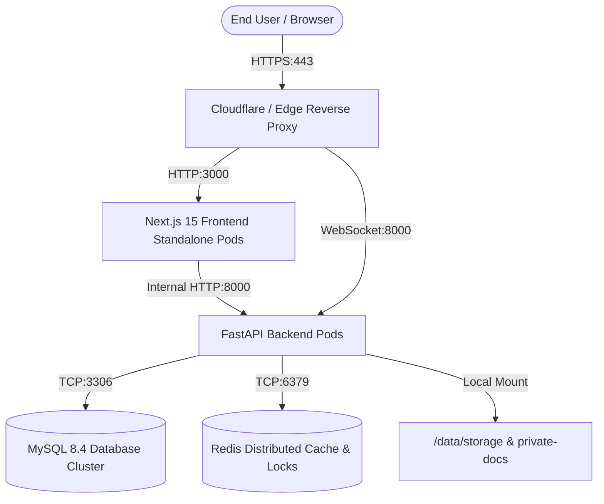

# Chapter 08 — Infrastructure & Environment Readiness

## 1. Production Topology & Architecture

---

## 2. Infrastructure Component Specifications

### 1. Frontend Infrastructure
- **Container Base**: `node:24-alpine`
- **Output Mode**: Next.js Standalone Mode (`NEXT_OUTPUT_STANDALONE=true`)
- **Exposed Port**: `3000`
- **Health Check**: Probes `http://127.0.0.1:3000/` every 30s with a 5s timeout.
- **Process User**: Unprivileged `nextjs:nodejs` user (UID/GID 1001).

### 2. Backend Infrastructure
- **Container Base**: `python:3.12-slim`
- **Process Manager**: Uvicorn with `--proxy-headers` and configurable `--workers`.
- **Exposed Port**: `8000`
- **Health Check**: Probes `http://127.0.0.1:8000/api/health` every 30s.
- **Process User**: Unprivileged `tourvaa:tourvaa` user (UID/GID 1001).
- **Persistent Volume**: `/data` mounted for storage and private document storage.

### 3. Database Infrastructure
- **Engine**: MySQL 8.4 LTS
- **Collation**: `utf8mb4_unicode_ci`
- **Connection Pooling**: SQLAlchemy QueuePool with `pool_size=10`, `max_overflow=20`, `pool_recycle=3600`, and `pool_pre_ping=True`.

### 4. Cache & Distributed Lock Infrastructure
- **Engine**: Redis 7.x
- **Key Functions**:
  1. Distributed lock coordinator for background task sweeps ([distributed_lock.py](../../tourvaa-admin-backend/app/utils/distributed_lock.py)).
  2. WebSocket PubSub messaging relay for real-time customer/supplier communications ([messaging_ws.py](../../tourvaa-admin-backend/app/services/messaging_ws.py)).
