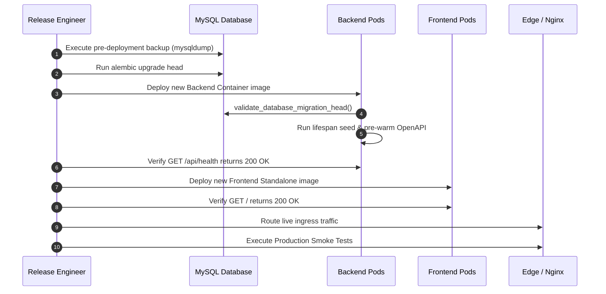

# Chapter 09 — Production Deployment Runbook

## 1. Pre-Deployment Verification Checklist

Before initiating production deployment:
- [ ] Confirm approved release candidate commit hashes:
  - Backend: `5fa0ce6eb1cfa734de2322c636750253f36d4bd0`
  - Frontend: `90535feafc042dbd7673d43fee8e4097cf382057`
- [ ] Verify that all 42 automated regression tests pass in CI.
- [ ] Ensure full database backup has completed within the last 15 minutes.
- [ ] Verify that production secrets (database credentials, JWT secret, encryption key) are loaded into the target secret vault.
- [ ] Notify customer support and schedule a 30-minute maintenance window if cold migrations are required.

---

## 2. Deployment Execution Sequence



---

## 3. Detailed Step-by-Step Deployment Commands

### Step 1: Database Pre-Deployment Snapshot
```bash
# Capture full database snapshot using a protected option file (chmod 600)
# (Avoid passing passwords via command line arguments to protect against ps aux snooping)
mysqldump --defaults-extra-file=/etc/mysql/secure_client.cnf \
  --single-transaction --routines --triggers --quick tourvaa > /backup/tourvaa_pre_deploy_$(date +%Y%m%d_%H%M%S).sql
```

### Step 2: Database Migration
```bash
cd /opt/tourvaa-backend
export DATABASE_URL="mysql+pymysql://${PROD_DB_USER}:${PROD_DB_PASS}@${PROD_DB_HOST}:3306/tourvaa"
python -m alembic upgrade head
python -m alembic current --check-heads
```

### Step 3: Backend Container Deployment
```bash
# Pull and start verified container image
docker pull ghcr.io/ayatiworks/tourvaa-admin-backend:v1.0.0-rc1

docker run -d \
  --name tourvaa-backend \
  --restart unless-stopped \
  --network tourvaa-net \
  -p 8000:8000 \
  -v /var/data/tourvaa:/data \
  --env-file /etc/tourvaa/backend.env \
  ghcr.io/ayatiworks/tourvaa-admin-backend:v1.0.0-rc1

# Verify backend health
curl -f http://127.0.0.1:8000/api/health || (echo "Backend health check failed!" && exit 1)
```

### Step 4: Frontend Container Deployment
```bash
# Pull and start verified frontend container
docker pull ghcr.io/ayatiworks/tourvaa-admin-frontend:v1.0.0-rc1

docker run -d \
  --name tourvaa-frontend \
  --restart unless-stopped \
  --network tourvaa-net \
  -p 3000:3000 \
  --env-file /etc/tourvaa/frontend.env \
  ghcr.io/ayatiworks/tourvaa-admin-frontend:v1.0.0-rc1

# Verify frontend health
curl -f http://127.0.0.1:3000/ || (echo "Frontend health check failed!" && exit 1)
```

### Step 5: Ingress Traffic Switch & Post-Deploy Verification
- Reload Nginx or update edge routing rules to direct ingress traffic to port 3000.
- Execute the [Production Smoke Tests](11-production-smoke-tests.md).
