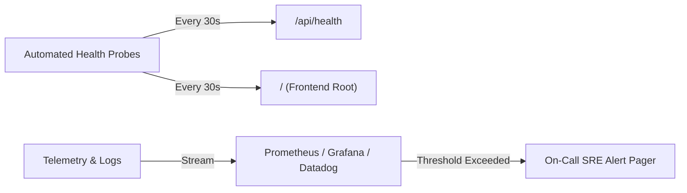

# Chapter 16 — Post-Release Monitoring & Telemetry Plan

## 1. Production Health Probes & Monitoring Metrics

---

## 2. Key Performance Indicators (KPIs) & Alert Thresholds

| Metric | Target SLA | Warning Threshold | Critical Alert Threshold | Action Plan |
|:---|:---:|:---:|:---:|:---|
| **API Response Latency (p95)** | < 150 ms | > 350 ms | > 1,000 ms | Scale backend pods; check database query bottlenecks |
| **HTTP 5xx Error Rate** | < 0.05% | > 0.5% | > 2.0% | Inspect backend logs; check database connection pool |
| **Frontend Page Load (LCP)** | < 2.0 s | > 3.0 s | > 4.5 s | Check edge CDN caching; optimize hero image delivery |
| **Database Connection Pool** | < 40% utilized | > 70% utilized | > 90% utilized | Check unclosed sessions; adjust `pool_size` and `max_overflow` |
| **WebSocket Connection Drops**| < 1% / hr | > 5% / hr | > 15% / hr | Check Redis PubSub health and edge timeout settings |

---

## 3. Log Aggregation & Incident Response Protocol

1. **Log Format**: All FastAPI backend logs are emitted in structured JSON format with severity levels (`INFO`, `WARNING`, `ERROR`, `CRITICAL`).
2. **First-Response Checklist**:
   - Check `/api/health` status and DB connectivity flag.
   - Query log aggregator for recent `ERROR` tracebacks.
   - If error rate exceeds 2%, initiate [Disaster Recovery Rollback Runbook](10-backup-rollback-recovery.md).
