# Module Dependencies Inventory & Dependency Graph

This document details the cross-module dependencies, inter-service calls, database linkages, and data-flow interactions across all functional modules in the Tourvaa platform.

---

## 1. High-Level Dependency Graph

```mermaid
graph TD
    AUTH[Authentication & Users] --> ROLES[Roles & Permissions]
    AUTH --> SESSIONS[User Sessions & Audit]
    
    TOURS[Tours & Catalog Engine] --> GEO[Geo Reference: Country/State/City]
    TOURS --> SUPPLIERS[Suppliers Management]
    TOURS --> VERSIONS[Tour Versions & Approvals]
    TOURS --> PRICING[Pricing & Currency Engine]
    TOURS --> DISCOUNTS[Discounts & Deals Engine]
    
    BOOKINGS[Booking Engine] --> TOURS
    BOOKINGS --> CUSTOMERS[Customers & Saved Travellers]
    BOOKINGS --> AGENTS[Agents & B2B Resellers]
    BOOKINGS --> SUPPLIERS
    BOOKINGS --> PAYMENTS[Payments & Gateway Holds]
    BOOKINGS --> CALENDAR[Booking & Departure Calendar]
    BOOKINGS --> AFFILIATE[Affiliate Tracking & Attribution]
    
    PAYMENTS --> GATEWAYS[Stripe / PayPal Gateways]
    PAYMENTS --> INVOICES[Invoices & Receipts]
    PAYMENTS --> SETTINGS[Encrypted Payment Settings]
    
    SUPPLIERS --> S_LEDGER[Supplier Ledger & Payouts]
    AGENTS --> A_LEDGER[Agent Ledger & Commissions]
    AFFILIATE --> A_WALLET[Affiliate Wallet & Payouts]
    
    BOOKINGS --> NOTIF[Notifications & Mailer Engine]
    BOOKINGS --> MESSAGING[Realtime Messaging & WebSockets]
    
    CHATBOT[AI Chatbot & RAG Engine] --> TOURS
    CHATBOT --> CMS[Website CMS & Help Centre]
    CHATBOT --> EMBEDDINGS[FastEmbed / ONNX Vectors]
    
    EXTERNAL[External Day Tours] --> VIATOR[Viator Partner API]
    EXTERNAL --> GEO
```

---

## 2. Module Dependency Matrix

| Functional Module | Depends On | Depended On By | Shared Database Tables | Inter-Service Call Interfaces |
|---|---|---|---|---|
| **Authentication & Users** | Roles, AppSettings, Mailer | All modules | `users`, `roles`, `permissions`, `user_roles`, `user_sessions`, `login_history` | `decode_auth_token()`, `get_current_user()`, `verify_password()` |
| **Tours & Catalog** | Geo (Countries/Cities), Suppliers, Pricing, Discounts | Bookings, Chatbot, CMS, Checkout, Wishlist | `tours`, `tour_overviews`, `tour_itineraries`, `tour_pricing`, `tour_calendar`, `tour_categories` | `get_tour_by_id()`, `check_tour_availability()`, `get_active_pricing()` |
| **Tour Versions & Approvals** | Tours, Users, Audit | Supplier Portal, Admin Tour Approval | `tour_versions`, `tour_review_comments`, `tours` | `create_tour_version()`, `approve_tour_version()`, `reject_tour_version()` |
| **Booking Engine** | Tours, Customers, Suppliers, Agents, Payments, Notifications | Invoices, Ledger, Calendar, Messaging, Reviews | `bookings`, `booking_travellers`, `booking_status_history`, `booking_accommodations` | `create_booking()`, `update_booking_status()`, `expire_stale_pending_bookings()` |
| **Checkout & Payments** | Bookings, Settings (Stripe/PayPal), Customers, Notifications | Booking Engine, Invoices, Refunds | `payments`, `payment_transactions`, `payment_holds`, `checkout_sessions` | `create_checkout_session()`, `capture_authorized_payment()`, `release_expired_gateway_holds()` |
| **Invoices & Financial Receipts** | Bookings, Payments, Customers, Agents, Suppliers | Booking Engine, Customer/Agent/Admin Portals | `invoices`, `invoice_items` | `generate_customer_invoice()`, `generate_confirmation_receipt()`, `check_balance_due_reminders()` |
| **Cancellations & Refunds** | Bookings, Payments, Gateways, Notifications | Booking Engine, Customer/Agent Portals | `cancellation_requests`, `refund_rules`, `customer_cancellation_requests` | `request_cancellation()`, `process_admin_refund()`, `calculate_refund_amount()` |
| **Suppliers & Ledger** | Users, Geo, Tours, Bookings, Private Documents | Tours, Bookings, Supplier Portal, Admin Payouts | `suppliers`, `supplier_contacts`, `supplier_business_info`, `supplier_ledgers`, `supplier_payouts` | `record_supplier_earning()`, `request_supplier_payout()`, `approve_supplier_account()` |
| **Agents & B2B Resellers** | Users, Bookings, Customers, Payments | Booking Engine, Agent Portal, Agent Ledger | `agents`, `agent_contacts`, `agent_business_info`, `agent_ledger` | `record_agent_commission()`, `apply_agent_markup()`, `approve_agent_account()` |
| **Affiliate Tracking** | Users, Bookings, Payments, Notifications | Public Storefront, Checkout, Affiliate Portal | `affiliate_links`, `affiliate_clicks`, `affiliate_attributions`, `affiliate_conversions`, `affiliate_payouts` | `record_affiliate_click()`, `attribute_booking_conversion()`, `compute_commission()` |
| **Customer Management** | Users, Bookings, Wishlist, Saved Travellers | Customer Portal, Checkout, Reviews | `customers`, `customer_saved_travellers`, `customer_wishlist_items`, `customer_communications` | `get_or_create_customer()`, `sync_customer_profile()`, `check_wishlist_reminders()` |
| **Website CMS & Blog** | Geo, Tours, Cloudinary Storage | Public Storefront, SEO Engine | `cms_homepage_banners`, `cms_popular_destinations`, `cms_popular_tours`, `cms_blogs`, `cms_pages` | `get_homepage_cms()`, `get_blog_by_slug()`, `get_custom_page()` |
| **Destination Guides & Geo** | Geo (Country/State/City), Tours, CMS | Public Storefront, Tour Forms, Filters | `countries`, `states`, `cities`, `cms_country_pages`, `cms_favourite_countries` | `get_country_details()`, `list_active_cities()`, `resolve_locale_currency()` |
| **Realtime Messaging** | Users, Bookings, Redis (Pub/Sub), WebSockets | All portals, Customer Support, Admin Operations | `conversations`, `messages`, `message_replies`, `chat_sessions` | `dispatch_ws_notification()`, `create_ticket_token()`, `post_thread_message()` |
| **Notification Engine** | SMTP Settings, Users, WebPush (VAPID) | All modules for lifecycle communications | `notifications`, `notification_logs`, `notification_deliveries`, `push_subscriptions` | `dispatch_lifecycle_email()`, `enqueue_notification()`, `dispatch_webpush()` |
| **AI Chatbot & RAG** | Tours, FAQs, Help Centre, FastEmbed/ONNX | Public Widget, Customer Support | `chat_faqs`, `chat_sessions`, `chat_messages`, `chat_embeddings`, `chat_feedback` | `ask_chatbot()`, `semantic_search()`, `reindex_all_embeddings()` |
| **External Day Tours** | Viator Partner API, Geo, Settings | Public Storefront, Affiliate Tracking | `external_tours`, `api_settings` | `search_day_trips()`, `resolve_viator_product()`, `build_affiliate_url()` |
| **Reporting & Analytics** | Bookings, Payments, Tours, Suppliers, Agents | Admin & Supplier Portals | `report_schedules`, `bookings`, `payments`, `supplier_ledgers` | `generate_sales_report()`, `run_due_report_schedules()`, `export_excel()` |
| **Audit & Security** | Users, Sessions, Database Events | System-wide observability | `audit_logs`, `login_history`, `user_status_history` | `log_audit()`, `record_login_failure()`, `prune_retention_data()` |
| **Platform Settings & Currency**| Database Settings, Currency Master | System-wide pricing, display, email | `app_settings`, `payment_settings`, `api_settings`, `currencies`, `smtp_settings` | `get_active_currencies()`, `convert_currency()`, `get_payment_credentials()` |

---

## 3. Database Foreign Key Reference Density

The relational model exhibits strong referential integrity, centered around the primary operational hubs:

1. **`bookings` Table (Core Hub):**
   - Referenced by: `booking_travellers`, `booking_optional_activities`, `booking_accommodations`, `booking_extensions`, `booking_status_history`, `booking_communications`, `payments`, `payment_transactions`, `invoices`, `cancellation_requests`, `tour_reviews`, `affiliate_conversions`, `booking_calendar_events`.
   - References: `tours.id`, `customers.id`, `suppliers.id`, `agents.id`, `affiliate_attributions.id`.

2. **`tours` Table (Product Hub):**
   - Referenced by: `tour_overviews`, `tour_itineraries`, `tour_pricing`, `tour_calendar`, `tour_unavailable_dates`, `tour_discounts`, `tour_inclusions`, `tour_exclusions`, `tour_highlights`, `tour_gallery_images`, `tour_versions`, `bookings`, `customer_wishlist_items`, `tour_reviews`, `cms_popular_tours`.
   - References: `countries.id`, `states.id`, `cities.id`, `tour_categories.id`, `suppliers.id`.

3. **`users` Table (Identity Hub):**
   - Referenced by: `user_roles`, `user_sessions`, `login_history`, `customers.user_id`, `suppliers.user_id`, `agents.user_id`, `affiliates.user_id`, `audit_logs.user_id`, `notifications.user_id`, `push_subscriptions.user_id`.
   - References: `roles.id`.
