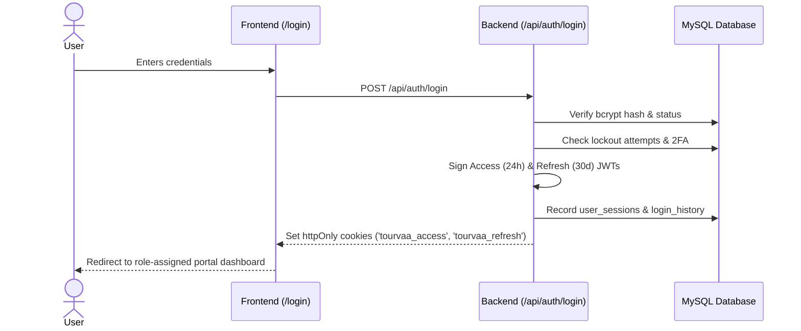

# Module 01: Authentication & User Management

## 1. Module Overview

| Attribute | Details |
|---|---|
| **Module Name** | Authentication & User Management |
| **Business Purpose** | Manages user identity, registration, login, dual-domain JWT issuance, password recovery, 2FA with TOTP, session tracking, and account lockout. |
| **Supported Roles** | All Users (Public Visitors, Customers, Suppliers, Agents, Affiliates, Admins, Super Admins) |
| **Permissions Required** | `users.view, users.create, users.edit, users.delete, roles.view, permissions.view` |

---

## 2. Functional & Business Workflows

### 2.1 Workflow Architecture

### 2.2 Functional Capabilities
- **Core Operations**: Fully implemented CRUD lifecycle operations backing the portal interfaces.
- **Validation Rules**: Strict Pydantic and React Hook Form validation rules enforcing data integrity and sanitization.
- **Error Handling**: Standardized error responses returning structured JSON codes and human-readable messages.

---

## 3. Technical Implementation Details

### 3.1 Source Files & Entry Points
- **Frontend Pages**:
- [`/login`](../../tourvaa-admin-frontend/src/app/%28public%29/login/page.tsx)
- [`/register`](../../tourvaa-admin-frontend/src/app/%28public%29/register/page.tsx)
- [`/forgot-password`](../../tourvaa-admin-frontend/src/app/forgot-password/page.tsx)
- [`/reset-password`](../../tourvaa-admin-frontend/src/app/reset-password/page.tsx)
- [`/auth/verify-email`](../../tourvaa-admin-frontend/src/app/%28public%29/auth/verify-email/page.tsx)
- [`/admin/users`](../../tourvaa-admin-frontend/src/app/admin/users/page.tsx)
- [`/admin/users/[id]`](../../tourvaa-admin-frontend/src/app/admin/users/[id]/page.tsx)
- [`/admin/roles`](../../tourvaa-admin-frontend/src/app/admin/roles/page.tsx)
- [`/admin/permissions`](../../tourvaa-admin-frontend/src/app/admin/permissions/page.tsx)
- [`/admin/sessions`](../../tourvaa-admin-frontend/src/app/admin/sessions/page.tsx)
- **Backend Routers**:
- [`app/routers/auth.py`](../../tourvaa-admin-backend/app/routers/auth.py)
- [`app/routers/users.py`](../../tourvaa-admin-backend/app/routers/users.py)
- [`app/routers/roles.py`](../../tourvaa-admin-backend/app/routers/roles.py)
- [`app/routers/permissions.py`](../../tourvaa-admin-backend/app/routers/permissions.py)
- [`app/routers/sessions.py`](../../tourvaa-admin-backend/app/routers/sessions.py)
- [`app/routers/google_auth.py`](../../tourvaa-admin-backend/app/routers/google_auth.py)
- **Domain Services**:
- [`app/services/auth.py`](../../tourvaa-admin-backend/app/services/auth.py)
- [`app/services/users.py`](../../tourvaa-admin-backend/app/services/users.py)
- [`app/services/roles.py`](../../tourvaa-admin-backend/app/services/roles.py)
- [`app/services/sessions.py`](../../tourvaa-admin-backend/app/services/sessions.py)

### 3.2 Database Entities
- **Primary Database Tables**:
- `users`
- `roles`
- `permissions`
- `role_permissions`
- `user_roles`
- `user_sessions`
- `login_history`
- `user_status_history`
