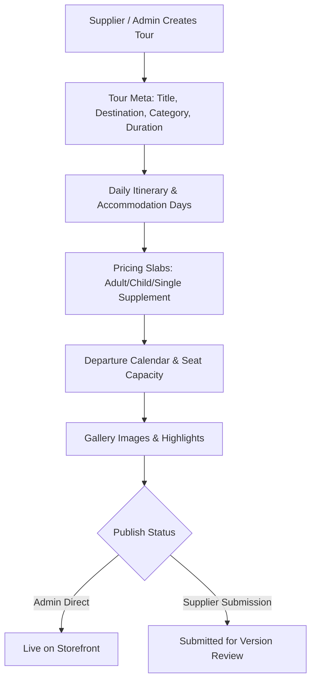

# Module 02: Tours & Catalog Engine

## 1. Module Overview

| Attribute | Details |
|---|---|
| **Module Name** | Tours & Catalog Engine |
| **Business Purpose** | Comprehensive catalog management for multi-day tours, day tours, itineraries, pricing tiers, room allocations, departures calendar, and media galleries. |
| **Supported Roles** | Public Visitors, Customers, Agents, Suppliers (own tours), Admins |
| **Permissions Required** | `tours.view, tours.create, tours.edit, tours.delete, categories.view, categories.create` |

---

## 2. Functional & Business Workflows

### 2.1 Workflow Architecture

### 2.2 Functional Capabilities
- **Core Operations**: Fully implemented CRUD lifecycle operations backing the portal interfaces.
- **Validation Rules**: Strict Pydantic and React Hook Form validation rules enforcing data integrity and sanitization.
- **Error Handling**: Standardized error responses returning structured JSON codes and human-readable messages.

---

## 3. Technical Implementation Details

### 3.1 Source Files & Entry Points
- **Frontend Pages**:
- [`/tours`](../../tourvaa-admin-frontend/src/app/%28public%29/tours/page.tsx)
- [`/tours/[id]`](../../tourvaa-admin-frontend/src/app/%28public%29/tours/[id]/page.tsx)
- [`/tours/[id]/[slug]`](../../tourvaa-admin-frontend/src/app/%28public%29/tours/[id]/[slug]/page.tsx)
- [`/admin/tours`](../../tourvaa-admin-frontend/src/app/admin/tours/page.tsx)
- [`/admin/tours/create`](../../tourvaa-admin-frontend/src/app/admin/tours/create/page.tsx)
- [`/admin/tours/[id]/edit`](../../tourvaa-admin-frontend/src/app/admin/tours/[id]/edit/page.tsx)
- [`/admin/tours/categories`](../../tourvaa-admin-frontend/src/app/admin/tours/categories/page.tsx)
- [`/supplier/tours`](../../tourvaa-admin-frontend/src/app/supplier/tours/page.tsx)
- [`/supplier/tours/create`](../../tourvaa-admin-frontend/src/app/supplier/tours/create/page.tsx)
- [`/supplier/tours/[id]/edit`](../../tourvaa-admin-frontend/src/app/supplier/tours/[id]/edit/page.tsx)
- **Backend Routers**:
- [`app/routers/tours.py`](../../tourvaa-admin-backend/app/routers/tours.py)
- [`app/routers/cms.py`](../../tourvaa-admin-backend/app/routers/cms.py)
- **Domain Services**:
- [`app/services/tours.py`](../../tourvaa-admin-backend/app/services/tours.py)
- [`app/services/tour_availability.py`](../../tourvaa-admin-backend/app/services/tour_availability.py)
- [`app/services/itinerary.py`](../../tourvaa-admin-backend/app/services/itinerary.py)
- [`app/services/discounts.py`](../../tourvaa-admin-backend/app/services/discounts.py)

### 3.2 Database Entities
- **Primary Database Tables**:
- `tours`
- `tour_overviews`
- `tour_itineraries`
- `tour_pricing`
- `tour_calendar`
- `tour_unavailable_dates`
- `tour_inclusions`
- `tour_exclusions`
- `tour_highlights`
- `tour_gallery_images`
- `tour_categories`
- `tour_subcategories`
