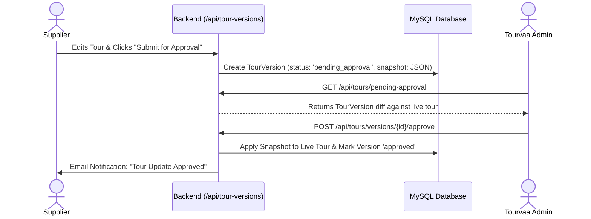

# Module 03: Tour Versioning & Approval System

## 1. Module Overview

| Attribute | Details |
|---|---|
| **Module Name** | Tour Versioning & Approval System |
| **Business Purpose** | Tracks immutable change snapshots for tours edited by suppliers, allowing admins to inspect diffs, comment, approve, or reject changes without corrupting the live tour. |
| **Supported Roles** | Suppliers, Admins, Super Admins |
| **Permissions Required** | `tours.edit, tours.approve` |

---

## 2. Functional & Business Workflows

### 2.1 Workflow Architecture

### 2.2 Functional Capabilities
- **Core Operations**: Fully implemented CRUD lifecycle operations backing the portal interfaces.
- **Validation Rules**: Strict Pydantic and React Hook Form validation rules enforcing data integrity and sanitization.
- **Error Handling**: Standardized error responses returning structured JSON codes and human-readable messages.

---

## 3. Technical Implementation Details

### 3.1 Source Files & Entry Points
- **Frontend Pages**:
- [`/admin/tour-approval`](../../tourvaa-admin-frontend/src/app/admin/tour-approval/page.tsx)
- [`/supplier/tours/[id]/preview`](../../tourvaa-admin-frontend/src/app/supplier/tours/[id]/preview/page.tsx)
- [`/supplier/tours/[id]/edit`](../../tourvaa-admin-frontend/src/app/supplier/tours/[id]/edit/page.tsx)
- **Backend Routers**:
- [`app/routers/tour_versions.py`](../../tourvaa-admin-backend/app/routers/tour_versions.py)
- **Domain Services**:
- [`app/services/tour_versions.py`](../../tourvaa-admin-backend/app/services/tour_versions.py)

### 3.2 Database Entities
- **Primary Database Tables**:
- `tour_versions`
- `tour_review_comments`
- `tours`
