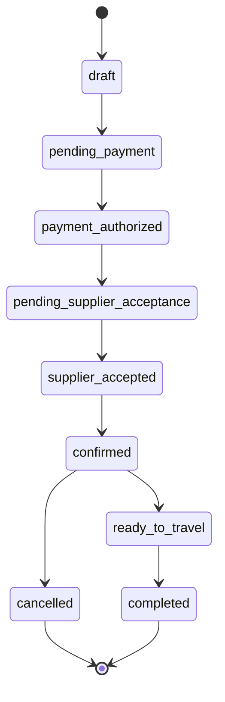

# Module 04: Booking Engine & Lifecycle Management

## 1. Module Overview

| Attribute | Details |
|---|---|
| **Module Name** | Booking Engine & Lifecycle Management |
| **Business Purpose** | Manages end-to-end booking reservations, seat allocations, supplier assignments, lifecycle status transitions, traveller manifests, and expiry routines. |
| **Supported Roles** | Customers, Agents, Suppliers, Admins |
| **Permissions Required** | `bookings.view, bookings.create, bookings.edit, bookings.delete` |

---

## 2. Functional & Business Workflows

### 2.1 Workflow Architecture

### 2.2 Functional Capabilities
- **Core Operations**: Fully implemented CRUD lifecycle operations backing the portal interfaces.
- **Validation Rules**: Strict Pydantic and React Hook Form validation rules enforcing data integrity and sanitization.
- **Error Handling**: Standardized error responses returning structured JSON codes and human-readable messages.

---

## 3. Technical Implementation Details

### 3.1 Source Files & Entry Points
- **Frontend Pages**:
- [`/booking/[id]`](../../tourvaa-admin-frontend/src/app/%28public%29/booking/[id]/page.tsx)
- [`/customer/bookings`](../../tourvaa-admin-frontend/src/app/customer/bookings/page.tsx)
- [`/customer/bookings/[id]`](../../tourvaa-admin-frontend/src/app/customer/bookings/[id]/page.tsx)
- [`/agent/bookings`](../../tourvaa-admin-frontend/src/app/agent/bookings/page.tsx)
- [`/agent/bookings/[id]`](../../tourvaa-admin-frontend/src/app/agent/bookings/[id]/page.tsx)
- [`/supplier/bookings`](../../tourvaa-admin-frontend/src/app/supplier/bookings/page.tsx)
- [`/supplier/bookings/[id]`](../../tourvaa-admin-frontend/src/app/supplier/bookings/[id]/page.tsx)
- [`/admin/bookings`](../../tourvaa-admin-frontend/src/app/admin/bookings/page.tsx)
- [`/admin/bookings/[id]`](../../tourvaa-admin-frontend/src/app/admin/bookings/[id]/page.tsx)
- **Backend Routers**:
- [`app/routers/bookings.py`](../../tourvaa-admin-backend/app/routers/bookings.py)
- [`app/routers/booking_calendar.py`](../../tourvaa-admin-backend/app/routers/booking_calendar.py)
- **Domain Services**:
- [`app/services/bookings.py`](../../tourvaa-admin-backend/app/services/bookings.py)
- [`app/services/booking_calendar.py`](../../tourvaa-admin-backend/app/services/booking_calendar.py)
- [`app/services/booking_modifications.py`](../../tourvaa-admin-backend/app/services/booking_modifications.py)

### 3.2 Database Entities
- **Primary Database Tables**:
- `bookings`
- `booking_travellers`
- `booking_optional_activities`
- `booking_accommodations`
- `booking_extensions`
- `booking_status_history`
- `booking_communications`
- `booking_calendar_events`
