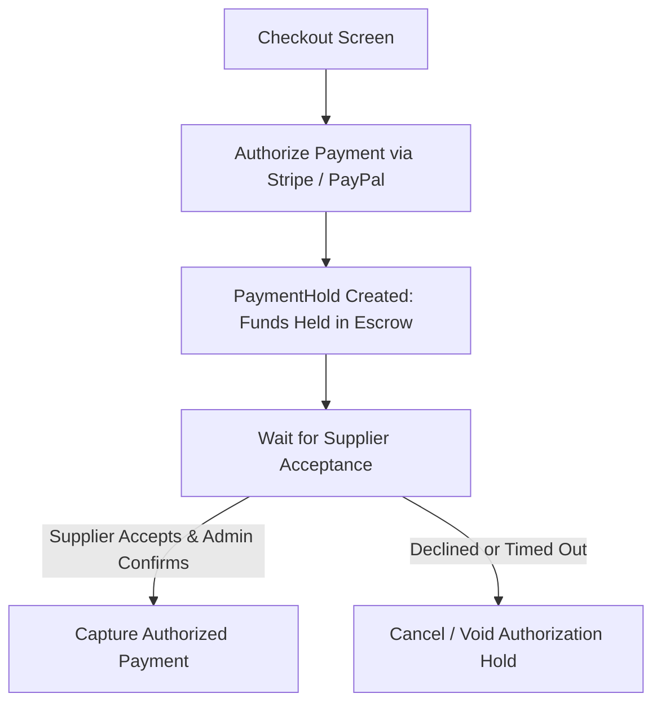

# Module 05: Checkout & Payment Gateway Processing

## 1. Module Overview

| Attribute | Details |
|---|---|
| **Module Name** | Checkout & Payment Gateway Processing |
| **Business Purpose** | Implements secure checkout sessions, credit card pre-authorizations (Stripe/PayPal), webhook signature validation, manual captures, and refund executions. |
| **Supported Roles** | Customers, Agents, Admins |
| **Permissions Required** | `payments.view, payments.create, payments.refund` |

---

## 2. Functional & Business Workflows

### 2.1 Workflow Architecture

### 2.2 Functional Capabilities
- **Core Operations**: Fully implemented CRUD lifecycle operations backing the portal interfaces.
- **Validation Rules**: Strict Pydantic and React Hook Form validation rules enforcing data integrity and sanitization.
- **Error Handling**: Standardized error responses returning structured JSON codes and human-readable messages.

---

## 3. Technical Implementation Details

### 3.1 Source Files & Entry Points
- **Frontend Pages**:
- [`/cart`](../../tourvaa-admin-frontend/src/app/%28public%29/cart/page.tsx)
- [`/booking/[id]`](../../tourvaa-admin-frontend/src/app/%28public%29/booking/[id]/page.tsx)
- [`/customer/payments`](../../tourvaa-admin-frontend/src/app/customer/payments/page.tsx)
- [`/customer/payments/[result]`](../../tourvaa-admin-frontend/src/app/customer/payments/[result]/page.tsx)
- [`/agent/payments/[result]`](../../tourvaa-admin-frontend/src/app/agent/payments/[result]/page.tsx)
- [`/admin/payments`](../../tourvaa-admin-frontend/src/app/admin/payments/page.tsx)
- [`/admin/payments/[id]`](../../tourvaa-admin-frontend/src/app/admin/payments/[id]/page.tsx)
- [`/admin/settings/payment`](../../tourvaa-admin-frontend/src/app/admin/settings/payment/page.tsx)
- **Backend Routers**:
- [`app/routers/checkout.py`](../../tourvaa-admin-backend/app/routers/checkout.py)
- [`app/routers/payments.py`](../../tourvaa-admin-backend/app/routers/payments.py)
- [`app/routers/payments_gateway.py`](../../tourvaa-admin-backend/app/routers/payments_gateway.py)
- **Domain Services**:
- [`app/services/checkout.py`](../../tourvaa-admin-backend/app/services/checkout.py)
- [`app/services/payments.py`](../../tourvaa-admin-backend/app/services/payments.py)
- [`app/services/payments_gateway.py`](../../tourvaa-admin-backend/app/services/payments_gateway.py)

### 3.2 Database Entities
- **Primary Database Tables**:
- `payments`
- `payment_transactions`
- `payment_holds`
- `checkout_sessions`
- `payment_settings`
