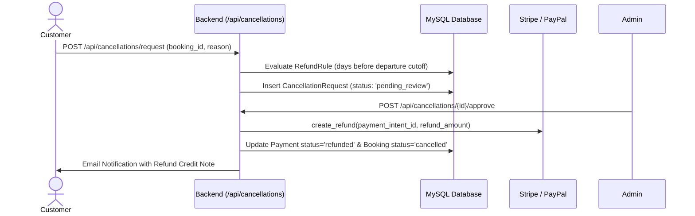

# Module 07: Cancellations & Refund Management

## 1. Module Overview

| Attribute | Details |
|---|---|
| **Module Name** | Cancellations & Refund Management |
| **Business Purpose** | Handles cancellation requests from travellers/agents, evaluates tier-based cancellation policies, executes gateway refunds, and updates ledger balances. |
| **Supported Roles** | Customers, Agents, Admins |
| **Permissions Required** | `cancellations.view, cancellations.edit, cancellations.create` |

---

## 2. Functional & Business Workflows

### 2.1 Workflow Architecture

### 2.2 Functional Capabilities
- **Core Operations**: Fully implemented CRUD lifecycle operations backing the portal interfaces.
- **Validation Rules**: Strict Pydantic and React Hook Form validation rules enforcing data integrity and sanitization.
- **Error Handling**: Standardized error responses returning structured JSON codes and human-readable messages.

---

## 3. Technical Implementation Details

### 3.1 Source Files & Entry Points
- **Frontend Pages**:
- [`/customer/cancellations`](../../tourvaa-admin-frontend/src/app/customer/cancellations/page.tsx)
- [`/cancellation-policy`](../../tourvaa-admin-frontend/src/app/%28public%29/cancellation-policy/page.tsx)
- [`/admin/refunds`](../../tourvaa-admin-frontend/src/app/admin/refunds/page.tsx)
- **Backend Routers**:
- [`app/routers/cancellations.py`](../../tourvaa-admin-backend/app/routers/cancellations.py)
- **Domain Services**:
- [`app/services/cancellations.py`](../../tourvaa-admin-backend/app/services/cancellations.py)

### 3.2 Database Entities
- **Primary Database Tables**:
- `cancellation_requests`
- `refund_rules`
- `customer_cancellation_requests`
- `bookings`
- `payments`
