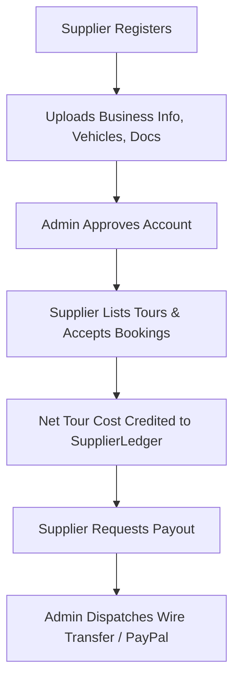

# Module 08: Suppliers Management & Financial Ledger

## 1. Module Overview

| Attribute | Details |
|---|---|
| **Module Name** | Suppliers Management & Financial Ledger |
| **Business Purpose** | Handles tour operator registration, business verification, vehicle records, operational document validation, net tour earnings calculation, and withdrawal payouts. |
| **Supported Roles** | Suppliers, Admins, Super Admins |
| **Permissions Required** | `suppliers.view, suppliers.create, suppliers.edit, suppliers.delete, supplier_ledger.view` |

---

## 2. Functional & Business Workflows

### 2.1 Workflow Architecture

### 2.2 Functional Capabilities
- **Core Operations**: Fully implemented CRUD lifecycle operations backing the portal interfaces.
- **Validation Rules**: Strict Pydantic and React Hook Form validation rules enforcing data integrity and sanitization.
- **Error Handling**: Standardized error responses returning structured JSON codes and human-readable messages.

---

## 3. Technical Implementation Details

### 3.1 Source Files & Entry Points
- **Frontend Pages**:
- [`/supplier/dashboard`](../../tourvaa-admin-frontend/src/app/supplier/dashboard/page.tsx)
- [`/supplier/onboarding`](../../tourvaa-admin-frontend/src/app/supplier/onboarding/page.tsx)
- [`/supplier/earnings`](../../tourvaa-admin-frontend/src/app/supplier/earnings/page.tsx)
- [`/supplier/payouts`](../../tourvaa-admin-frontend/src/app/supplier/payouts/page.tsx)
- [`/supplier/profile`](../../tourvaa-admin-frontend/src/app/supplier/profile/page.tsx)
- [`/admin/suppliers`](../../tourvaa-admin-frontend/src/app/admin/suppliers/page.tsx)
- [`/admin/suppliers/[id]`](../../tourvaa-admin-frontend/src/app/admin/suppliers/[id]/page.tsx)
- [`/admin/supplier-payouts`](../../tourvaa-admin-frontend/src/app/admin/supplier-payouts/page.tsx)
- **Backend Routers**:
- [`app/routers/suppliers.py`](../../tourvaa-admin-backend/app/routers/suppliers.py)
- [`app/routers/supplier_ledger.py`](../../tourvaa-admin-backend/app/routers/supplier_ledger.py)
- **Domain Services**:
- [`app/services/suppliers.py`](../../tourvaa-admin-backend/app/services/suppliers.py)
- [`app/services/supplier_ledger.py`](../../tourvaa-admin-backend/app/services/supplier_ledger.py)

### 3.2 Database Entities
- **Primary Database Tables**:
- `suppliers`
- `supplier_contacts`
- `supplier_business_info`
- `supplier_vehicles`
- `supplier_invoicing`
- `supplier_documents`
- `supplier_approval_history`
- `supplier_ledgers`
- `supplier_payouts`
- `supplier_payout_items`
