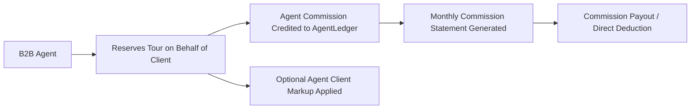

# Module 09: B2B Agents & Reseller Portal

## 1. Module Overview

| Attribute | Details |
|---|---|
| **Module Name** | B2B Agents & Reseller Portal |
| **Business Purpose** | Manages wholesale travel agents, B2B wholesale rates, agent custom markups, credit buffer limits, commission settlements, and agent commercial statements. |
| **Supported Roles** | Agents, Admins, Super Admins |
| **Permissions Required** | `agents.view, agents.create, agents.edit, agents.delete, agent_ledger.view` |

---

## 2. Functional & Business Workflows

### 2.1 Workflow Architecture

### 2.2 Functional Capabilities
- **Core Operations**: Fully implemented CRUD lifecycle operations backing the portal interfaces.
- **Validation Rules**: Strict Pydantic and React Hook Form validation rules enforcing data integrity and sanitization.
- **Error Handling**: Standardized error responses returning structured JSON codes and human-readable messages.

---

## 3. Technical Implementation Details

### 3.1 Source Files & Entry Points
- **Frontend Pages**:
- [`/agent/dashboard`](../../tourvaa-admin-frontend/src/app/agent/dashboard/page.tsx)
- [`/agent/tours`](../../tourvaa-admin-frontend/src/app/agent/tours/page.tsx)
- [`/agent/bookings`](../../tourvaa-admin-frontend/src/app/agent/bookings/page.tsx)
- [`/agent/invoices`](../../tourvaa-admin-frontend/src/app/agent/invoices/page.tsx)
- [`/agent/payouts`](../../tourvaa-admin-frontend/src/app/agent/payouts/page.tsx)
- [`/agent/customers`](../../tourvaa-admin-frontend/src/app/agent/customers/page.tsx)
- [`/admin/agents`](../../tourvaa-admin-frontend/src/app/admin/agents/page.tsx)
- [`/admin/agents/[id]`](../../tourvaa-admin-frontend/src/app/admin/agents/[id]/page.tsx)
- [`/admin/agent-payouts`](../../tourvaa-admin-frontend/src/app/admin/agent-payouts/page.tsx)
- **Backend Routers**:
- [`app/routers/agents.py`](../../tourvaa-admin-backend/app/routers/agents.py)
- [`app/routers/agent_ledger.py`](../../tourvaa-admin-backend/app/routers/agent_ledger.py)
- **Domain Services**:
- [`app/services/agents.py`](../../tourvaa-admin-backend/app/services/agents.py)
- [`app/services/agent_ledger.py`](../../tourvaa-admin-backend/app/services/agent_ledger.py)

### 3.2 Database Entities
- **Primary Database Tables**:
- `agents`
- `agent_contacts`
- `agent_business_info`
- `agent_invoicing`
- `agent_documents`
- `agent_ledger`
- `bookings`
