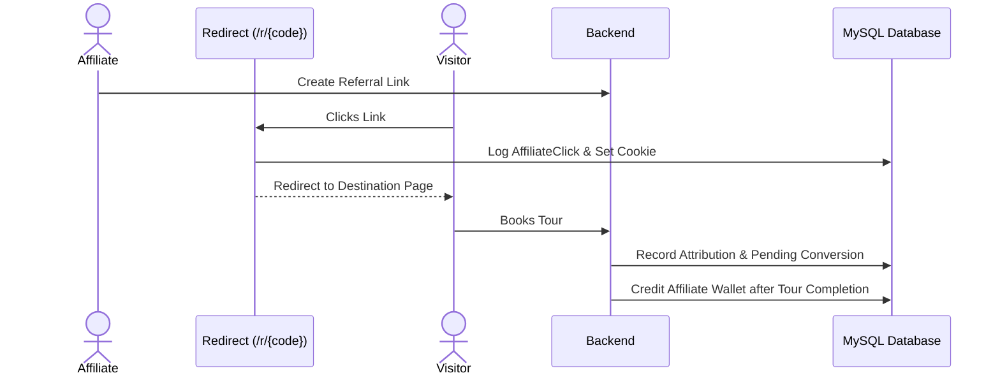

# Module 10: Affiliate Marketing & Tracking Engine

## 1. Module Overview

| Attribute | Details |
|---|---|
| **Module Name** | Affiliate Marketing & Tracking Engine |
| **Business Purpose** | Manages custom referral links, trackable redirect endpoints (/r/{code}), click logs, cookie attribution windows, commission tiers, and wallet withdrawals. |
| **Supported Roles** | Affiliates, Admins, Super Admins |
| **Permissions Required** | `affiliates.view, affiliates.create, affiliates.edit, affiliate_links.view, affiliate_payouts.view` |

---

## 2. Functional & Business Workflows

### 2.1 Workflow Architecture

### 2.2 Functional Capabilities
- **Core Operations**: Fully implemented CRUD lifecycle operations backing the portal interfaces.
- **Validation Rules**: Strict Pydantic and React Hook Form validation rules enforcing data integrity and sanitization.
- **Error Handling**: Standardized error responses returning structured JSON codes and human-readable messages.

---

## 3. Technical Implementation Details

### 3.1 Source Files & Entry Points
- **Frontend Pages**:
- [`/affiliate/dashboard`](../../tourvaa-admin-frontend/src/app/affiliate/dashboard/page.tsx)
- [`/affiliate/referral-links`](../../tourvaa-admin-frontend/src/app/affiliate/referral-links/page.tsx)
- [`/affiliate/clicks`](../../tourvaa-admin-frontend/src/app/affiliate/clicks/page.tsx)
- [`/affiliate/conversions`](../../tourvaa-admin-frontend/src/app/affiliate/conversions/page.tsx)
- [`/affiliate/wallet`](../../tourvaa-admin-frontend/src/app/affiliate/wallet/page.tsx)
- [`/affiliate/payouts`](../../tourvaa-admin-frontend/src/app/affiliate/payouts/page.tsx)
- [`/admin/affiliates`](../../tourvaa-admin-frontend/src/app/admin/affiliates/page.tsx)
- [`/admin/affiliates/links`](../../tourvaa-admin-frontend/src/app/admin/affiliates/links/page.tsx)
- [`/admin/affiliates/commission-rules`](../../tourvaa-admin-frontend/src/app/admin/affiliates/commission-rules/page.tsx)
- [`/admin/affiliates/payouts`](../../tourvaa-admin-frontend/src/app/admin/affiliates/payouts/page.tsx)
- **Backend Routers**:
- [`app/routers/affiliates.py`](../../tourvaa-admin-backend/app/routers/affiliates.py)
- [`app/routers/affiliate_tracking.py`](../../tourvaa-admin-backend/app/routers/affiliate_tracking.py)
- [`app/routers/affiliate_links.py`](../../tourvaa-admin-backend/app/routers/affiliate_links.py)
- [`app/routers/affiliate_commission_rules.py`](../../tourvaa-admin-backend/app/routers/affiliate_commission_rules.py)
- [`app/routers/affiliate_payouts.py`](../../tourvaa-admin-backend/app/routers/affiliate_payouts.py)
- [`app/routers/affiliate_redirect.py`](../../tourvaa-admin-backend/app/routers/affiliate_redirect.py)
- **Domain Services**:
- [`app/services/affiliates.py`](../../tourvaa-admin-backend/app/services/affiliates.py)
- [`app/services/affiliate_tracking.py`](../../tourvaa-admin-backend/app/services/affiliate_tracking.py)
- [`app/services/affiliate_commission.py`](../../tourvaa-admin-backend/app/services/affiliate_commission.py)
- [`app/services/affiliate_payouts.py`](../../tourvaa-admin-backend/app/services/affiliate_payouts.py)

### 3.2 Database Entities
- **Primary Database Tables**:
- `affiliates`
- `affiliate_marketing_info`
- `affiliate_invoicing`
- `affiliate_documents`
- `affiliate_links`
- `affiliate_clicks`
- `affiliate_attributions`
- `affiliate_commission_rules`
- `affiliate_conversions`
- `affiliate_payout_methods`
- `affiliate_payouts`
- `affiliate_wallet_transactions`
