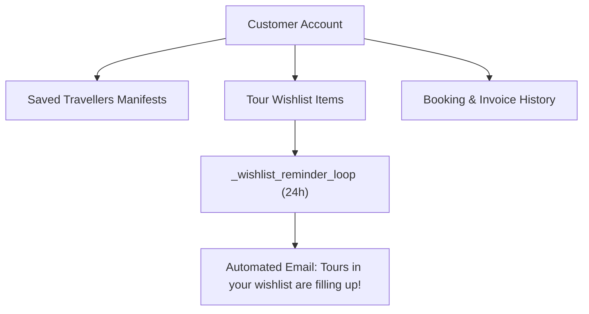

# Module 11: Customer Management & Traveller Portal

## 1. Module Overview

| Attribute | Details |
|---|---|
| **Module Name** | Customer Management & Traveller Portal |
| **Business Purpose** | Manages customer profiles, saved family/group traveller rosters, personalized tour wishlists, scheduled weekly wishlist reminder sweeps, and communication history. |
| **Supported Roles** | Customers, Admins |
| **Permissions Required** | `customers.view, customers.create, customers.edit, customers.delete` |

---

## 2. Functional & Business Workflows

### 2.1 Workflow Architecture

### 2.2 Functional Capabilities
- **Core Operations**: Fully implemented CRUD lifecycle operations backing the portal interfaces.
- **Validation Rules**: Strict Pydantic and React Hook Form validation rules enforcing data integrity and sanitization.
- **Error Handling**: Standardized error responses returning structured JSON codes and human-readable messages.

---

## 3. Technical Implementation Details

### 3.1 Source Files & Entry Points
- **Frontend Pages**:
- [`/customer/dashboard`](../../tourvaa-admin-frontend/src/app/customer/dashboard/page.tsx)
- [`/customer/bookings`](../../tourvaa-admin-frontend/src/app/customer/bookings/page.tsx)
- [`/customer/travellers`](../../tourvaa-admin-frontend/src/app/customer/travellers/page.tsx)
- [`/customer/wishlist`](../../tourvaa-admin-frontend/src/app/customer/wishlist/page.tsx)
- [`/customer/profile`](../../tourvaa-admin-frontend/src/app/customer/profile/page.tsx)
- [`/customer/support`](../../tourvaa-admin-frontend/src/app/customer/support/page.tsx)
- [`/admin/customers`](../../tourvaa-admin-frontend/src/app/admin/customers/page.tsx)
- [`/admin/customers/[id]`](../../tourvaa-admin-frontend/src/app/admin/customers/[id]/page.tsx)
- **Backend Routers**:
- [`app/routers/customers.py`](../../tourvaa-admin-backend/app/routers/customers.py)
- [`app/routers/customers_portal.py`](../../tourvaa-admin-backend/app/routers/customers_portal.py)
- **Domain Services**:
- [`app/services/customers.py`](../../tourvaa-admin-backend/app/services/customers.py)
- [`app/services/wishlist_reminders.py`](../../tourvaa-admin-backend/app/services/wishlist_reminders.py)

### 3.2 Database Entities
- **Primary Database Tables**:
- `customers`
- `customer_saved_travellers`
- `customer_wishlist_items`
- `customer_communications`
- `customer_cancellation_requests`
