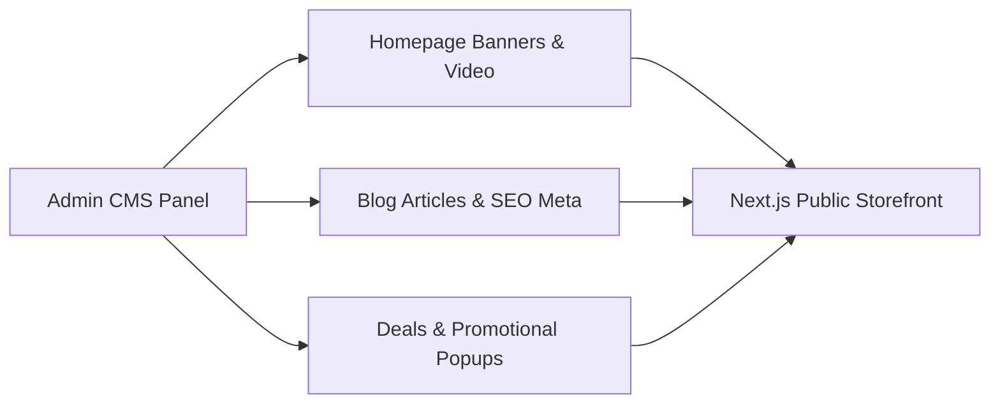

# Module 12: Website CMS & Travel Blog

## 1. Module Overview

| Attribute | Details |
|---|---|
| **Module Name** | Website CMS & Travel Blog |
| **Business Purpose** | Content management system for homepage hero banners (image & video), popular destinations, handpicked deals, published blog articles, policies, and promotional popups. |
| **Supported Roles** | Public Visitors, Admins |
| **Permissions Required** | `website_cms.view, website_cms.edit, blogs.view, blogs.create, blogs.edit` |

---

## 2. Functional & Business Workflows

### 2.1 Workflow Architecture

### 2.2 Functional Capabilities
- **Core Operations**: Fully implemented CRUD lifecycle operations backing the portal interfaces.
- **Validation Rules**: Strict Pydantic and React Hook Form validation rules enforcing data integrity and sanitization.
- **Error Handling**: Standardized error responses returning structured JSON codes and human-readable messages.

---

## 3. Technical Implementation Details

### 3.1 Source Files & Entry Points
- **Frontend Pages**:
- [`/`](../../tourvaa-admin-frontend/src/app/%28public%29/page.tsx)
- [`/blogs`](../../tourvaa-admin-frontend/src/app/%28public%29/blogs/page.tsx)
- [`/blogs/[slug]`](../../tourvaa-admin-frontend/src/app/%28public%29/blogs/[slug]/page.tsx)
- [`/about`](../../tourvaa-admin-frontend/src/app/%28public%29/about/page.tsx)
- [`/terms`](../../tourvaa-admin-frontend/src/app/%28public%29/terms/page.tsx)
- [`/privacy-policy`](../../tourvaa-admin-frontend/src/app/%28public%29/privacy-policy/page.tsx)
- [`/cancellation-policy`](../../tourvaa-admin-frontend/src/app/%28public%29/cancellation-policy/page.tsx)
- [`/admin/cms`](../../tourvaa-admin-frontend/src/app/admin/cms/page.tsx)
- [`/admin/cms/[section]`](../../tourvaa-admin-frontend/src/app/admin/cms/[section]/page.tsx)
- [`/admin/blogs`](../../tourvaa-admin-frontend/src/app/admin/blogs/page.tsx)
- [`/admin/blogs/create`](../../tourvaa-admin-frontend/src/app/admin/blogs/create/page.tsx)
- **Backend Routers**:
- [`app/routers/website_cms.py`](../../tourvaa-admin-backend/app/routers/website_cms.py)
- [`app/routers/public.py`](../../tourvaa-admin-backend/app/routers/public.py)
- **Domain Services**:
- [`app/services/website_cms.py`](../../tourvaa-admin-backend/app/services/website_cms.py)
- [`app/services/cms.py`](../../tourvaa-admin-backend/app/services/cms.py)

### 3.2 Database Entities
- **Primary Database Tables**:
- `cms_homepage_banners`
- `cms_popular_destinations`
- `cms_popular_tours`
- `cms_tours_on_deals`
- `cms_blogs`
- `cms_customer_reviews`
- `cms_help_centre`
- `cms_policies`
- `cms_promotional_popups`
- `cms_pages`
