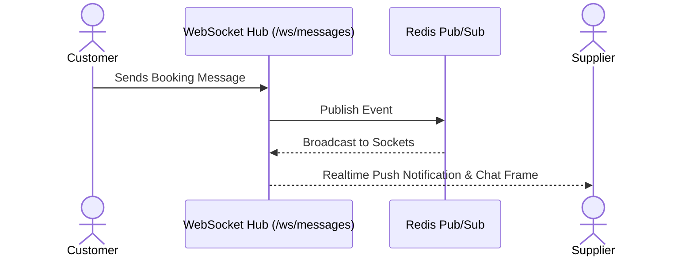

# Module 14: Realtime Messaging & Customer Support

## 1. Module Overview

| Attribute | Details |
|---|---|
| **Module Name** | Realtime Messaging & Customer Support |
| **Business Purpose** | Realtime communication hub connecting customers, suppliers, agents, and administrators on booking-specific message threads, using WebSockets and Redis pub/sub. |
| **Supported Roles** | Customers, Suppliers, Agents, Admins |
| **Permissions Required** | `messages.view, messages.create` |

---

## 2. Functional & Business Workflows

### 2.1 Workflow Architecture

### 2.2 Functional Capabilities
- **Core Operations**: Fully implemented CRUD lifecycle operations backing the portal interfaces.
- **Validation Rules**: Strict Pydantic and React Hook Form validation rules enforcing data integrity and sanitization.
- **Error Handling**: Standardized error responses returning structured JSON codes and human-readable messages.

---

## 3. Technical Implementation Details

### 3.1 Source Files & Entry Points
- **Frontend Pages**:
- [`/admin/messages`](../../tourvaa-admin-frontend/src/app/admin/messages/page.tsx)
- [`/customer/support`](../../tourvaa-admin-frontend/src/app/customer/support/page.tsx)
- [`/supplier/messages`](../../tourvaa-admin-frontend/src/app/supplier/messages/page.tsx)
- [`/agent/messages`](../../tourvaa-admin-frontend/src/app/agent/messages/page.tsx)
- [`/affiliate/messages`](../../tourvaa-admin-frontend/src/app/affiliate/messages/page.tsx)
- [`/message-reply`](../../tourvaa-admin-frontend/src/app/message-reply/page.tsx)
- **Backend Routers**:
- [`app/routers/messaging.py`](../../tourvaa-admin-backend/app/routers/messaging.py)
- **Domain Services**:
- [`app/services/messaging.py`](../../tourvaa-admin-backend/app/services/messaging.py)
- [`app/services/messaging_ws.py`](../../tourvaa-admin-backend/app/services/messaging_ws.py)

### 3.2 Database Entities
- **Primary Database Tables**:
- `conversations`
- `messages`
- `message_replies`
- `booking_communications`
