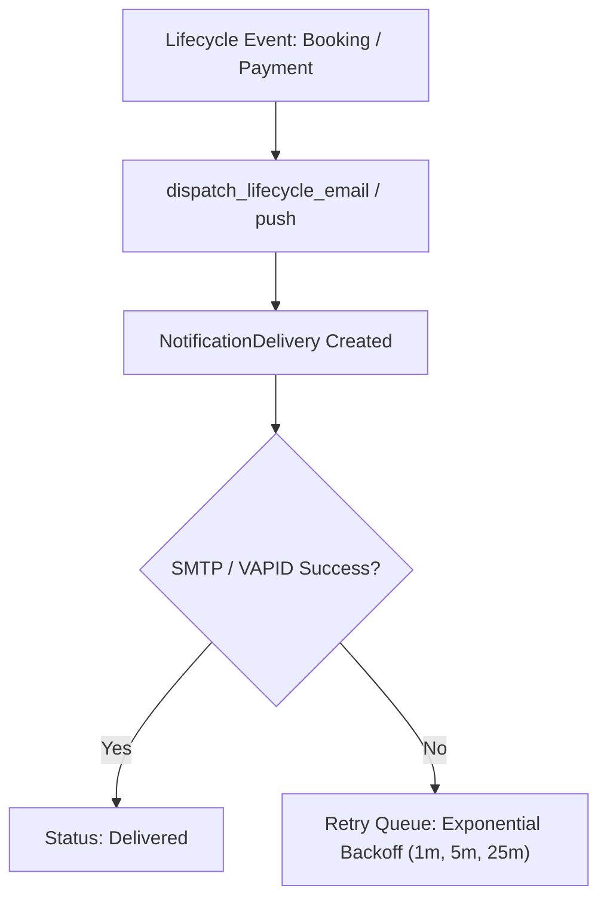

# Module 15: Notification Engine: Email & WebPush

## 1. Module Overview

| Attribute | Details |
|---|---|
| **Module Name** | Notification Engine: Email & WebPush |
| **Business Purpose** | Centralized multi-channel notification dispatcher handling transactional SMTP emails, browser WebPush notifications (VAPID), in-app alerts, and retry queues. |
| **Supported Roles** | All Users |
| **Permissions Required** | `notifications.view, email.view, email.edit` |

---

## 2. Functional & Business Workflows

### 2.1 Workflow Architecture

### 2.2 Functional Capabilities
- **Core Operations**: Fully implemented CRUD lifecycle operations backing the portal interfaces.
- **Validation Rules**: Strict Pydantic and React Hook Form validation rules enforcing data integrity and sanitization.
- **Error Handling**: Standardized error responses returning structured JSON codes and human-readable messages.

---

## 3. Technical Implementation Details

### 3.1 Source Files & Entry Points
- **Frontend Pages**:
- [`/admin/notifications`](../../tourvaa-admin-frontend/src/app/admin/notifications/page.tsx)
- [`/admin/email-logs`](../../tourvaa-admin-frontend/src/app/admin/email-logs/page.tsx)
- [`/admin/email-templates`](../../tourvaa-admin-frontend/src/app/admin/email-templates/page.tsx)
- [`/admin/settings`](../../tourvaa-admin-frontend/src/app/admin/settings/page.tsx)
- **Backend Routers**:
- [`app/routers/notifications.py`](../../tourvaa-admin-backend/app/routers/notifications.py)
- [`app/routers/email_templates.py`](../../tourvaa-admin-backend/app/routers/email_templates.py)
- [`app/routers/email_logs.py`](../../tourvaa-admin-backend/app/routers/email_logs.py)
- **Domain Services**:
- [`app/services/notifications.py`](../../tourvaa-admin-backend/app/services/notifications.py)
- [`app/services/notification_delivery.py`](../../tourvaa-admin-backend/app/services/notification_delivery.py)
- [`app/services/notifications_push.py`](../../tourvaa-admin-backend/app/services/notifications_push.py)
- [`app/services/email_templates.py`](../../tourvaa-admin-backend/app/services/email_templates.py)

### 3.2 Database Entities
- **Primary Database Tables**:
- `notifications`
- `notification_logs`
- `notification_deliveries`
- `push_subscriptions`
- `push_delivery_logs`
- `email_logs`
- `email_templates`
- `smtp_settings`
