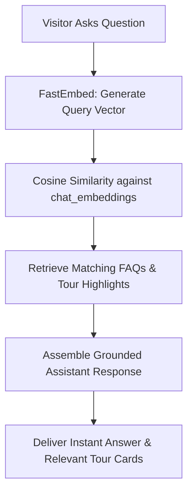

# Module 16: AI Travel Assistant & RAG Engine

## 1. Module Overview

| Attribute | Details |
|---|---|
| **Module Name** | AI Travel Assistant & RAG Engine |
| **Business Purpose** | Self-hosted AI chatbot powered by FastEmbed and ONNX (BAAI/bge-small-en-v1.5) on CPU. Indexes FAQs, Help Centre articles, and published tours for semantic retrieval. |
| **Supported Roles** | Public Visitors, Admins |
| **Permissions Required** | `chatbot.view, chatbot.edit` |

---

## 2. Functional & Business Workflows

### 2.1 Workflow Architecture

### 2.2 Functional Capabilities
- **Core Operations**: Fully implemented CRUD lifecycle operations backing the portal interfaces.
- **Validation Rules**: Strict Pydantic and React Hook Form validation rules enforcing data integrity and sanitization.
- **Error Handling**: Standardized error responses returning structured JSON codes and human-readable messages.

---

## 3. Technical Implementation Details

### 3.1 Source Files & Entry Points
- **Frontend Pages**:
- [`/admin/chatbot`](../../tourvaa-admin-frontend/src/app/admin/chatbot/page.tsx)
- [`ChatWidget.tsx`](../../tourvaa-admin-frontend/src/components/public/ChatWidget.tsx) (Public Floating Chat Widget)
- **Backend Routers**:
- [`app/routers/chatbot.py`](../../tourvaa-admin-backend/app/routers/chatbot.py)
- **Domain Services**:
- [`app/services/chatbot.py`](../../tourvaa-admin-backend/app/services/chatbot.py)
- [`app/services/rag.py`](../../tourvaa-admin-backend/app/services/rag.py)
- [`app/services/embeddings.py`](../../tourvaa-admin-backend/app/services/embeddings.py)

### 3.2 Database Entities
- **Primary Database Tables**:
- `chat_faqs`
- `chat_sessions`
- `chat_messages`
- `chat_embeddings`
- `chat_feedback`
