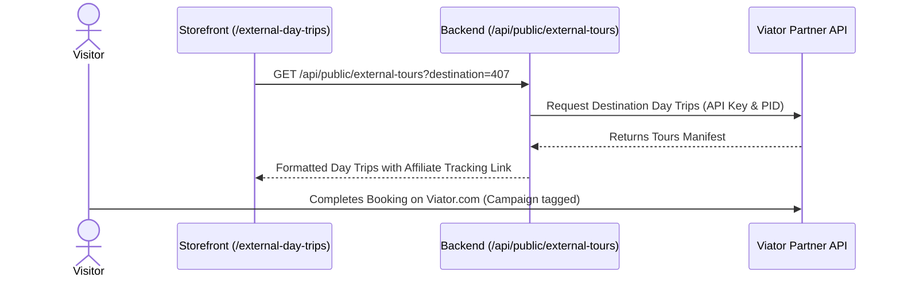

# Module 17: External Day Tours (Viator Integration)

## 1. Module Overview

| Attribute | Details |
|---|---|
| **Module Name** | External Day Tours (Viator Integration) |
| **Business Purpose** | Integrates Viator Partner API (Basic Access) to supplement multi-day catalog with localized external day tours, activities, and affiliate tracking commissions. |
| **Supported Roles** | Public Visitors, Admins |
| **Permissions Required** | `settings.view, settings.edit` |

---

## 2. Functional & Business Workflows

### 2.1 Workflow Architecture

### 2.2 Functional Capabilities
- **Core Operations**: Fully implemented CRUD lifecycle operations backing the portal interfaces.
- **Validation Rules**: Strict Pydantic and React Hook Form validation rules enforcing data integrity and sanitization.
- **Error Handling**: Standardized error responses returning structured JSON codes and human-readable messages.

---

## 3. Technical Implementation Details

### 3.1 Source Files & Entry Points
- **Frontend Pages**:
- [`/external-day-trips`](../../tourvaa-admin-frontend/src/app/%28public%29/external-day-trips/page.tsx)
- [`/admin/integrations`](../../tourvaa-admin-frontend/src/app/admin/integrations/page.tsx)
- [`/admin/integrations/viator`](../../tourvaa-admin-frontend/src/app/admin/integrations/viator/page.tsx)
- **Backend Routers**:
- [`app/routers/external_tours.py`](../../tourvaa-admin-backend/app/routers/external_tours.py)
- **Domain Services**:
- [`app/services/viator.py`](../../tourvaa-admin-backend/app/services/viator.py)
- [`app/integrations/viator/service.py`](../../tourvaa-admin-backend/app/integrations/viator/service.py)

### 3.2 Database Entities
- **Primary Database Tables**:
- `external_tours`
- `api_settings`
