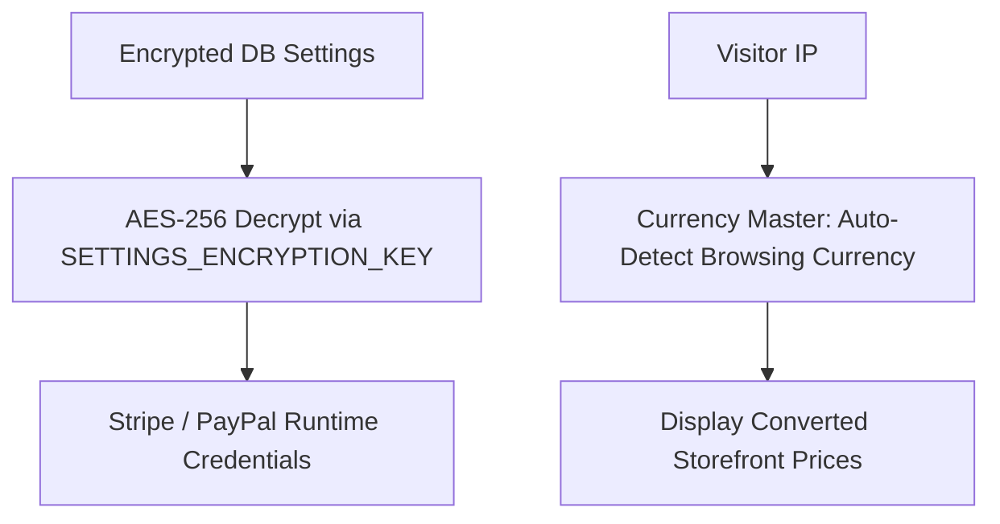

# Module 20: Platform Settings & Multi-Currency Engine

## 1. Module Overview

| Attribute | Details |
|---|---|
| **Module Name** | Platform Settings & Multi-Currency Engine |
| **Business Purpose** | Manages global application settings, encrypted payment gateway secrets, API credentials, SMTP configurations, currency exchange rates, and GeoIP localization. |
| **Supported Roles** | Admins, Super Admins |
| **Permissions Required** | `settings.view, settings.edit, currency.view, currency.edit` |

---

## 2. Functional & Business Workflows

### 2.1 Workflow Architecture

### 2.2 Functional Capabilities
- **Core Operations**: Fully implemented CRUD lifecycle operations backing the portal interfaces.
- **Validation Rules**: Strict Pydantic and React Hook Form validation rules enforcing data integrity and sanitization.
- **Error Handling**: Standardized error responses returning structured JSON codes and human-readable messages.

---

## 3. Technical Implementation Details

### 3.1 Source Files & Entry Points
- **Frontend Pages**:
- [`/admin/settings`](../../tourvaa-admin-frontend/src/app/admin/settings/page.tsx)
- [`/admin/settings/api`](../../tourvaa-admin-frontend/src/app/admin/settings/api/page.tsx)
- [`/admin/settings/payment`](../../tourvaa-admin-frontend/src/app/admin/settings/payment/page.tsx)
- [`/admin/settings/default-commissions`](../../tourvaa-admin-frontend/src/app/admin/settings/default-commissions/page.tsx)
- **Backend Routers**:
- [`app/routers/settings.py`](../../tourvaa-admin-backend/app/routers/settings.py)
- [`app/routers/currency.py`](../../tourvaa-admin-backend/app/routers/currency.py)
- **Domain Services**:
- [`app/services/settings.py`](../../tourvaa-admin-backend/app/services/settings.py)
- [`app/services/currency.py`](../../tourvaa-admin-backend/app/services/currency.py)

### 3.2 Database Entities
- **Primary Database Tables**:
- `app_settings`
- `payment_settings`
- `api_settings`
- `currencies`
- `smtp_settings`
