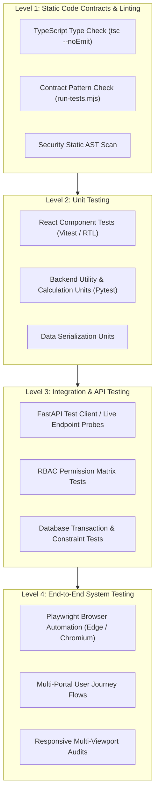

# 01 — Test Strategy & Quality Assurance Framework
**Tourvaa Travel & Tourism Experience Platform**

---

### 1. Purpose and Quality Objectives

The purpose of this Test Strategy is to define the principles, quality gates, execution levels, and verification criteria governing the Tourvaa Travel & Tourism Experience Platform. 

The primary objectives are:
1. **Verification of Functional Correctness**: Confirm that all 20 business modules operate according to business specifications across 7 role-based portals.
2. **Data & Transaction Integrity**: Ensure that financial ledgers, room allotments, and booking states transition atomically without orphan records or ledger leakage.
3. **Security & Boundary Enforcement**: Validate that role-based access control (RBAC), authentication tokens, rate limits, and brute-force defenses prevent unauthorized access.
4. **Cross-Device Usability & Accessibility**: Guarantee that responsive layouts maintain functional stability across desktop, tablet, and mobile devices adhering to WCAG 2.2 AA standards.
5. **Production Readiness Determination**: Provide an evidence-backed go/no-go recommendation based on empirical test execution.

---

### 2. Testing Scope

#### 2.1 In-Scope Domains
- **Frontend Architecture**: 163 Next.js App Router pages, client-side navigation, form validation, modal dialogues, toast notifications, loading skeletons, and error boundaries.
- **Backend API Layer**: 594 route paths and 785 operations in FastAPI, OpenAPI contract compliance, request validation schemas, and error responses.
- **Database Engine**: 139 tables in MySQL 8.0, 252 foreign key constraints, primary keys, indexing strategies, and transaction rollback mechanics.
- **Authentication & RBAC**: 9 user roles (Super Admin, Admin, Sub Admin, Supplier, Agent, Customer, Affiliate, Accountant, Demo), session lifecycle, and route protection.
- **Core Business Workflows**: Tour search, reservation lifecycle, payment hold & capture, multi-currency conversion, commission attribution, and messaging.
- **Security & Reliability**: CSRF middleware behavior, rate limiting, SQL injection defense, secret isolation, and error information masking.

#### 2.2 Out-of-Scope / Prohibited Operations
- **Live Financial Gateway Charges**: No real credit card or cryptocurrency transactions against production payment gateways (Stripe, Razorpay, Coinbase).
- **External Real-World Communications**: No outbound live email dispatches to real customers or automated SMS/WhatsApp triggers.
- **Destructive Production Schema Changes**: No automated execution of `alembic upgrade head` or table truncations on live production environments.

---

### 3. Testing Levels and Methodology

#### 3.1 Level 1: Static Contract & Consistency Testing
- Evaluates code contracts, route structures, and file integrity without spinning up server state.
- Executed via `node tests/run-tests.mjs` verifying 682 assertions across route exports, portal redirects, and permission definitions.

#### 3.2 Level 2: Component & Algorithm Unit Testing
- Evaluates isolated domain logic: commission calculation algorithms, currency conversion rounding, date range validations, and React component state.
- Backend unit tests run with Pytest (`test_booking_financials_unit.py`, `test_messaging_serialization_unit.py`).
- Frontend unit tests run with Vitest (`tests/unit/*.test.tsx`).

#### 3.3 Level 3: Backend API & Database Integration Testing
- Assesses live HTTP interactions against `http://127.0.0.1:8000/api`.
- Validates status codes, response payloads, pagination envelopes, and HTTP 401/403/422 responses across 110 test files.
- Tests database foreign key integrity and cascade constraints directly via MySQL queries.

#### 3.4 Level 4: Browser-Level End-to-End (E2E) Testing
- Driven by Playwright using headless Chromium and Microsoft Edge channels.
- Emulates realistic end-user behavior across public storefronts and authenticated role consoles.
- Performs runtime error sniffing, console exception catching, and layout overflow detection.

---

### 4. Defect Severity & Priority Model

| Severity Level | Definition | Impact on Release | Target Resolution SLA |
| :--- | :--- | :--- | :--- |
| **P0 — Critical** | Security vulnerability, data corruption risk, crash on primary user journey, or complete portal blocker. | **Release Blocker** (Immediate hotfix required) | < 24 Hours |
| **P1 — High** | Major feature failure without acceptable workaround, rate limiting flaws, or core calculation error. | **Conditional Blocker** (Must be resolved or formally accepted) | < 3 Days |
| **P2 — Medium** | Non-critical workflow defect, layout overflow on specific viewport, or UI state inconsistency. | **Non-Blocker** (Scheduled in subsequent sprint) | < 7 Days |
| **P3 — Low** | Minor cosmetic glitch, typo, suboptimal focus indicator, or missing secondary metadata tag. | **Backlog Item** (Triage for future polish) | Next Release Cycle |

---

### 5. Quality Gate Criteria

To achieve **Conditional Production Readiness**, the application must satisfy:
1. **Critical Path Zero Defects**: 0 open P0 security or data loss vulnerabilities.
2. **Backend API Integrity**: > 95% pass rate across automated regression suites.
3. **Database Schema Compliance**: 0 unresolved orphan foreign keys and 100% migration revision consistency.
4. **Portal Access Boundaries**: 100% strict enforcement of RBAC redirects across all 7 portal scopes.
5. **Responsive Layout Baseline**: 0 horizontal layout overflow across desktop (1280px) and mobile (375px) viewports.
