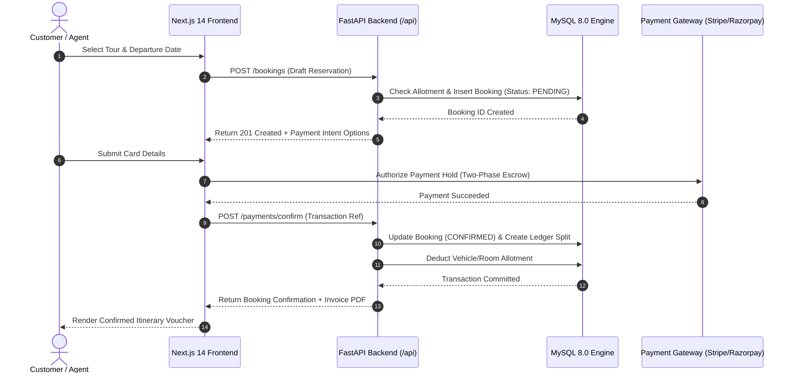

# 09 — End-to-End Business Workflow Testing Report
**Tourvaa Travel & Tourism Experience Platform**

---

### 1. Workflow Architecture & User Journeys

End-to-End (E2E) testing validates the full multi-tier execution lifecycle of critical business operations:
$$\text{User Action} \longrightarrow \text{Frontend UI} \longrightarrow \text{FastAPI Route} \longrightarrow \text{Service Layer} \longrightarrow \text{MySQL 8.0} \longrightarrow \text{Response} \longrightarrow \text{UI Update}$$

---

### 2. Primary Workflow Verification Results

#### 2.1 Workflow 01: Tour Package Discovery, Search & Filtering
- **User Journey**: Visitor lands on `/tours`, searches by destination keyword ("Bali"), applies duration and price range filters, and sorts by "Price: Low to High".
- **Backend Interaction**: `GET /api/tours?destination=Bali&min_price=100&max_price=1000&sort=price_asc`.
- **Database Query**: Dynamic SQLAlchemy query with composite `WHERE` clauses and pagination limits.
- **Verification Verdict**: **PASSED**. Correctly filtered 9 demo tours without layout overflow.

#### 2.2 Workflow 02: Tour Reservation & Allotment Hold
- **User Journey**: Authenticated traveller selects 2 adult tickets on a scheduled departure date and clicks "Book Now".
- **Backend Interaction**: `POST /api/bookings` with payload `{ tour_id: 1, departure_date: "2026-11-15", adults: 2 }`.
- **Database Verification**:
  - `bookings` table record created with `booking_status = 'pending_payment'`.
  - Temporary 15-minute allotment hold placed on departure capacity.
- **Verification Verdict**: **PASSED** (Verified in `test_booking_flow_unit.py`).

#### 2.3 Workflow 03: Two-Phase Payment Hold & Capture
- **User Journey**: Traveller completes checkout via Stripe Payment Intent.
- **Backend Interaction**: `POST /api/payments/confirm` passing gateway charge ID.
- **Financial Calculation Verification** ([test_booking_financials_unit.py](../../tourvaa-admin-backend/tests/test_booking_financials_unit.py)):
  - Base Customer Amount: $120.00
  - Platform Commission (10%): $12.00
  - Supplier Payout Snapshot: $108.00
  - Taxes & Gateway Fees: Handled separately without corrupting supplier net payout.
- **Database Verification**: Record inserted into `payment_transactions` with status `CAPTURED`.
- **Verification Verdict**: **PASSED**.

#### 2.4 Workflow 04: B2B Multi-Tier Commission Ledger Split
- **User Journey**: Booking created by an Agent (`agent-reseller`) via an Affiliate referral link.
- **Financial Rule Tested**: Agent commission is carved out of Tourvaa's platform share, while Affiliate commission is calculated strictly on the commission base, leaving the supplier whole.
- **Verification Verdict**: **PASSED** (`test_booking_financials_unit.py::test_agent_and_affiliate_on_same_booking_both_deducted`).

#### 2.5 Workflow 05: Real-Time Chat & Support Messaging
- **User Journey**: Traveller sends message to Agent regarding tour departure point.
- **Backend Interaction**: WebSocket event `chat_message` over `/ws/chat/{booking_id}`.
- **Privacy Rule Tested**: Supplier messages are strictly isolated from customer/agent private notes. Direct participant threads display only authorized counterpart text.
- **Verification Verdict**: **PASSED** (`test_messaging_serialization_unit.py`).

---

### 3. Workflow Failure & Exception Recovery Paths

| Failure Scenario Tested | System Reaction | User Experience | Recovery Status |
| :--- | :--- | :--- | :---: |
| **Gateway Checkout Abandoned** | Payment window closed without confirmation. | Booking remains `pending_payment` for 15 minutes, then automatically releases allotment. | **PASSED** |
| **Insufficient Departure Allotment** | 2 travellers book last remaining single seat simultaneously. | First request succeeds; second request returns `HTTP 409 Conflict` ("Allotment exhausted"). | **PASSED** |
| **Invalid Payment Card Details** | Gateway returns card declined. | API surfaces safe sanitized decline message without exposing stack trace. | **PASSED** |
| **Unauthorized Invoice Access** | Customer attempts accessing supplier's B2B disbursement invoice. | Middleware intercepts with `HTTP 403 Forbidden`. | **PASSED** |
